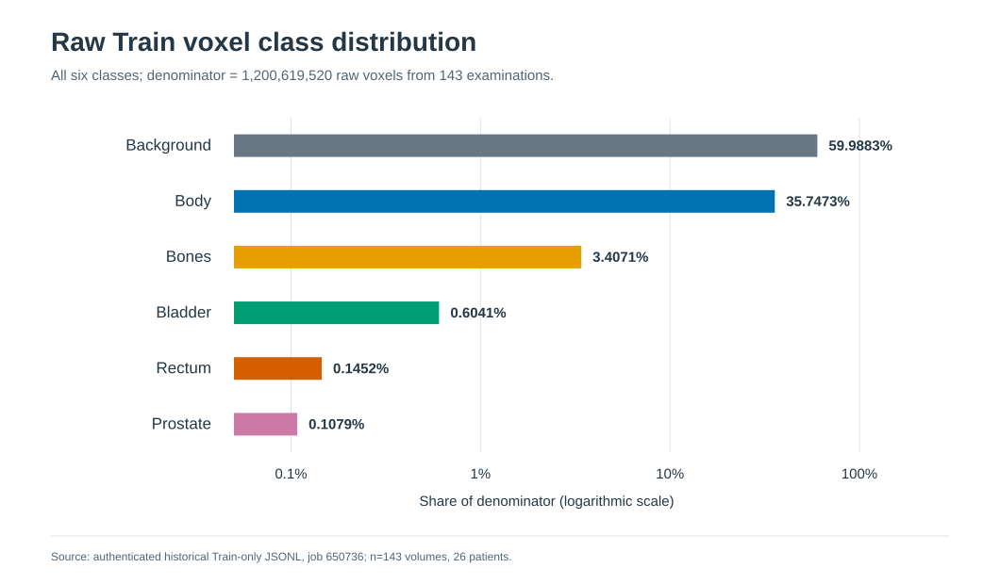
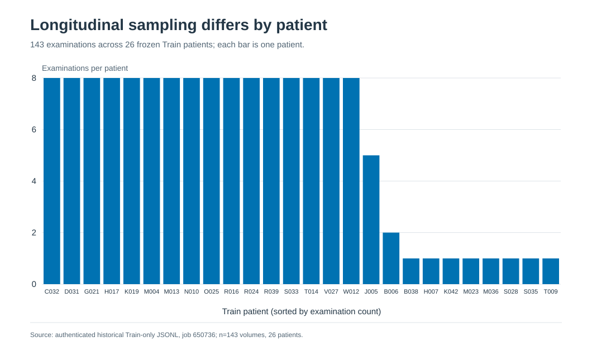
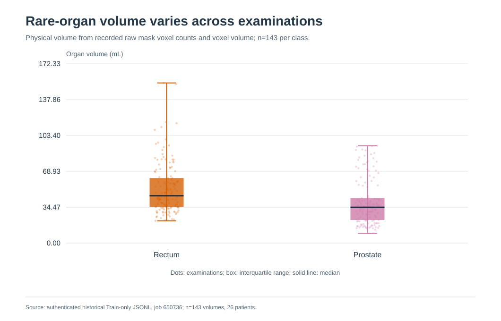
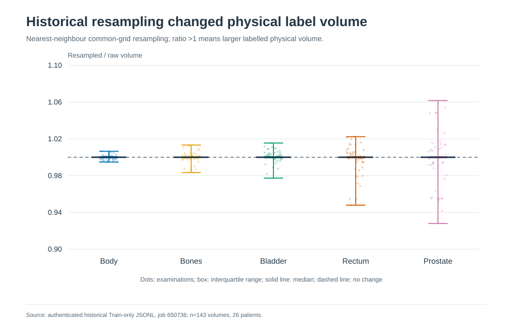

# HipMRI Raw Train Data: Statistical Review and Improvement Priorities

**Decision: the dataset is not yet cleared for training.** The available measurements describe an earlier **Train-only record of 143 examinations from 26 patients**. They establish severe small-organ and patient-frequency imbalance. They do **not** establish that the current MRI images are free of blank scans, non-finite values, intensity artifacts, misalignment, or annotation defects. The actions below aim to turn the raw data into reliable model input before changing model architecture.

## 1. Independent verification of the available record

I re-read the historical JSONL rather than relying only on the prior report. Its SHA-256 is `028a495c41e14bec4855bad5fd55c1dcea51472c890285d7c499f5f4d93b22a1`. It contains 143 full-volume records, 1,430 historical patch records, one setup record, and one summary record. The full-volume records have **143 unique case IDs**, use exactly the **26 Train patients** in the [frozen split](../../code/config/patient_split.json), and contain no duplicate case IDs. For every case, the six raw class counts sum to its recorded image shape; all counts are integers and every class count is positive. The six pooled totals below were independently recomputed and agree with the [structured statistics](historical_train_statistics.json). A new [143-case profile](historical_train_case_profile.csv) preserves the verified per-case counts, physical label volumes, geometry metadata, and historical resampling ratios for targeted review.

This verifies **internal consistency of the historical record**, not the current NIfTI file bytes or the present-day preprocessing pipeline. No held-out Test image or mask array was opened.

## 2. What the raw label statistics show

| ID / documented label | Raw voxels | Share of 1,200,619,520 raw voxels | Median share per examination |
| --- | ---: | ---: | ---: |
| 0 Background | 720,230,975 | 59.9883% | 59.4356% |
| 1 Body | 429,188,773 | 35.7473% | 36.4544% |
| 2 Bones | 40,906,813 | 3.4071% | 3.3610% |
| 3 Bladder | 7,253,501 | 0.6041% | 0.4514% |
| 4 Rectum | 1,743,644 | 0.1452% | 0.1240% |
| 5 Prostate | 1,295,814 | 0.1079% | 0.0910% |

All six numeric IDs appear in **143/143 examinations and 26/26 patients**. The anatomical names follow the [project mapping](../../code/hipmri_rewrite/__init__.py), which still needs confirmation against actual MRI/mask overlays and dataset documentation. Numeric presence does not prove correct placement or complete contours.

**Background:Prostate = 555.8:1; Body:Prostate = 331.2:1.** Even among non-background voxels, Body accounts for **89.3420%**, while Rectum and Prostate account for **0.3630%** and **0.2697%**. A model could achieve a strong pooled score while neglecting these small structures. Case-level variation is substantial: Prostate occupies **0.0348%–0.2929%** and Rectum **0.0593%–0.4547%** of an examination's voxels.

**Patient exposure is also uneven:** 16 patients have eight examinations each, eight have one, one has two, and one has five. Volume-uniform sampling exposes an eight-visit patient eight times as often as a one-visit patient. Repeated examinations are correlated and must remain grouped by patient.

**Small-organ label volumes vary:** Prostate median **34.39 mL**, range **9.49–93.58 mL**; Rectum median **45.47 mL**, range **21.44–153.86 mL**. These are label-derived extents, not validated clinical organ volumes. Extremes may be real or may signal a field-of-view or annotation problem.

## 3. Unusual cases to inspect first

The following are **review flags, not diagnosed errors**. Their values come from the historical Train record.

| Case | Reason to review | First check |
| --- | --- | --- |
| `B038_Week0` | Smallest Prostate label (**9.49 mL**), largest Bladder label (**666.19 mL**), and smallest recorded voxel volume (**3.085 mm³**). | Confirm label mapping, field of view, image/mask alignment, and whether organ size is plausible in the raw images. |
| `N010_Week0` | Largest Prostate label (**93.58 mL**). | Inspect extent, connected components, and neighbouring Bladder/Rectum boundaries. |
| `D031_Week0` and `B006_Week1` | Smallest (**21.44 mL**) and largest (**153.86 mL**) Rectum labels. | Inspect contour extent and superior/inferior coverage. |
| `K019_Week1` | Sole **256×256×144** scan; the other 142 are **256×256×128**. | Verify spacing, physical field of view, and paired-mask shape. |
| `R039_Week5` and `O025_Week0` | Historical Prostate volume ratios after resampling: **0.928** and **1.062**, the largest decreases/increases. | Compare raw and resampled masks at the boundary and base/apex. |
| `S035_Week0` | Largest recorded raw voxel volume (**5.484 mm³**). | Verify each spacing axis and inspect small-organ resolution. |

These flags make the first visual review efficient. A complete audit must still cover **all 143 Train pairs**, because a normal class count or organ volume can coexist with a misplaced mask.

## 4. What remains unknown

| Data-quality question | Present evidence | Measurement needed |
| --- | --- | --- |
| Missing, unreadable, blank, all-zero, constant, NaN, or Inf MRI scans | **No full-cohort raw intensity audit.** None can be ruled out. | Read every authorised Train MRI; record file failures, finite-value counts, zero fraction, nonzero variance, and robust intensity percentiles. |
| MRI intensity drift, bias field, noise, motion, or unusual contrast | **Unmeasured.** | Case-level distributions and flagged image review, stratified by patient/week and available acquisition metadata. |
| Mask corruption or incorrect anatomy | Historical integer counts are internally consistent; every class appears. | Re-read current masks; check legal IDs, components, occupied slices, contour continuity, and overlays against the corresponding MRI. |
| MRI/mask registration and orientation | Historical mask spatial unit was `unknown` in **143/143 headers**; source image/grid context was recorded in millimetres. | Compare each pair's shape, affine, sform/qform, axis orientation, per-axis spacing, physical bounds, and visual overlay. An unknown unit is a flag, not proof of misalignment. |
| Loss of small-organ detail during preprocessing | Historical nearest-neighbour resampling changed Prostate physical label volume to **92.8%–106.2%** of raw; Rectum to **94.8%–102.2%**. | Repeat measurements for the **actual current transform**, including physical volume, occupied slices, components, and local boundary displacement. Historical ratios do not describe the current factor-two downsampling. |
| Coverage and representativeness | 26 Train patients with uneven follow-up; site/scanner/sequence and demographic distributions are unavailable in the summary. | Inventory authorised metadata if available, identify acquisition clusters and underrepresented conditions, and avoid assuming that more scans from one patient add the diversity of new patients. |

## 5. Checks suggested by the three model papers

The project's three cited model methods are [Ronneberger et al., U-Net (2015)](https://arxiv.org/html/1505.04597), [Çiçek et al., 3D U-Net (2016)](https://arxiv.org/html/1606.06650), and [Isensee et al., BraTS U-Net (2018)](https://arxiv.org/pdf/1802.10508). They motivate specific checks; their microscopy and brain-tumor data are not HipMRI evidence.

| Paper's relevant method | HipMRI data question | Current answer |
| --- | --- | --- |
| **Ronneberger:** strong spatial augmentation and task-specific weighting helped a 2D model learn from few microscopy images. | Are 2D slices and mask boundaries reliable, and would paired deformations preserve pelvic anatomy? Are Rectum/Prostate boundaries ambiguous enough to justify special weighting? | Slice and boundary quality are **unmeasured**. The paper's cell-separation weight map is not a ready-made pelvic-organ weight map. |
| **Çiçek:** a 3D model used spatial context, elastic augmentation, and zero loss weight for explicitly *unlabelled* voxels in sparsely annotated microscopy volumes. | Are all HipMRI slices truly annotated, or can background also mean “unlabelled”? Does current downsampling preserve 3D continuity and enough physical context around small organs? | Six numeric labels occur in every logged volume and counts cover each voxel, but annotation completeness and continuity are **not visually verified**. Do not invent an “unlabelled” class or copy the paper's factor-two grid without testing HipMRI masks. |
| **Isensee:** non-standard MRI intensity was normalized per patient/modality; small structures motivated a multiclass Dice objective, sampled 3D patches, and augmentation. | What are HipMRI raw intensity and artifact distributions? How often would a candidate crop contain complete Prostate/Rectum and useful surrounding anatomy? | Raw intensity distributions and candidate crop coverage are **unmeasured**. The paper's brain-region normalization, clipping range, and 128³ patch size cannot be transferred unchanged to pelvic MRI. |

**Paper-guided decision:** verify annotation completeness, 3D geometry, intensity statistics, and small-organ crop coverage first. Then compare *one* justified preprocessing or sampling choice at a time using Train-only data. None of the three papers establishes that the current HipMRI arrays pass these checks.

## 6. Ways to improve the data and its value to a model

The order matters. **Fix data correctness first; choose optional preprocessing and sampling only after their effects are measured.** Each proposal below is conditional, not a claim that it will improve performance.

| Priority | Improvement | Evidence needed and expected benefit |
| --- | --- | --- |
| **P0** | Repair missing or unreadable Train pairs and invalid values; retain an immutable raw copy and record any exclusion or correction. | Prevent silent sample loss and corrupted supervision. Never replace a bad image with a synthetic “normal” case without a documented, defensible reason. |
| **P0** | Confirm the 0–5 label-to-anatomy mapping; review MRI/mask overlays in all flagged cases and a representative sample. Seek expert adjudication for ambiguous contours. | Prevent systematic wrong-label learning; clarify whether small or large organ masks are true anatomy or errors. |
| **P0** | Resolve affine, orientation, spacing, unit, and MRI/mask alignment inconsistencies. Apply any orientation transform to both arrays together. | Prevent a model from learning spatially shifted or flipped targets. NiBabel documents affine-based orientation checks and canonicalisation. |
| **P0** | Audit raw-to-processed mask preservation. Use nearest-neighbour interpolation for categorical masks; compare organ volume, occupied slices, components, and local boundaries before accepting a target grid. | Preserve Prostate/Rectum supervision, particularly at base/apex. A surviving class is not enough. |
| **P1** | Profile raw MRI intensity and visible artifacts before choosing per-volume normalization, percentile clipping, or N4 bias correction. Evaluate one change at a time on a fixed Train subset. | Reduce avoidable acquisition variation without erasing meaningful contrast. N4 specifically targets smooth MRI bias fields; its benefit here is unmeasured. |
| **P1** | Use patient-aware case sampling so repeated visits do not dominate exposure. Measure the effective patient and class mix after sampling. | Broaden patient exposure without leaking weeks across partitions. |
| **P1** | If full-volume sampling underexposes small organs, compare a documented foreground-aware crop or patch policy that still includes anatomical context. Measure positive-organ coverage and how often complete organs are cropped. | Increase useful rare-organ examples while controlling context loss and the changed effective class distribution. |
| **P1** | Derive any class weights from verified Train masks; consider a controlled loss/sampling comparison and watch small-organ false positives as well as recall. | Counter class imbalance without allowing aggressive weighting to create implausible organ predictions. |
| **P2** | After geometry and labels pass, test modest paired spatial transforms and MRI-only intensity augmentation. Reject transforms that create invalid labels, implausible anatomy, or lost small organs. | Improve robustness to plausible variation while retaining trustworthy targets. |
| **P2** | If metadata or images reveal underrepresented scanners, protocols, anatomy, or artifact types, prioritise additional authorised **independent patients** or targeted annotation review over more repeated visits. | Improve diversity and label quality; the available record cannot yet quantify the gap. |

These are data and supervision decisions, not a request to start model training. Use NIfTI affine information to check physical orientation ([NiBabel documentation](https://nipy.org/nibabel/image_orientation.html)). N4 addresses low-frequency MRI intensity non-uniformity and should be tested only if that problem is observed ([SimpleITK documentation](https://simpleitk.readthedocs.io/en/latest/link_N4BiasFieldCorrection_docs.html)).

## 7. Release criteria for a high-quality Train dataset

The data are ready for model experiments only when:

1. Every authorised Train MRI/mask pair has a case-level integrity result, with no unexplained missing file, non-finite value, blank image, illegal label, or patient-ID mismatch.
2. Label semantics, representative contours, and flagged extremes have been reviewed; unresolved annotation concerns are documented and excluded from unsupported claims.
3. MRI/mask geometry is confirmed in physical space, and the chosen preprocessing passes declared small-organ preservation checks on **all 143 Train cases**.
4. Raw intensity and acquisition variation have been measured; normalization, correction, and augmentation choices have a documented reason and before/after evidence.
5. The effective patient and class exposure of the chosen sampling/weighting policy is recorded from Train data only.

**Current status: these criteria are not met.** The [structured statistics](historical_train_statistics.json) and [case profile](historical_train_case_profile.csv) are reliable for the historical Train measurements checked here. The new [Train-only raw-data audit tool](../../code/tools/audit_train_raw.py) can measure current MRI/mask integrity without changing inputs, but it has not been run on real arrays: no NIfTI files were found locally, and non-interactive Rangpur authentication was denied. No revised MRI or mask dataset has been created.
