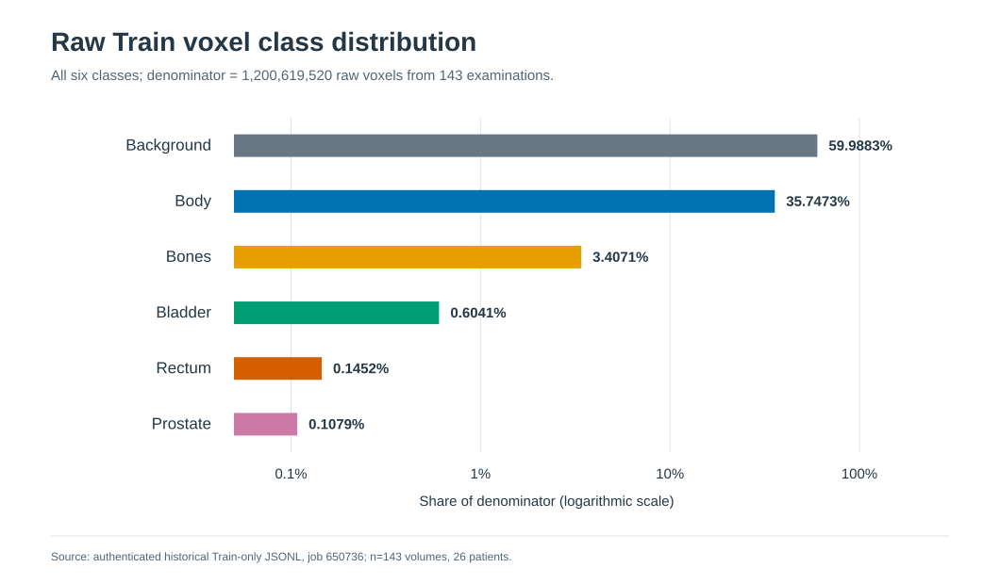
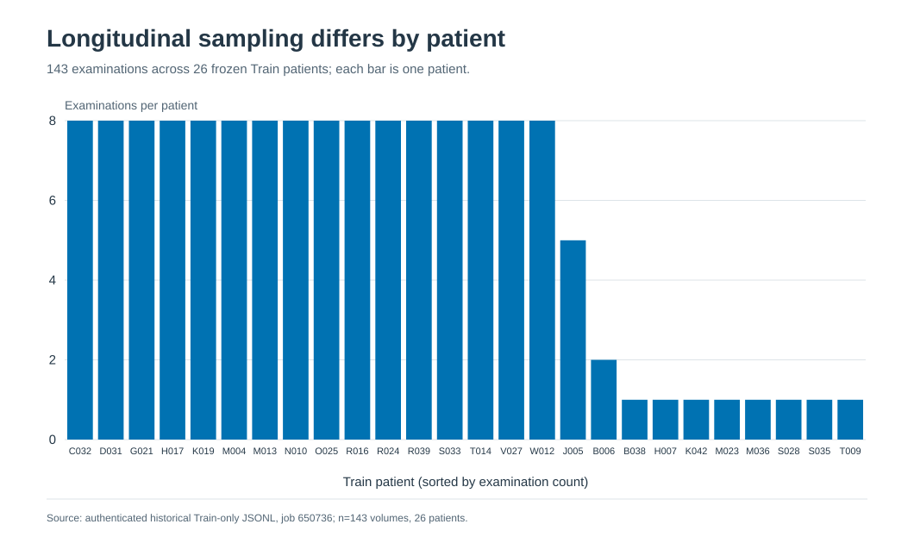
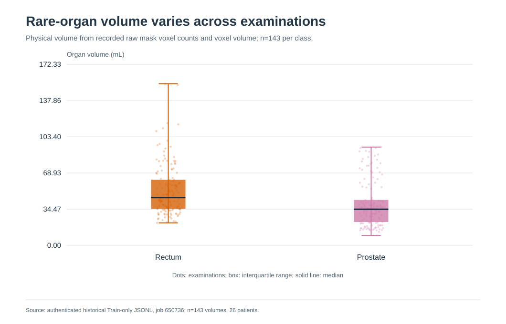
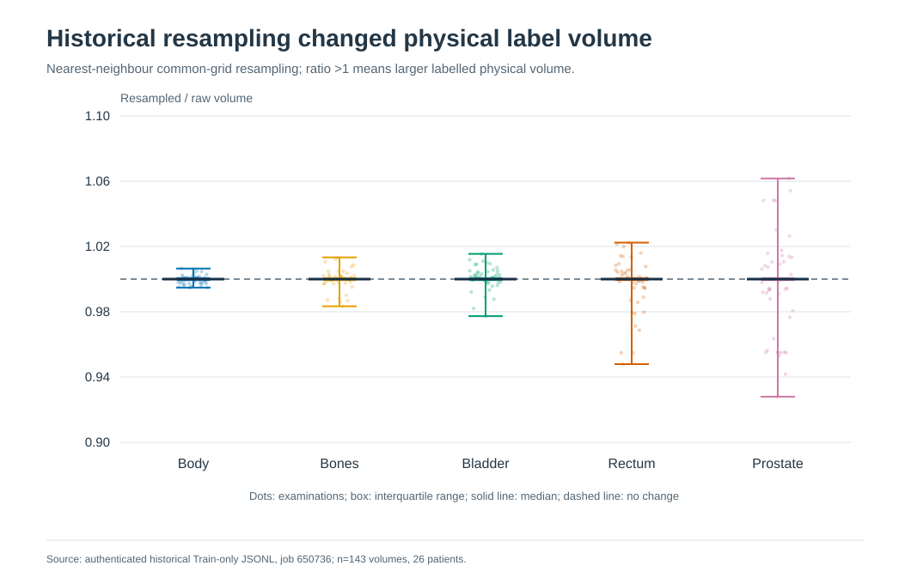

# 前期数据与独立研究审查：完整阶段记录

合并日期：2026-10-20。保留下列原始报告完整正文，仅重设标题层级及相对链接；历史判断按其当时证据解读，不作为当前自动执行指令。最新状态见[项目入口](../../README.md)。

## 原文：HipMRI_Pretraining_Data_Analysis.md

来源SHA-256：`d9ded2e9a41b855b2a6db9bc70d460f638c2587919382b43704408c4ccfbbfaf`。

## HipMRI Raw Train Data: Statistical Review and Improvement Priorities

**Historical analysis:** This document records the pre-G1 evidence and the
questions it raised. The current audit and decisions are maintained in the
[formal research report](RESEARCH_REPORT.md); status statements below
describe the earlier review unless explicitly updated.

**Decision: the dataset is not yet cleared for training.** The available measurements describe an earlier **Train-only record of 143 examinations from 26 patients**. They establish severe small-organ and patient-frequency imbalance. They do **not** establish that the current MRI images are free of blank scans, non-finite values, intensity artifacts, misalignment, or annotation defects. The actions below aim to turn the raw data into reliable model input before changing model architecture.

### 1. Independent verification of the available record

I re-read the historical JSONL rather than relying only on the prior report. Its SHA-256 is `028a495c41e14bec4855bad5fd55c1dcea51472c890285d7c499f5f4d93b22a1`. It contains 143 full-volume records, 1,430 historical patch records, one setup record, and one summary record. The full-volume records have **143 unique case IDs**, use exactly the **26 Train patients** in the [frozen split](../../code/config/patient_split.json), and contain no duplicate case IDs. For every case, the six raw class counts sum to its recorded image shape; all counts are integers and every class count is positive. The six pooled totals below were independently recomputed and agree with the [structured statistics](../data_analysis/legacy_training_statistics/historical_train_statistics.json). A new [143-case profile](../data_analysis/legacy_training_statistics/historical_train_case_profile.csv) preserves the verified per-case counts, physical label volumes, geometry metadata, and historical resampling ratios for targeted review.

This verifies **internal consistency of the historical record**, not the current NIfTI file bytes or the present-day preprocessing pipeline. No held-out Test image or mask array was opened.

### 2. What the raw label statistics show

| ID / documented label | Raw voxels | Share of 1,200,619,520 raw voxels | Median share per examination |
| --- | ---: | ---: | ---: |
| 0 Background | 720,230,975 | 59.9883% | 59.4356% |
| 1 Body | 429,188,773 | 35.7473% | 36.4544% |
| 2 Bones | 40,906,813 | 3.4071% | 3.3610% |
| 3 Bladder | 7,253,501 | 0.6041% | 0.4514% |
| 4 Rectum | 1,743,644 | 0.1452% | 0.1240% |
| 5 Prostate | 1,295,814 | 0.1079% | 0.0910% |

All six numeric IDs appear in **143/143 examinations and 26/26 patients**. The anatomical names follow the [project mapping](../../code/hipmri_rewrite/__init__.py), which still needs confirmation against actual MRI/mask overlays and dataset documentation. Numeric presence does not prove correct placement or complete contours.

**Background:Prostate = 555.8:1; Body:Prostate = 331.2:1.** Even among non-background voxels, Body accounts for **89.3420%**, while Rectum and Prostate account for **0.3630%** and **0.2697%**. A model could achieve a strong pooled score while neglecting these small structures. Case-level variation is substantial: Prostate occupies **0.0348%–0.2929%** and Rectum **0.0593%–0.4547%** of an examination's voxels.

**Patient exposure is also uneven:** 16 patients have eight examinations each, eight have one, one has two, and one has five. Volume-uniform sampling exposes an eight-visit patient eight times as often as a one-visit patient. Repeated examinations are correlated and must remain grouped by patient.

**Small-organ label volumes vary:** Prostate median **34.39 mL**, range **9.49–93.58 mL**; Rectum median **45.47 mL**, range **21.44–153.86 mL**. These are label-derived extents, not validated clinical organ volumes. Extremes may be real or may signal a field-of-view or annotation problem.

### 3. Unusual cases to inspect first

The following are **review flags, not diagnosed errors**. Their values come from the historical Train record.

| Case | Reason to review | First check |
| --- | --- | --- |
| `B038_Week0` | Smallest Prostate label (**9.49 mL**), largest Bladder label (**666.19 mL**), and smallest recorded voxel volume (**3.085 mm³**). | Confirm label mapping, field of view, image/mask alignment, and whether organ size is plausible in the raw images. |
| `N010_Week0` | Largest Prostate label (**93.58 mL**). | Inspect extent, connected components, and neighbouring Bladder/Rectum boundaries. |
| `D031_Week0` and `B006_Week1` | Smallest (**21.44 mL**) and largest (**153.86 mL**) Rectum labels. | Inspect contour extent and superior/inferior coverage. |
| `K019_Week1` | Sole **256×256×144** scan; the other 142 are **256×256×128**. | Verify spacing, physical field of view, and paired-mask shape. |
| `R039_Week5` and `O025_Week0` | Historical Prostate volume ratios after resampling: **0.928** and **1.062**, the largest decreases/increases. | Compare raw and resampled masks at the boundary and base/apex. |
| `S035_Week0` | Largest recorded raw voxel volume (**5.484 mm³**). | Verify each spacing axis and inspect small-organ resolution. |

These flags make the first visual review efficient. A complete audit must still cover **all 143 Train pairs**, because a normal class count or organ volume can coexist with a misplaced mask.

### 4. What remains unknown

| Data-quality question | Present evidence | Measurement needed |
| --- | --- | --- |
| Missing, unreadable, blank, all-zero, constant, NaN, or Inf MRI scans | **No full-cohort raw intensity audit.** None can be ruled out. | Read every authorised Train MRI; record file failures, finite-value counts, zero fraction, nonzero variance, and robust intensity percentiles. |
| MRI intensity drift, bias field, noise, motion, or unusual contrast | **Unmeasured.** | Case-level distributions and flagged image review, stratified by patient/week and available acquisition metadata. |
| Mask corruption or incorrect anatomy | Historical integer counts are internally consistent; every class appears. | Re-read current masks; check legal IDs, components, occupied slices, contour continuity, and overlays against the corresponding MRI. |
| MRI/mask registration and orientation | Historical mask spatial unit was `unknown` in **143/143 headers**; source image/grid context was recorded in millimetres. | Compare each pair's shape, affine, sform/qform, axis orientation, per-axis spacing, physical bounds, and visual overlay. An unknown unit is a flag, not proof of misalignment. |
| Loss of small-organ detail during preprocessing | Historical nearest-neighbour resampling changed Prostate physical label volume to **92.8%–106.2%** of raw; Rectum to **94.8%–102.2%**. | Repeat measurements for the **actual current transform**, including physical volume, occupied slices, components, and local boundary displacement. Historical ratios do not describe the current factor-two downsampling. |
| Coverage and representativeness | 26 Train patients with uneven follow-up; site/scanner/sequence and demographic distributions are unavailable in the summary. | Inventory authorised metadata if available, identify acquisition clusters and underrepresented conditions, and avoid assuming that more scans from one patient add the diversity of new patients. |

### 5. Checks suggested by the three model papers

The project's three cited model methods are [Ronneberger et al., U-Net (2015)](https://arxiv.org/html/1505.04597), [Çiçek et al., 3D U-Net (2016)](https://arxiv.org/html/1606.06650), and [Isensee et al., BraTS U-Net (2018)](https://arxiv.org/pdf/1802.10508). They motivate specific checks; their microscopy and brain-tumor data are not HipMRI evidence.

| Paper's relevant method | HipMRI data question | Current answer |
| --- | --- | --- |
| **Ronneberger:** strong spatial augmentation and task-specific weighting helped a 2D model learn from few microscopy images. | Are 2D slices and mask boundaries reliable, and would paired deformations preserve pelvic anatomy? Are Rectum/Prostate boundaries ambiguous enough to justify special weighting? | Slice and boundary quality are **unmeasured**. The paper's cell-separation weight map is not a ready-made pelvic-organ weight map. |
| **Çiçek:** a 3D model used spatial context, elastic augmentation, and zero loss weight for explicitly *unlabelled* voxels in sparsely annotated microscopy volumes. | Are all HipMRI slices truly annotated, or can background also mean “unlabelled”? Does current downsampling preserve 3D continuity and enough physical context around small organs? | Six numeric labels occur in every logged volume and counts cover each voxel, but annotation completeness and continuity are **not visually verified**. Do not invent an “unlabelled” class or copy the paper's factor-two grid without testing HipMRI masks. |
| **Isensee:** non-standard MRI intensity was normalized per patient/modality; small structures motivated a multiclass Dice objective, sampled 3D patches, and augmentation. | What are HipMRI raw intensity and artifact distributions? How often would a candidate crop contain complete Prostate/Rectum and useful surrounding anatomy? | Raw intensity distributions and candidate crop coverage are **unmeasured**. The paper's brain-region normalization, clipping range, and 128³ patch size cannot be transferred unchanged to pelvic MRI. |

**Paper-guided decision:** verify annotation completeness, 3D geometry, intensity statistics, and small-organ crop coverage first. Then compare *one* justified preprocessing or sampling choice at a time using Train-only data. None of the three papers establishes that the current HipMRI arrays pass these checks.

### 6. Ways to improve the data and its value to a model

The order matters. **Fix data correctness first; choose optional preprocessing and sampling only after their effects are measured.** Each proposal below is conditional, not a claim that it will improve performance.

| Priority | Improvement | Evidence needed and expected benefit |
| --- | --- | --- |
| **P0** | Repair missing or unreadable Train pairs and invalid values; retain an immutable raw copy and record any exclusion or correction. | Prevent silent sample loss and corrupted supervision. Never replace a bad image with a synthetic “normal” case without a documented, defensible reason. |
| **P0** | Confirm the 0–5 label-to-anatomy mapping; review MRI/mask overlays in all flagged cases and a representative sample. Seek expert adjudication for ambiguous contours. | Prevent systematic wrong-label learning; clarify whether small or large organ masks are true anatomy or errors. |
| **P0** | Resolve affine, orientation, spacing, unit, and MRI/mask alignment inconsistencies. Apply any orientation transform to both arrays together. | Prevent a model from learning spatially shifted or flipped targets. NiBabel documents affine-based orientation checks and canonicalisation. |
| **P0** | Audit raw-to-processed mask preservation. Use nearest-neighbour interpolation for categorical masks; compare organ volume, occupied slices, components, and local boundaries before accepting a target grid. | Preserve Prostate/Rectum supervision, particularly at base/apex. A surviving class is not enough. |
| **P1** | Profile raw MRI intensity and visible artifacts before choosing per-volume normalization, percentile clipping, or N4 bias correction. Evaluate one change at a time on a fixed Train subset. | Reduce avoidable acquisition variation without erasing meaningful contrast. N4 specifically targets smooth MRI bias fields; its benefit here is unmeasured. |
| **P1** | Use patient-aware case sampling so repeated visits do not dominate exposure. Measure the effective patient and class mix after sampling. | Broaden patient exposure without leaking weeks across partitions. |
| **P1** | If full-volume sampling underexposes small organs, compare a documented foreground-aware crop or patch policy that still includes anatomical context. Measure positive-organ coverage and how often complete organs are cropped. | Increase useful rare-organ examples while controlling context loss and the changed effective class distribution. |
| **P1** | Derive any class weights from verified Train masks; consider a controlled loss/sampling comparison and watch small-organ false positives as well as recall. | Counter class imbalance without allowing aggressive weighting to create implausible organ predictions. |
| **P2** | After geometry and labels pass, test modest paired spatial transforms and MRI-only intensity augmentation. Reject transforms that create invalid labels, implausible anatomy, or lost small organs. | Improve robustness to plausible variation while retaining trustworthy targets. |
| **P2** | If metadata or images reveal underrepresented scanners, protocols, anatomy, or artifact types, prioritise additional authorised **independent patients** or targeted annotation review over more repeated visits. | Improve diversity and label quality; the available record cannot yet quantify the gap. |

These are data and supervision decisions, not a request to start model training. Use NIfTI affine information to check physical orientation ([NiBabel documentation](https://nipy.org/nibabel/image_orientation.html)). N4 addresses low-frequency MRI intensity non-uniformity and should be tested only if that problem is observed ([SimpleITK documentation](https://simpleitk.readthedocs.io/en/latest/link_N4BiasFieldCorrection_docs.html)).

### 7. Release criteria for a high-quality Train dataset

The data are ready for model experiments only when:

1. Every authorised Train MRI/mask pair has a case-level integrity result, with no unexplained missing file, non-finite value, blank image, illegal label, or patient-ID mismatch.
2. Label semantics, representative contours, and flagged extremes have been reviewed; unresolved annotation concerns are documented and excluded from unsupported claims.
3. MRI/mask geometry is confirmed in physical space, and the chosen preprocessing passes declared small-organ preservation checks on **all 143 Train cases**.
4. Raw intensity and acquisition variation have been measured; normalization, correction, and augmentation choices have a documented reason and before/after evidence.
5. The effective patient and class exposure of the chosen sampling/weighting policy is recorded from Train data only.

**Status at the time of this historical review:** these criteria were not met. The [structured statistics](../data_analysis/legacy_training_statistics/historical_train_statistics.json) and [case profile](../data_analysis/legacy_training_statistics/historical_train_case_profile.csv) remain historical Train evidence. The real-array G1 audit has since run on Rangpur and passed its integrity gate; its findings and the remaining G2/G3 questions are tracked in the [formal research report](RESEARCH_REPORT.md). No revised MRI or mask dataset has been created.

---

## 原文：HipMRI_P1_Independent_Review_20261020_ZH.md

来源SHA-256：`83b6a03d031215c2ed1b567fd3d91370ffc60ccca3705d02c5163201157e2e3f`。

## P1 独立复审：证据、未决机制与下一项实验

**日期：2026-10-20。范围：只读审查与本报告；没有训练、改变历史权重或重组项目。**
应用本轮 Research Governance 附件。检查课程原文、冻结配置、模型/训练/推理/指标源码，以及 G5、G7、P2 已有记录；Test 仅核对已发布的汇总及患者汇总，不读取 Test MRI、标签数组或重新评估。现有权重在 Rangpur，本轮未加载权重验证；其运行与身份依据既有记录。没有可核验的新课程公告或导师 check-off 证据，以下课程映射以所供草案为准。

**审查结论：Improved 的系统性 Body 退步已确立；单一根因没有确立。P2 已证实固定权重的推理上下文敏感性，但不构成直接启动 G7 训练的因果依据。下一项优先做一次受限的归一化统计回放诊断，之后最多选择一个训练因素。** 本报告更新此前“P2 后直接转向 G7”的建议，保留全部历史结果。

### 1. 课程要求映射

已重新提取草案第 2、5–6、11–16 页，并查看第 5、6、12、14 页图像。文件名含 draft_v2.2，文档标题为 Version 2.0 Draft，不代表已确认的最终公告。

| 课程依据 | 要求性质与现状 | 尚缺证据/动作 |
|---|---|---|
| §2.2，第 6 页 | **Hard 必须**：降采样 HipMRI、3D Improved U-Net、体积残差、Deep Supervision。现有残差和三个尺度输出均获得梯度 | 如改监督方式应明确说明；原文未要求必须采用独立 head loss，也未要求全面击败 Standard |
| §2.2，第 5 页 | **必须**：患者隔离、空间配准、已实现基线、相同评估划分、逐类 Dice/IoU。已有三模型及六类指标 | 2D 与 3D 的现有差异不能单独归因于空间维度 |
| §2.2、§5.3 | **研究核心**：边界、base/apex、切片过渡及 3–5 个真实失败案例，包含 FP/FN 对照 | 当前 Body 证据较强；Validation 三模型同病例的终端切片、相邻器官界面及连续性证据不足 |
| §2.2、§5.3 | **必须**：参数量、峰值显存、每例推理耗时和工程建议 | 现有程序测量有共驻模型、冷启动等混杂，需逐模型统一基准；“额外 5–10 倍成本”是待检验的问题，不是规定结论 |
| §3，第 11–12 页 | **必过 hurdle**：一页 feasibility review 与导师 check-off。英文 review 已有 | 文稿仍需明确列出 3–5 个可测试验收条件及资源上限，纳入最终 README；补写文稿不能证明此前 check-off 已完成 |
| §4–6 | **必须**：recognition/ 下五个入口文件、精确依赖、技术 README、AI Disclosure、渐进提交、PR、README 的 Turnitin PDF | 活动树未见 recognition/ 提交入口；requirements 仍为版本范围；PR、check-off、截止日完成状态未知。本轮不重构或发布 |
| 第 6 页 | **表列目标**：Hard Test Dice ≥0.7 | 原表未说明类别与患者聚合口径，不能用三小器官患者等权分数直接宣称满足该目标 |

多随机种子、交叉验证、滑窗、G7 边缘采样、归一化替换和更复杂 loss 都是**可选研究手段**，不是草案明确要求的额外模型清单。不把临床边界分析等同于临床安全或放疗获益证明。

### 2. 已核实的表现与限制

| 模型 | Validation：患者等权三小器官 Dice | 既有 Test：同口径 Dice | Validation Body HD95：38 卷中位数 |
|---|---:|---:|---:|
| Standard 3D，第 50 轮 | 0.850223 | 0.785102 | 4.7509 mm |
| Improved 3D，第 50 轮 | 0.841996 | 0.807784 | 76.6122 mm |
| 补充 2D，第 50 轮 | 0.775688 | 未做同口径 Test 评估 | 当前无同口径完整边界记录 |

- Improved 的 Body HD95 **38/38 卷均高于 Standard**；≥20 mm 的 Background→Body 误检为 **1,358,516 vs 1,007** 体素。这里的 HD95 是双向表面距离合并后的 95 分位数，不是病例间置信区间。
- 六类 Validation pooled Dice：Standard 为 **0.9969/0.9769/0.8596/0.9436/0.8038/0.8179**；Improved 为 **0.9636/0.9274/0.8800/0.9509/0.7835/0.7878**，顺序为 Background/Body/Bones/Bladder/Rectum/Prostate。Improved 在 Bones、Bladder 上有优势，不能称为所有类别都更差，也不能称全面更好。
- Rectum/Prostate 的 pooled recall 从 Standard 的 **0.8807/0.9383** 升至 **0.9330/0.9467**，precision 则从 **0.7393/0.7250** 降至 **0.6753/0.6745**。这是已观察到的取舍，不是 loss 的因果证明。
- 历史 Test 总分差为 +0.022682；M015 对患者等权总差的贡献为 +0.028247。其余五患者的描述性均分为 0.844443 vs 0.837766。**这只是已发布结果的敏感性说明，不剔除 M015、不据此选实验，也不把其余五例当作新 Test。**
- P2 四个预选 Validation 病例中，Improved 远处误检 **153,886→30,148，下降 80.41%**；但 K018 膀胱 Dice **0.7327→0.5837**，Body HD95 **125.63→132.42 mm**；K008 前列腺 **0.8454→0.7944**。因此滑窗未通过“保住器官与边界”的替代条件。四例不能代表完整验证集。

### 3. 实现复核与混杂因素

**未发现已证实的共同错轴/错网格缺陷。** MRI/标签共用物理采样位置，标签最近邻、图像线性插值，affine 同步变换；XYZ↔DHW 后删除高端 padding。G1 的未知 mask 单位是未消除的元数据限制；机械匹配、器官未消失均不保证所有局部边界正确。降采样本身限制毫米级边界分辨率。

**原 G5 不是滑窗。** 正式验证是整卷单次前向；只有 P2 引入固定滑窗。不能把 P2 的融合行为当成原模型失败的来源。训练为 64×64×32 XYZ，验证通常 128×128×64；P2 同时改变归一化范围、卷积上下文、padding、窗口边缘与上采样位置，不能隔离其中一个。

**H2 的数学限制明确。** 现有 loss 为 `L(h_main+h_half+h_quarter, y)`。在输出层面，对一个 head 加 δ、另一个减 δ，不改变总 logits 或 loss；各头没有独立的分割语义约束。主头单独推理分数降至 **0.2414** 说明其不是独立训练好的替代模型，而不是“去掉辅助监督的消融”。P2 中 quarter 在 K018/B040/K008 抵消其他头的 Body 倾向，在 J026 却曾助长它；各 head 中位数不可直接相加。

**公平性与选择偏差仍在。** 两个 3D 模型共享采样、loss、优化器和更新数，但还同时改变归一化、激活、上/下采样、残差、dropout 与输出融合；一次 seed 不能拆分这些因素。2D 另有器官感知采样、宽度 16 vs 8、不同类权重，只能作为方案比较。每五轮评估，所有最佳轮次恰在预算终点 50，不能证明已经收敛或“只需再训练十轮”。配置写 40 轮但 manifest 有明确 40→50 延长记录，不是实际训练轮数矛盾。

**独立样本不是 38。** 六名 Validation 患者的周次先合并混淆矩阵再等权计分，符合既定口径；38 卷 HD95 中位数却按访问次数加权，两者必须分开解释。反复复用六名患者及挑选高错误病例，会增加适应性开发偏差；不能使用按 volume 独立抽样的置信区间。已有 Test 已被观察，后续独立泛化主张需真正未见的患者。

**工程耗时主要受保存策略影响。** 50 轮 Standard 的训练 batch/逐 batch 检查点累计为 **646.8/4560.7 秒**，Improved 为 **679.1/6560.9 秒**；后者分别占两项之和约 **88%/91%**。batch 计时还包含数据获取与传输，不能称为纯 GPU 计算。该字段不包含所有 epoch/best 文件写入及完整作业开销。G6 又同时驻留两模型且无统一 warm-up，现有显存/时间不能作为严格架构成本排名。保留用户要求的逐 batch 恢复能力，不为加速而静默改保存规则。

### 4. 根因假设排序

证据强度与“是否值得立刻重训”分开排序。成本为拟议测量预算，不是已经消耗的资源。

| 优先级 | 假设 | 已有证据 / 不能推出什么 | 区分能力、成本与风险 |
|---|---|---|---|
| 1 | **H4：推理范围与归一化/空间上下文交互** | P2 固定权重产生巨大误检变化；InstanceNorm eval 使用当前输入统计，Standard GroupNorm 也依赖输入。具体组件未隔离 | 固定输入窗口，只改变归一化统计来源；单短 GPU 作业，无权重风险 |
| 2 | **H2：相加 heads 的共适应** | 有 loss 形式、单头退化与同体素 margin 证据；不能锁定一个“坏头”，更不能删掉课程要求的 DS | 先借 H4 诊断看各 head 响应；之后才考虑独立辅助损失的重训，约一个训练预算，有性能回退风险 |
| 3 | **H1：边缘负样本曝光不足** | G7 提升角落覆盖且保留约 95% 小器官体素曝光；没有模型训练收益，也未建立“新增曝光覆盖当前错误”的直接证据 | 原采样/9+1 配对训练可测干预收益；但同时改变位置与标签曝光，不能证明唯一根因，成本较高 |
| 4 | **H3：loss/权重的精确率—召回率取舍** | 取舍已出现；两模型 loss 相同却有截然不同 Body 错误，不能单独解释差距 | 后置单因素 loss 比较；小器官学习依赖权重的既有诊断意味着撤权重有明显风险 |
| 全程 | **H5：患者差异与优化随机性** | 单 seed、六患者及重复访问足以限制结论稳定性；全 38 卷同向退步也不等于已排除坏 seed | 最终有价值方案再增加配对 seed；不要用大量患者周次伪造独立样本量 |
| 已确认的设计缺口 | **H6：选模目标未约束 Body 边界** | 三小器官 score 不包含 Body HD95，确实允许边界差的 checkpoint 被选中；不是误检产生机制 | 立即补充报告视角，未来实验预先声明边界终点；不按新指标追溯改选历史 best |

### 5. 下一项：一次归一化统计回放诊断，而非立即训练

**问题：P2 的改善中，有多少来自 InstanceNorm 统计量随推理范围改变，而不是窗口本身？** 这是对 H4 的更窄检验，不是新的部署方案。本轮仅提出设计，不实现或提交 GPU 作业。

1. 固定 P2 四例、Improved 第 50 轮权重、同一预处理及滑窗坐标/融合。原整卷和原生滑窗先复现 P2。
2. 在原生整卷前向记录 14 个 InstanceNorm 层的实际输入逐通道均值与方差。对**相同滑窗输入**比较：A 原生窗口统计；B 回放该病例整卷统计。其余运算、affine 参数及 epsilon 不变，不改变 checkpoint、loss、head 融合或输入值。统计不使用 GT。
3. 先验证回放公式的方差口径及数值等价性；整卷自身统计回放必须通过预设数值检验，否则停止并报告实现失败，不能解释模型机制。不要把 `track_running_stats=True` 却未估计统计量的直接切换当作此实验。
4. 主观察量：既定远处 Body 误检计数及同一参考体素上的 combined/head margin；同时报告六类 Dice、Body HD95、连通域及每例变化。原生滑窗与回放滑窗的输入范围相同，因此比“整卷 vs 滑窗”更能隔离统计来源的贡献。
5. **预先声明的机制判据（不是临床阈值）：**每例令 `R=(回放误检−原生滑窗误检)/(原整卷误检−原生滑窗误检)`。当前四例分母均为正；若至少三例 R≥0.5 且同体素 margin 朝原整卷方向移动，视为统计来源有实质贡献的支持。若达不到，削弱“统计变化解释大部分改善”的命题；混合结果按病例保留，不反复调窗口或回放层来追求通过。R 可小于 0 或大于 1，不是概率或显著性检验。
6. **预算上限：一个 A100 作业、10 分钟；预计数分钟，仅为 P2 作业 61 秒基础上的估算。**该反事实可能产生分布外激活，阳性结果不能证明 InstanceNorm 在任何输入上都不合适，阴性结果也不能排除感受野、padding 或融合的作用。

### 6. 对现有计划的修正与停止规则

- **撤回“P2 有损伤，所以自动开启 G7”。**P2 否定了简单替换滑窗的充分性，没有证伪 H4；G7 工程门槛通过也不等于其研究优先级最高。
- 若统计回放支持 H4，下一项训练可优先检验 **Improved 内只替换归一化** 的变体，保留残差与原 DS，固定初始化、loss、采样、更新数和原整卷评估；在训练前声明器官保持与边界改善条件。若不支持且边缘曝光仍是可检验方向，再考虑 G7，并先确认新增 Train 负样本与实际模型错误的关联，而非又做一次全量来源审计。
- 若转入 head 训练消融，只比较“现有相加输出”与“各 head 独立监督、主头推理”；这是监督/推理组合干预，不能把收益全部归于一个 head。禁止用当前权重的 main-only 结果替代重训，也不把无 DS 网络当作最终 Hard 候选。
- 任何新采样/结构训练从相同初始状态、同预算开始。接着旧第 50 轮训练再与原 50 轮对比，混入了额外优化预算。历史 control 能否复用须依据初始化、环境及训练过程等价性，不只是配置文件相同；必要时才配对重训 control。
- **与优化并行推进交付价值更高的 P6/P7：**三模型在 Validation 的同口径 base/apex、界面 FP/FN、三维连续性，以及逐模型隔离的资源基准；整理五个薄提交入口与最终 README。不要因为先解决 Body 误检而忽视课程核心的小器官边界。
- 一次受限诊断后只选择一个训练因素；若效果不明确或资源/截止日不允许，停止继续机制追逐，完成现有三模型的失败分析和工程取舍。没有证据时，结论可以是“Improved 仍为带重要限制的研究原型”，无需强行宣布胜出。

#### 核查来源与本轮边界

- [课程草案](../../../../COMP3710_Report_2026_draft_v2.2.pdf)，§2.2、3–6；本轮治理附件优先约束执行与 Test 使用。
- [Standard 第 50 轮](../../logs/training/baseline_3d/epoch_050.json)、[Improved 第 50 轮](../../logs/training/improved_3d/epoch_050.json)、[2D 第 50 轮](../../logs/training/baseline_2d/epoch_050.json)；各 manifest 与延长记录。
- [Validation Body 全量审计](../tables/comparisons/g5_validation_body_audit.json)、[辅助头诊断](../tables/comparisons/g5_validation_aux_logits.json)、[P2 原始记录](../../logs/validation/inference_context/p2_four_cases_20261020/manifest.json)、[G7 分析](../data_analysis/boundary_sampling_audit/README.md)。
- [模型](../../code/hipmri_rewrite/models/improved_3d.py)、[共享基线模块](../../code/hipmri_rewrite/models/common.py)、[数据](../../code/hipmri_rewrite/data.py)、[loss](../../code/hipmri_rewrite/losses.py)、[正式推理](../../code/hipmri_rewrite/inference.py)、[训练器](../../code/tools/train_g5_cohort.py)、[选模](../../code/hipmri_rewrite/training.py)。

本轮执行的是课程原文核对、源码阅读和已有 JSON 的确定性复算；没有声称运行新的训练、统计回放、资源基准或独立 Test。既有较低训练 loss 不作为 Improved 更好的证据。

---

## 原文：HipMRI_P3_Sampling_Review_ZH.md

来源SHA-256：`effdd7b2dc03c37caf11b6793d40ae094fa325264b387d2306db713293d62767`。

## P3：Train 采样独立复核与下一步决策

> 阶段说明：下文是当时的G7单因素建议。后续v2/v3已完成；当前v4采用[A0/A1空间增强配对协议](../../code/docs/V4_Paired_Training_ZH.md)，没有使用G7角落采样。保留本文作为研究路线演变记录。

日期：2026-10-20。已读取《HipMRI_规划和codex指令_ZH.md》的 P3 全文，复核采样源码、配置、审计逻辑及已验证的全量结果。本阶段不训练模型。

**后续决策更新：**用户要求重新结合论文和不均衡问题设计v2，见[论文复核与v2重新设计](../experiments/improved_3d_v2/reports/RESEARCH_REPORT_ZH.md#design)。本页采样测量仍有效，但下文“优先训练9+1”的建议已被替代，尚未执行该训练。

### 1. P2 给出的边界

四例固定权重诊断显示 Improved 远处 Body 误报对整卷/滑窗上下文敏感，合计下降 80.41%，但有小器官和 Body HD95 退步，故不替换原推理协议。统计量回放未通过数值正控，不能据此认定 InstanceNorm 是根因；原生重复推理完全一致。详见 [P2B 收口记录](../diagnostics/inference_context/prediction_mechanisms_20261020/NUMERICAL_REPLAY_REVIEW_ZH.md)。采样不足仍是待检验假设。

### 2. P3 已有真实全量证据，无须重跑

Prompt 中“真实全量采样验证未完成”已过时：CPU 作业 676249 已覆盖 143 个 Train volume、26 名患者、50 轮日程，用时 4 分 46 秒。每臂 13,000 个 patch；11,700 对位置完全保留，1,300 个替换均合格。CSV 已复现历史 50 轮曝光并通过哈希验证。

| 指标 | 原均匀采样 | 9+1 候选 |
|---|---:|---:|
| 外侧 8 体素角落命中 | 3.25% | 12.95% |
| 外侧 2 体素角落命中 | 0.046% | 0.262% |
| Background 体素份额 | 27.949% | 30.252% |
| Body 体素份额 | 59.657% | 57.862% |
| Bones 体素份额 | 8.427% | 8.107% |
| Bladder 体素份额 | 2.569% | 2.446% |
| Rectum 体素份额 | 0.752% | 0.714% |
| Prostate 体素份额 | 0.646% | 0.619% |

三个小器官体素曝光保留率为 95.20%/94.91%/95.80%，命中率保留率为 98.12%/97.71%/99.49%。这些是 **patch 曝光**，不代表原始数据类别比例。每患者每轮 10 个 patch，周次沿用原随机日程；患者均衡不意味着周次严格等量。

现有[六类曝光及位置图、CSV 和校验记录](../data_analysis/boundary_sampling_audit/README.md)已满足本阶段可视化要求。

### 3. 候选的优点、限制与替代方案

候选保留前九个 uniform draw，只替换第十个；MRI/标签配对不变，真实体积内裁剪，不将人工 padding 当负样本。负体素定义为 GT Background、非零 MRI、距 GT Body 至少 20 mm、且位于外侧 8 体素壳层。GT 仅在 Train 采样使用。

替换 patch 的非零 MRI 份额最小 46.17%、中位数 85.38%；合格远处背景体素最小 440、中位数 8,969.5，因此这次完整日程没有靠空白 patch 通过门槛。确定性随机种子和原位置 fallback 支持复现。

限制：非零不等于有丰富纹理，不能将此称为已验证的模型 hard-negative mining；角落覆盖不能代表所有面、Body 近边界或实际错误区域。8 体素是索引宽度，各病例物理厚度不同；只有距离阈值使用毫米。曝光损失约 4%–5%，仍可能影响小器官。现有数据不能证明这些 crop 恰好覆盖导致误检的机制。

近 Body 边界负采样更针对轮廓，但未证明能解决远处误报；模型驱动 Train 难例挖掘增加推理、选择规则和计算成本；多类别混合会增加同时改变的因素。当前不新增这些策略或扫描比例，先检验已经通过真实全量审计的最简单候选。

### 4. 决策：进入一个采样单因素实验

**建议 proceed，保留原 9+1 候选，不修改采样代码或阈值。** 工程门槛不是分割成功标准。它检验训练曝光能否缓解错误，不宣称采样就是根因。

下一阶段 P4：Improved 原采样为控制，Improved 9+1 为处理；从相同初始化/种子重新训练 50 轮，不能直接在历史第 50 轮续训后归因采样。患者/周次日程、保留九个 crop、架构、三头融合、损失及其权重、优化器、更新次数、预处理和整卷推理全部固定。保留历史控制；若无法验证同初始条件，则重建匹配控制并报告额外成本。

在提交前固定评价：主要关注六患者等权 Body HD95 配对变化及远处误报；同时逐患者报告全部六类 Dice/IoU、precision/recall、小器官主分数及失败病例。保留原小器官选模逻辑，固定报告第 50 轮，避免按有利结果挑轮次。只有远处误报下降、Body 边界改善且小器官无实质损伤，才支持该干预有用；没有改善或以明显器官损伤换取改善，则不接受该方案。具体实质损伤容忍值须在训练提交前写入 P4 配置，不能看结果后补定。

历史 Improved 50 轮约 1 小时 42 分钟，可作为约两 GPU 小时量级的粗估，包含大量 checkpoint I/O；不是新实验的运行保证。不在 P3 发起 GPU 训练，不新增 Test 评估或用历史 Test 选择分支。

### 5. 本次检查

重新运行 `python -B -m unittest discover -s tests -p test_sampling_edges.py -v`：3 项通过，覆盖物理距离、配对裁剪、确定性、空 MRI fallback、拒绝非 Train 及缺失 Body。已有真实 smoke/full 审计继续使用，不重复申请资源。没有修改原 sampler、冻结协议、checkpoint 或历史指标。

---
