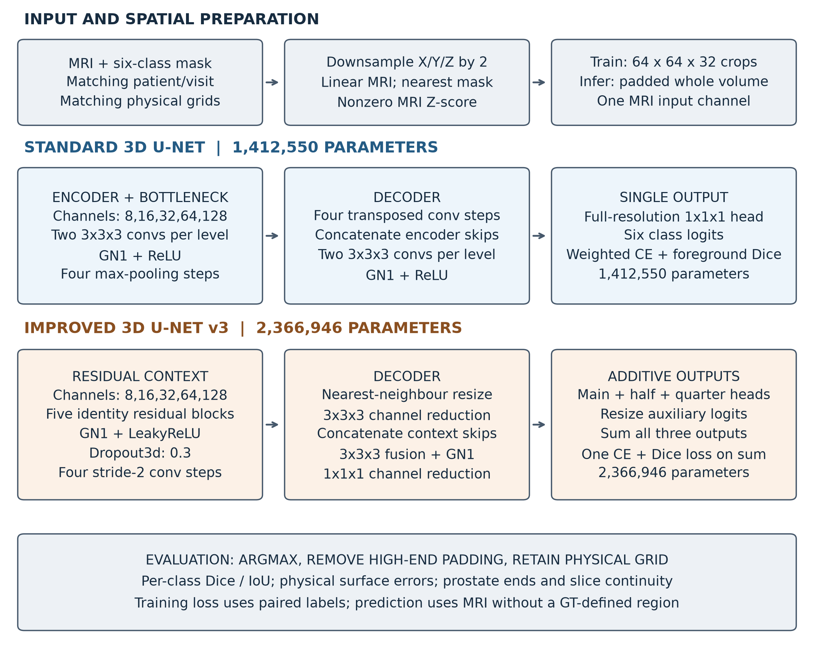
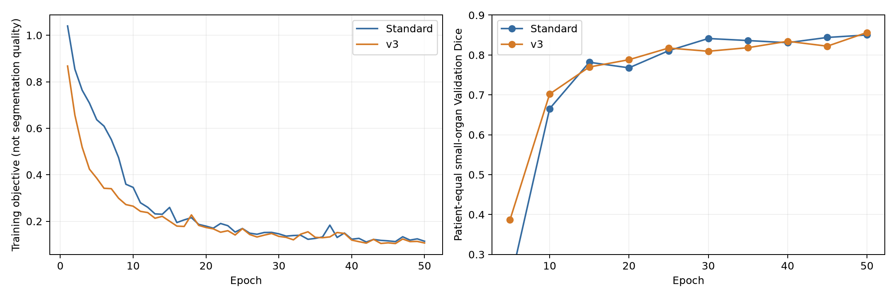
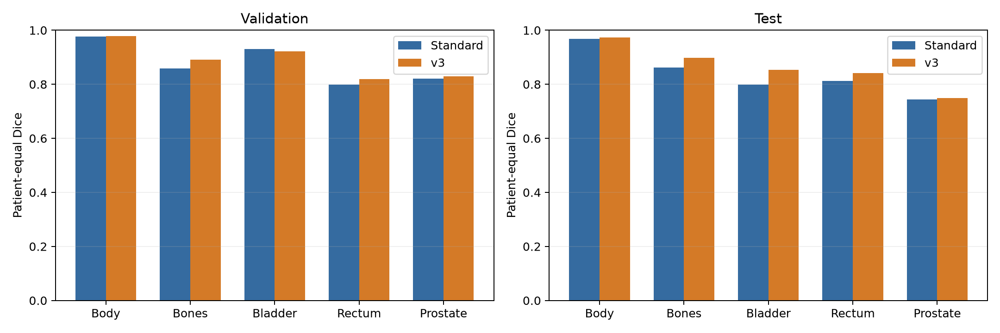
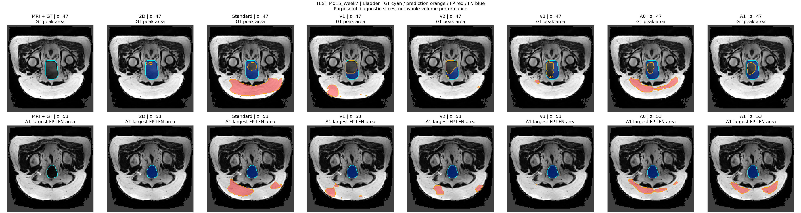
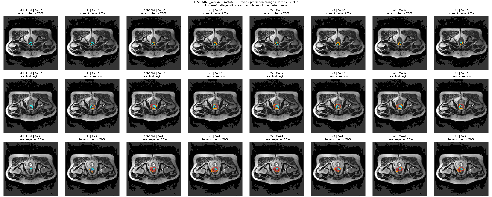
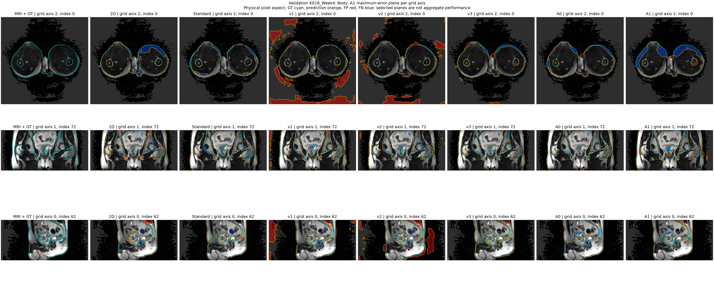
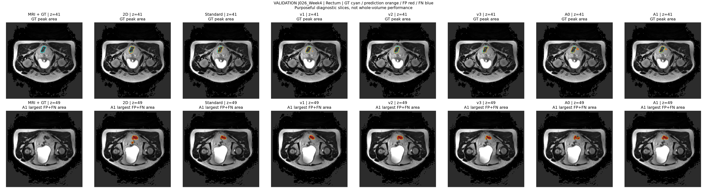
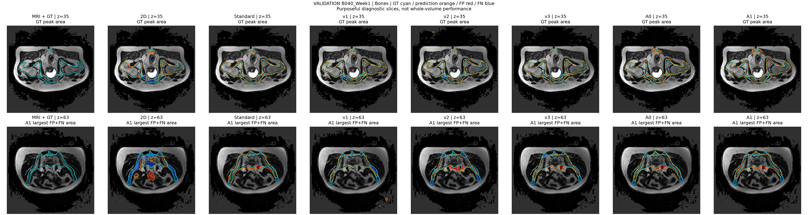

# HipMRI Segmentation: Spatial Continuity, Boundary Errors and Computational Cost

**COMP3710 Final Assessment | Student ID: s4906923 | Updated 22 October 2026**

## Abstract

Ten 50-epoch U-Net runs were compared on HipMRI using patient-disjoint splits: 26 Train, 6 Validation and 6 Test patients. Each run was evaluated at its best measured Validation checkpoint. Improved v3 had the highest Validation small-organ Dice, 0.8564, compared with 0.8502 for Standard 3D. On the existing Test cohort, their small-organ Dice values were 0.8145 and 0.7851, and prostate Dice values were 0.7485 and 0.7433. Relative to the supplementary 2D configuration, both 3D models had higher prostate base/apex slice Dice and fewer visits with internal prediction gaps. Relative to Standard, however, v3 had lower mean base/apex slice Dice and more adjacent-organ confusion. Its median prostate HD95 was lower, 6.65 versus 7.98 mm, but its maximum was higher, 115.37 versus 19.23 mm. Reference peak allocated inference memory was 0.3458 GiB for v3, 0.2460 GiB for Standard and 0.0761 GiB for 2D. These measurements support retaining v3 for the original Validation endpoint while retaining Standard for boundary comparison. They do not establish autonomous contouring performance. Test had already been inspected, and only six patients contributed to each evaluation split; no external-cohort or independent-seed replication was completed.

## 1. Introduction

The COMP3710 segmentation specification asks whether volumetric continuity or multiscale context reduces local boundary and slice-transition errors that whole-organ Dice can conceal. For HipMRI, it identifies prostate base/apex contours, bladder/rectum interfaces, disconnected predictions and computational cost as the investigation. This report implements the 3D Improved U-Net route with residual units and multiscale outputs, using Standard 3D U-Net as the main baseline and a separately trained 2D U-Net as a supplementary context comparison. These choices follow the baseline allowance and Hard-route description on pages 5-6 of the supplied specification.

| Course investigation | Research question measured in this study | Results and corresponding discussion |
|---|---|---|
| Volumetric continuity versus slice-wise processing | Do the tested 3D configurations improve prostate base/apex overlap and slice continuity over the supplementary 2D configuration? | [Regional overlap, gaps and adjacent-slice area change](#35-prostate-regions-slice-continuity-and-adjacent-organ-confusion); [interpretation of the 2D/3D comparison](#41-spatial-continuity-in-the-tested-2d-and-3d-configurations) |
| Local boundary errors concealed by global overlap | Does Improved v3 improve prostate ends, adjacent-organ separation and surface-error extremes over Standard 3D, in addition to whole-organ Dice? | [Per-class overlap](#32-per-class-test-overlap-and-precisionrecall), [surface errors](#33-surface-distances-and-distant-body-predictions) and [five MRI cases](#36-case-level-error-analysis); [boundary comparison](#42-mean-overlap-gains-and-persistent-boundary-errors) |
| Anatomical benefit versus computation | What additional inference memory and latency accompany the measured 3D results, and which uses remain unsupported by the observed errors? | [Measured resources](#34-parameter-count-gpu-memory-and-inference-time); [cost interpretation](#43-measured-inference-cost-and-profiling-scope) and [engineering recommendation](#46-engineering-recommendation-for-the-recorded-prototype) |

The first question corresponds to the course's 2D/3D context comparison. The second applies its local-boundary requirement to the submitted Improved-versus-Standard comparison. The third corresponds to its resource table and manager recommendation. The 2D run changes sampling, width and class weights as well as dimensionality, so the study cannot attribute the whole 2D/3D difference to 3D convolution alone. The measured adjacent-organ statistic counts GT Bladder/Rectum voxels labelled Prostate; it does not measure rectal-wall or bladder-mucosa invasion. No radiation-dose or treatment-outcome evaluation was performed.

**Supplementary material.** [Appendix A](#appendix-a-software-environment-and-reproduction-commands) gives the recorded software environment and commands for training, fixed-checkpoint evaluation, example export and PDF generation. [Appendix B](#appendix-b-evidence-files-and-assessment-checklist) lists the submitted files, saved experiment evidence and coursework actions that require confirmation. [Appendix C](#appendix-c-feasibility-review) retains the one-page feasibility review within this README, as required on page 14 of the specification. The source specification's SHA-256 and page mapping are retained in `evidence/provenance.json`.

Checkpoint selection used Validation. Test was inspected during the research process and is reported as an existing descriptive cohort, not a new blind evaluation. Sections 2-4 separate the implemented methods, measured results and interpretation.

## 2. Materials and methods

### 2.1 Dataset audit and preprocessing

**Audit sequence.** The recorded pretraining checks covered source pairs, the factor-two preprocessing path, delivered samples and two-patch optimiser behaviour. The initial audit decoded Train arrays only; Validation/Test filenames were inventoried to check the split, without using their label distributions to design the recipe.

| Check before formal cohort training | Recorded evidence and decision |
|---|---|
| Cohort and mechanical integrity | All 143 Train MRI/mask pairs from 26 patients were audited; no inventory/case errors, non-finite values or illegal labels were found. All six labels occurred in every Train volume; no identical-file hash groups were found within Train. |
| Geometry and gross alignment | Every MRI/mask affine matched exactly. All Train MRI used LPS orientation and millimetres; 142 volumes were 256x256x128 and one was 256x256x144. Two axial overlays per volume showed no obvious gross displacement. This screen did not certify every local contour. |
| Documented metadata warning | All 143 mask headers left spatial units unspecified. Matching grids, affines and spacings supported using the paired MRI geometry, with this limitation retained rather than silently correcting the source. |
| Distribution and supervision | Train-only counts showed Background 59.99%, Body 35.75%, Bones 3.41%, Bladder 0.60%, Rectum 0.15% and Prostate 0.11%. Visit counts varied from 1 to 8 per patient. This motivated patient-balanced sampling and Train-derived CE weights, rather than treating correlated visits as independent patients. |
| Actual preprocessing | The factor-two pipeline processed 143/143 Train cases without errors; all small organs survived. Prostate physical label volume after/before resampling ranged from 0.9383 to 1.0423. Normalised nonzero MRI values had mean approximately 0 and standard deviation approximately 1. Organ survival did not prove thin-boundary preservation. |
| Delivered samples and learning checks | Patient-balanced CPU sampling/tensor checks preceded a paired GPU optimiser smoke and full-volume capacity probe. In a controlled two-patch, 500-update check, unweighted CE left Standard predicting no Bladder, Rectum or Prostate voxels. Weighted CE produced same-patch Dice of 0.9843, 0.9796 and 0.9722 for these organs, respectively. This justified a weighted learning protocol, not a claim about unseen-patient accuracy. |

**Training acceptance.** Zero unresolved mechanical errors, matching paired geometry, preserved labels through the actual transform, finite model inputs, verified sampling and a working optimiser/inference path supported proceeding to controlled training. These checks did not include expert certification of every contour or a clinical suitability assessment. The unspecified mask units and downsampling's potential loss of millimetre-scale detail remained explicit limitations. The numerical summaries and original audit hashes are retained under `pretraining_review` in `evidence/provenance.json`.

| Split | Patients | Volumes | Purpose |
|---|---|---|---|
| Train | 26 | 143 | Optimisation and Train-derived weights |
| Validation | 6 | 38 | Checkpoint selection and diagnosis |
| Existing Test | 6 | 30 | Descriptive fixed-checkpoint evaluation |

`config/patient_split.json` records the fixed patient lists. Visits from one patient never cross splits. Files are paired by patient/week. `dataset.py` checks matching 3D shape, affine and voxel spacing, finite arrays and integer labels 0-5. MRI must declare millimetres; matching masks with unknown spatial units are accepted as a documented source-metadata limitation. Metadata agreement is not expert confirmation of anatomy.

MRI and mask are jointly downsampled by (2,2,2). Output centre j samples source centre `(j+0.5)*2-0.5`; the affine uses the same transform. MRI interpolation is linear, mask nearest-neighbour; lost labels trigger failure. Image-only nonzero Z-score preserves outside zeros. The ground-truth mask (GT) never defines the region used for prediction.

Arrays use X/Y/Z voxel order until conversion to channel/depth/height/width (CDHW) model input. High-end zero padding makes dimensions divisible by 16 and is removed before metrics/export. Evaluation is on the downsampled physical grid, not original resolution. Cross-entropy (CE) takes integer labels; Dice converts them to six-channel one-hot internally; `one_hot()` is also available.

Keep raw files outside Git:

```text
HipMRI_Study_open/
  semantic_MRs/PatientID_WeekN_LFOV.nii.gz
  semantic_labels_only/PatientID_WeekN_SEMANTIC.nii.gz
```

### 2.2 Network architectures

**Architecture specification.** Standard uses volumetric convolution and encoder-decoder skips, with U-Net and 3D U-Net cited as architectural references [1,2]. The Improved implementation uses residual context blocks and multiscale outputs, with Isensee et al. cited as its reference [3]. Both implemented models start at eight channels. Their recorded reference inference-memory measurements are given in Section 3.4; no width-search experiment was completed. The layer definitions below describe this project's implementations rather than an exact reproduction of the papers.

| Property | Standard 3D U-Net | Improved 3D U-Net v3 |
|---|---|---|
| Input and output | One MRI channel; six class logits | One MRI channel; six combined class logits |
| Feature hierarchy | Five resolutions, channels 8,16,32,64,128; four downsampling steps | Same five resolutions and channel widths |
| Encoder stage | Two 3x3x3 convolutions, each followed by GN1 and ReLU | 3x3x3 stem; a residual context block at every resolution |
| Downsampling | 2x2x2 max pooling, stride 2 | 3x3x3 convolution, stride 2, padding 1; channels double |
| Decoder step | 2x2x2 transposed convolution, stride 2; concatenate matching encoder features; two-convolution block | Nearest-neighbour upsampling to the skip grid, 3x3x3 channel reduction and LeakyReLU; concatenate matching context features; localisation block |
| Localisation / block details | 3x3x3 convolutions use padding 1 and no bias | Localisation: 3x3x3 convolution on 2C channels, GN1 and LeakyReLU, then 1x1x1 reduction to C |
| Normalisation and activation | GN(1,C), epsilon 1e-5, learned scale/offset; ReLU | Fourteen GN(1,C) sites, epsilon 1e-5, learned scale/offset; LeakyReLU slope 0.01 |
| Residual and regularisation | No residual blocks or dropout | Five identity residual blocks; Dropout3d probability 0.3 between each block's two convolutions, active during training |
| Segmentation heads | One 1x1x1 convolution at full resolution | 1x1x1 heads at full, half and quarter resolution; resize the latter two and sum the logits |
| Trainable parameters | 1,412,550 | 2,366,946 |

For a training patch, both encoders follow this spatial/channel schedule. Sizes are X/Y/Z voxels; the implementation receives Bx1x32x64x64 after conversion to depth/height/width order. B is batch size.

| Encoder level | Channels | Patch feature size X/Y/Z |
|---|---|---|
| Full resolution | 8 | 64x64x32 |
| Half resolution | 16 | 32x32x16 |
| Quarter resolution | 32 | 16x16x8 |
| One eighth | 64 | 8x8x4 |
| Bottleneck, one sixteenth | 128 | 4x4x2 |

The decoder reverses this hierarchy, using four feature-concatenation skips, and ends with Bx6x32x64x64 logits for a training patch. Evaluation accepts a larger padded whole volume with the same channel hierarchy; this is not a fixed patch-size inference model.

**The v3 residual block.** For feature tensor x with C channels, the branch applies GN1 -> LeakyReLU -> 3x3x3 convolution -> Dropout3d -> GN1 -> LeakyReLU -> 3x3x3 convolution, then adds the original x. The spatial convolutions use stride 1 and padding 1. GN1 normalises across channels and spatial positions within each sample, not across the batch. v1 instead used per-channel InstanceNorm. The input-context and head-output experiments are reported in Section 4.4; the normalisation definition alone does not identify the cause of a prediction error.

**Output fusion and supervision.** The full-resolution head sees eight decoder channels; the half- and quarter-resolution heads see 16 and 32. Auxiliary logits are resized to the main grid by trilinear interpolation with `align_corners=False`. Training and inference both use `combined = main + resized_half + resized_quarter`; one loss is applied to this sum, so all three heads receive gradients. This is additive multiscale supervision, not the independent head losses of v2. Class order is Background, Body, Bones, Bladder, Rectum, Prostate. Softmax supplies probabilities for the Dice loss; inference uses the largest combined logit per voxel.



### 2.3 Loss function, training and checkpoint selection

Both models use random seed 371017 and the Adam optimiser, with a fixed learning rate of 0.001 and no weight decay. One shuffled/cycled visit per Train patient supplies ten uniform 64x64x32 XYZ patches per epoch: 260 patches, batch size 2, 130 updates; 50 epochs yield 6,500 updates. The submission preserves the deterministic visit/crop/batch schedule. Exact GPU rerun weights are not guaranteed across kernels, hardware and library versions.

Loss is `0.5 * weighted_cross_entropy + 0.5 * foreground_soft_Dice_loss`. Background remains in CE but is excluded from Dice. CE weights derived from Train data are `[1.453871, 1, 2.617199, 4.498586, 8.893215, 9.699950]` in label order. The selected weights came from Train patch exposure and the controlled two-patch learning check described in Section 2.1. The v5-L comparison tests a change to the three small-organ weights; its observed Validation and Test scores are reported in Section 3.1. Training loss and evaluation Dice are reported separately.

Validation runs every five epochs. Pool confusion matrices across visits within each patient; compute Bladder/Rectum/Prostate Dice, average within patient, then average six patients equally. Choose the highest score at measured epochs 5,10,...,50, with earlier ties. The intermediate epochs were not all evaluated. Both selected checkpoints happen to be epoch 50.



### 2.4 Experimental development and model selection

**Completed runs and evaluation budget.** The study completed ten formal 50-epoch runs: Standard, supplementary 2D, v1, v2, v3, A0, A1 and v5-C/L/S. Tiny-batch checks, inference probes and sampler audits were diagnostics, not additional successful cohort models. The sequence used Train exposure records and Validation predictions to decide what to test next. Recorded configuration changes below describe intended mechanisms; they are not by themselves proof of the cause of an error. The complete numerical comparisons are in Section 3. Standard, v1 and the supplementary 2D run were extended from the initial 40-epoch budget to 50; the final comparison uses the same 50-epoch total budget for every run. Earlier v2/v3 mechanism plans also specified fixed-epoch checks. Those historical checks are distinct from the final benchmark, which consistently reports each model's best measured Validation checkpoint.

**Initial comparison and subsequent diagnostics.** Standard and the first Improved network, subsequently called v1, were given the same patient-balanced 3D crops, loss, split and optimisation recipe. The residual context, InstanceNorm, dropout and additive output heads in v1 were intended to add contextual representation and regularisation. After training, review moved from loss curves to per-class Validation confusion counts, precision/recall, physical Body surfaces and MRI overlays. Reproducing the fixed predictions before calculating new measurements prevented a change of checkpoint or preprocessing from masquerading as a diagnostic finding.

The recorded v1 investigation examined four candidate mechanisms: boundary/background exposure, output-head coupling, imbalance weights and normalisation/input extent. These were diagnostic questions, not established causes. Train geometry/exposure audits tested what the sampler supplied. Fixed-weight Validation probes compared full-volume and sliding-window inputs and inspected the individual output heads. Neither inference-context changes nor removal of auxiliary outputs was treated as a retrained architecture comparison. Small numerical differences caused a head-replay control to fail; that control was not used as causal proof. v2, v3 and the later optimisation branches changed the factors specified in the table below.

| Run / parent | Design decision and question tested | Comparison logic |
|---|---|---|
| Standard / initial reference | Basic 3D U-Net, GN1, one head; establish a volumetric baseline under the verified pipeline | Same 3D split, patch schedule, objective and update budget as v1 |
| v1 / initial Improved | Residual context, InstanceNorm, dropout 0.3 and summed multiscale logits; test the contextual Hard architecture | Several components differ from Standard, so the aggregate contrast cannot identify one causal component |
| 2D / supplementary branch | Width-16 slice U-Net; four uniform plus two crops per small organ per patient, with its own Train-derived weights | Slice-only context and lower resource use provide an engineering reference; different width/sampling/weights prevent a pure dimensionality ablation |
| v2 / v1 | Train main, half and quarter heads independently: `(Lmain + 0.5 Lhalf + 0.25 Lquarter) / 1.75`; use the main head at inference | Tests whether individually useful heads avoid reliance on summed predictions; keeps v1's backbone and InstanceNorm. Training supervision and inference output change together |
| v3 / v1 | Replace all 14 InstanceNorm sites with GN1; retain v1's residual blocks, dropout, additive heads and loss | Normalisation is the only declared recipe change from v1; the comparison uses a historical single-run reference. v2's independent losses are not used |
| A0 / v3 | AdamW, decay 1e-5 excluding bias/normalisation, cosine learning rate from 0.001 towards 1e-5 over 6,500 updates | Tests a conventional optimisation/regularisation package; the combined changes cannot isolate decay from optimiser or schedule |
| A1 / A0 | With probability 0.3, apply paired physical-axis rotations up to 10 degrees and isotropic scaling 0.9-1.1; linear MRI and nearest-neighbour mask interpolation | A1-A0 tests this specific spatial augmentation under the AdamW/cosine recipe. A Train-only 26-patient geometry/exposure audit and real previews preceded training |
| v5-C / v3 | Concurrent run using the original v3 settings and nominal seed | Provides a contemporary control for L/S and reveals same-recipe run variation; this is not an independent-seed replication |
| v5-L / C | Compress only the three small-organ CE weights by square root: 4.498586/8.893215/9.699950 become 2.120987/2.982149/3.114474 | Tests a less aggressive imbalance penalty while retaining Adam, constant learning rate, architecture and sampling |
| v5-S / C | Retain Adam and zero decay; change only the learning-rate rule to cosine over 6,500 updates, towards 1e-5 | Separates the schedule question from A0's additional optimiser/decay changes |

**Sequence of revisions.** v2 changed head supervision and inference output after the v1 head-output diagnostic. Its best Validation small-organ score was below v1's, as recorded in Section 3.1. v3 therefore retained v1's additive outputs while replacing InstanceNorm with GN1. A0/A1 then tested optimiser/decay/schedule changes and paired spatial augmentation around the v3 architecture. The A1 Train-only audit covered 26 patients and six real previews, with gates for small-organ exposure and out-of-volume sampling; it preceded A1 training and did not measure segmentation accuracy. C/L/S subsequently separated the learning-rate schedule and small-organ CE weights under a concurrent v3-recipe control. The Train edge-sampling candidate was audited but never trained as a formal segmentation run and is not counted among the ten models.

**Selection of the submitted model pair.** The original selection endpoint remained patient-equal Validation Dice for Bladder, Rectum and Prostate, measured every five epochs. Each run first contributes its best measured checkpoint; comparing those checkpoints places v3 first under this rule. v3 scored 0.8564, compared with 0.8502 for Standard and 0.8542 for C. Its Validation Body HD95 median was 4.58 mm, compared with 76.61 mm for v1 (Section 3.3). None of the later branches exceeded v3's original primary Validation score. Standard is retained as the baseline; it has fewer parameters and lower recorded peak inference memory, and its Test boundary results differ from v3's as reported in Sections 3.3-3.5. C's higher existing Test prostate score does not justify changing the rule after seeing Test; v3 is the selected research candidate, not the winner of every metric or a clinically approved model. Section 3 quantifies those gains and regressions; Section 4 weighs their practical importance.

### 2.5 Evaluation protocol and study limitations

All models use identical patient splits and evaluation grids. 3D inference processes the complete downsampled volume once, not sliding windows. The supplementary 2D model processes slices and reconstructs a volume. A 3D training patch contains 131,072 voxels (64x64x32), whereas a 2D crop contains 4,096 pixels (64x64); equal epoch/update counts do not equalise processed input elements or computation. No GT-dependent post-processing is used. Taking the largest class logit gives the same class as applying softmax first.

TP, FP and FN denote true positives, false positives and false negatives. Dice=`2TP/(2TP+FP+FN)`, intersection over union (IoU)=`TP/(TP+FP+FN)`, precision=`TP/(TP+FP)`, recall=`TP/(TP+FN)`. If a class is absent from both prediction and GT, its overlap is recorded as unavailable rather than perfect. Primary overlap tables pool visits within patients before averaging patients. The foreground mean gives equal weight to labels 1-5; Background remains in the six-class table. The supplementary post-hoc 50% prostate-weighted score is not a selection rule or official course criterion.

The 95th-percentile Hausdorff distance (HD95) and average symmetric surface distance (ASSD) use concatenated directed distances between six-connected mask surfaces, in physical millimetres. HD95 is the 95th percentile; ASSD here is their combined mean. Empty-mask statuses are explicit and null, never zero distance. All five foreground masks were present in all 680 fixed-audit case/model entries. Surface medians/maxima below summarise volumes, unlike patient-equal overlap. The saved distances use this surface convention. The evaluation code rejects sheared grids rather than applying spacing-only Euclidean distances to them.

**Test has already been repeatedly inspected.** Checkpoints were chosen using Validation. Because Test has already been examined, it is not a fresh blind holdout and should not guide further tuning. Six patients, not 30 correlated visits, are the independent Test units. No external cohort or independent multi-seed replication was completed.

## 3. Results

### 3.1 Validation-selected checkpoints across ten runs

Every model in the table completed 50 training epochs. Only Standard/v3 runtime implementations are retained here; the other experiments are retained as comparisons, including changes that did not improve performance.

| Model | Best epoch | Validation small organs | Test small organs | Test foreground five | Test Prostate |
| --- | --- | --- | --- | --- | --- |
| 2D | 50 | 0.7757 | 0.7082 | 0.7883 | 0.6611 |
| Standard | 50 | 0.8502 | 0.7851 | 0.8370 | 0.7433 |
| v1 | 50 | 0.8420 | 0.8078 | 0.8502 | 0.7520 |
| v2 | 45 | 0.8362 | 0.7959 | 0.8422 | 0.7478 |
| v3 | 50 | 0.8564 | 0.8145 | 0.8631 | 0.7485 |
| A0 | 45 | 0.8450 | 0.7836 | 0.8400 | 0.7318 |
| A1 | 45 | 0.8298 | 0.7801 | 0.8362 | 0.7273 |
| v5-C | 50 | 0.8542 | 0.8040 | 0.8557 | 0.7633 |
| v5-L | 45 | 0.8426 | 0.7858 | 0.8388 | 0.7361 |
| v5-S | 45 | 0.8465 | 0.7788 | 0.8350 | 0.7281 |

**A1 augmentation result (design in Section 2.4).** The best Validation small-organ Dice decreased from 0.8450 to 0.8298, and existing Test Dice from 0.7836 to 0.7801. Validation distant Background-to-Body voxel counts decreased from 9,572 to 1,171; the corresponding Test counts decreased from 9,636 to 535. These are sums over volumes, not patient-equal rates. The lower counts occurred alongside the lower small-organ Dice values. This result concerns one tested augmentation scheme and training budget; it does not show that data augmentation is generally ineffective.

v3's Test small-organ gain over Standard is +0.0294, but only 3/6 patients improve; excluding influential M015 changes the contrast to approximately -0.0050. Validation improves for 5/6 patients. These descriptive sensitivities do not establish population superiority. C's higher Test prostate Dice is reported without switching the primary selection rule after seeing Test.

### 3.2 Per-class Test overlap and precision/recall

| Class | Std Dice | v3 Dice | Std IoU | v3 IoU | Precision Std / v3 | Recall Std / v3 |
| --- | --- | --- | --- | --- | --- | --- |
| Background | 0.9904 | 0.9885 | 0.9814 | 0.9778 | 0.9952 / 0.9961 | 0.9858 / 0.9814 |
| Body | 0.9677 | 0.9732 | 0.9384 | 0.9484 | 0.9748 / 0.9664 | 0.9610 / 0.9807 |
| Bones | 0.8619 | 0.8988 | 0.7578 | 0.8168 | 0.7868 / 0.8793 | 0.9543 / 0.9205 |
| Bladder | 0.7993 | 0.8539 | 0.7455 | 0.7768 | 0.7871 / 0.8807 | 0.8229 / 0.8598 |
| Rectum | 0.8128 | 0.8410 | 0.6918 | 0.7280 | 0.7898 / 0.8086 | 0.8414 / 0.8784 |
| Prostate | 0.7433 | 0.7485 | 0.6081 | 0.6193 | 0.7189 / 0.6983 | 0.8415 / 0.8516 |



v3 improves all five Test foreground mean Dice values here, but prostate gains only about 0.0052 while precision decreases from 0.7189 to 0.6983. In this comparison, the higher mean Dice occurs alongside lower patient-equal precision; the W029_Week6 example below also has lower whole-volume prostate Dice for v3.

### 3.3 Surface distances and distant Body predictions

| Class | Median HD95 Std / v3 mm | Worst HD95 Std / v3 mm | Median ASSD Std / v3 mm |
| --- | --- | --- | --- |
| Body | 4.86 / 4.50 | 18.72 / 22.23 | 1.21 / 1.66 |
| Bones | 7.46 / 4.58 | 18.97 / 19.02 | 2.69 / 1.83 |
| Bladder | 3.36 / 3.89 | 109.49 / 72.36 | 1.38 / 1.51 |
| Rectum | 7.06 / 7.28 | 38.56 / 109.19 | 2.46 / 2.09 |
| Prostate | 7.98 / 6.65 | 19.23 / 115.37 | 3.45 / 2.73 |

Median prostate HD95 improves 7.98 to 6.65 mm, while the worst value worsens 19.23 to 115.37 mm. Maximum Body HD95 was 18.72/22.23 mm and maximum Rectum HD95 was 38.56/109.19 mm for Standard/v3. The Hard-route stated Dice target of 0.7 is exceeded by v3's Test prostate (0.7485), small-organ (0.8145) and foreground (0.8631) means. The specification does not define the aggregation of that target; one of six Test patients still has prostate Dice below 0.7. These averages therefore do not establish either per-patient attainment or local contour safety.


The following additional Body measurements come from the selected-checkpoint records. Distant false predictions count GT Background voxels labelled Body at least 20 mm from GT Body. Counts are summed over the 38 Validation or 30 Test volumes; they are not patient-equal scores.

| Model | Validation median Body HD95 (mm) | Validation distant Body FP voxels | Test distant Body FP voxels |
|---|---|---|---|
| Standard | 4.75 | 1,007 | 2,804 |
| v1 | 76.61 | 1,358,516 | 667,239 |
| v3 | 4.58 | 73,204 | 81,145 |

v3 has a much lower Validation median and fewer distant Body false predictions than v1, but its distant-voxel counts remain above Standard on both splits. This separates the improvement over v1 from the comparison with the baseline. The unrounded counts and source-bundle identity are retained under `report_diagnostic_summaries` in `evidence/provenance.json`.

### 3.4 Parameter count, GPU memory and inference time

| Model | Parameters | Peak inference GiB | Reference latency s |
| --- | --- | --- | --- |
| 2D | 1,942,374 | 0.0761 | 0.1395 |
| Standard | 1,412,550 | 0.2460 | 0.1552 |
| v3 | 2,366,946 | 0.3458 | 0.1452 |

NVIDIA A100-PCIE-40GB, prepared Validation case K008_Week0, three warm-ups and five repetitions, one resident model. Latency includes transfer, execution, argmax and conversion, excluding decoding/preprocessing/metrics/IO. Peak figures are allocated inference memory, not training memory or device utilisation. The five recorded reference repetitions, per-case timings and patient records are retained in `evidence/experiments.json`.

The supplementary 2D model segments slices independently and uses 0.0761 GiB in this reference inference measurement. The 3D models process the full downsampled volume. Their end-region, continuity and distant-component measurements are reported separately, rather than inferred from the convolution dimensionality. The supplementary 2D arm differs in sampling, weights and width; it is not a clean dimension-only ablation and does not claim to meet the separate Easy-route dataset/target. Measurements of prostate end regions, nearby organs at risk (OAR) and changes between adjacent slices remain in `evidence/experiments.json`.


### 3.5 Prostate regions, slice continuity and adjacent-organ confusion

These diagnostics were calculated from the predictions and geometry records already saved for the 30 Test volumes. They do not involve new inference, tuning or checkpoint selection.

| Existing Test diagnostic | 2D | Standard 3D | Improved v3 |
|---|---|---|---|
| Apex mean slice Dice | 0.5186 | 0.7544 | 0.7523 |
| Central mean slice Dice | 0.7125 | 0.7824 | 0.7931 |
| Base mean slice Dice | 0.3473 | 0.5097 | 0.5069 |
| Visits with an internal predicted prostate gap (%) | 43.75 | 0.00 | 8.33 |
| Adjacent-area transition error (dimensionless) | 0.1953 | 0.0685 | 0.0720 |
| GT Bladder/Rectum voxels labelled Prostate (%) | 0.386 | 0.485 | 0.580 |

End-region values average GT-positive slice Dice within each visit, then visits within each patient, and finally the six patients equally. Base and apex are the physically superior and inferior 20% of GT-positive slices: geometric proxies rather than clinician-defined regions. These slice averages differ from the pooled whole-organ Dice in Section 3.2.

The gap statistic is the patient-equal mean fraction of visits with an empty predicted Z slice between nonempty predicted prostate slices. The GT has no such gaps in this cohort. It counts missing intermediate predicted slices, not correct anatomical placement. The area-transition error is the absolute difference between prediction and GT mean normalized adjacent-area changes on GT-positive adjacent slice pairs. It is a descriptive shape-change measure, not a validated anatomical quality score.

The adjacent-organ percentage pools counts within each patient before averaging patients. Its denominator is all GT Bladder/Rectum voxels, and its numerator is those labelled as Prostate. It measures class confusion, not specifically wall invasion, mucosal dose or clinical harm. No wall-specific region or clinical severity threshold was annotated for this measurement. Definitions and unrounded values are retained in `evidence/spatial_context_summary.json`.

**Regional comparison.** Standard/v3 improve apex and base overlap over this 2D configuration and show fewer internal gaps. However, v3's gains over Standard are concentrated in central slices; its apex and base means are slightly lower, its continuity measures are not better, and its adjacent-organ confusion percentage is higher. The central slice mean increased from 0.7824 to 0.7931, whereas the internal-gap fraction increased from 0.00% to 8.33%.

### 3.6 Case-level error analysis

These unchanged historical fixed-checkpoint panels are real MRI, not simulated or retouched contours. Cyan=GT, orange=prediction, red=FP, blue=FN. Seven labelled historical model columns are retained for provenance; compare **Standard** and **v3** for the submitted pair. Open the linked PNGs at full resolution to inspect small structures.

Ordinary panels show the GT-largest-area slice and the slice with largest A1 FP+FN area, shared across models. The Body panel uses A1 maximum-error planes. This purposive selection is not a random sample or a whole-volume score. Prostate base/apex uses physical superior/inferior ordering as a geometric proxy, not expert end-region annotation.

#### 3.6.1 M015_Week7, Test: bladder localisation



Standard includes distant non-bladder tissue and misses much of the bladder; v3 reduces distant predictions but still undersegments the target. Whole-volume bladder Dice is 0.0676 Standard versus 0.5224 v3; HD95 is 109.49 versus 58.84 mm. The v3 bladder Dice in this visit remained 0.5224 despite the increase over Standard. The saved evaluation did not isolate anatomy, intensity or annotation effects as the cause. Section 4.5 reports the Test comparison with and without patient M015.

#### 3.6.2 W029_Week6, Test: prostate ends and adjacent tissue



Both displayed base predictions extend beyond GT; their base-region mean slice Dice values are below 0.22. Whole-volume prostate Dice is 0.4623 Standard versus 0.4377 v3; base-region mean slice Dice is 0.2111 versus 0.2158. Slight end-region improvement does not imply whole-organ improvement. HD95 increases 19.23 to 20.59 mm. No controlled test established why this visit failed; no radiation-dose evaluation or expert clinical adjudication was performed.

#### 3.6.3 K018_Week4, Validation: Body and distant components



The displayed v1 distant FP pattern is reduced in v3, but isolated FP regions remain in the v3 column. Standard/v3 Body Dice is almost equal (0.9740/0.9742); HD95 is 4.75/6.24 mm, and distant Background-to-Body voxels are 5/3,128. The near-equal Dice values therefore coexist with different surface distances and distant-error counts. This case does not isolate normalisation or input context as the cause.

#### 3.6.4 J026_Week4, Validation: rectum extent



The GT-largest-area row contains overlapping GT and predicted Rectum contours. The error-selected row shows predicted Rectum outside the GT contour. Whole-volume Dice improves 0.8110 to 0.8437, ASSD improves 2.00 to 1.73 mm, but HD95 remains 6.24 mm. The lower ASSD and higher Dice do not remove the displayed false-positive extent or change the recorded HD95.

#### 3.6.5 B040_Week1, Validation: bone coverage



The pelvis contains both missing bone and extra predicted regions. v3 improves whole-volume Bones Dice 0.8607 to 0.9026 and HD95 7.41 to 4.58 mm, but the error-selected row retains FP and FN. The displayed FP/FN and the whole-volume metrics are reported for Bones separately from the three-small-organ selection score.

## 4. Discussion

### 4.1 Spatial continuity in the tested 2D and 3D configurations

The first research question is addressed by the whole-prostate and axial-region measurements. Standard/v3 had Test whole-prostate Dice 0.7433/0.7485, compared with 0.6611 for 2D. Apex slice Dice was 0.7544/0.7523 versus 0.5186, and base slice Dice was 0.5097/0.5069 versus 0.3473. The patient-equal fraction of visits with an internal predicted prostate gap was 0.00%/8.33%, compared with 43.75% for 2D. Thus the tested 3D configurations differed from the 2D configuration at prostate ends and intermediate slices, not only in the central-region score.

Those differences do not isolate dimensionality: 2D also changed width, sampling and class weights. Base Dice remained approximately 0.51 for both 3D models, and the W029_Week6 panel retained end-region FP/FN. The existing records support a comparison of these configurations, not a causal estimate for adding 3D kernels alone.

### 4.2 Mean overlap gains and persistent boundary errors

The second research question separates whole-organ overlap from local errors. v3 had higher Test mean Dice for all five foreground classes than Standard. For Prostate, Dice changed from 0.7433 to 0.7485, precision from 0.7189 to 0.6983 and recall from 0.8415 to 0.8516. Its median prostate HD95 was lower by about 1.33 mm, while its maximum was 115.37 mm rather than 19.23 mm.

The spatial diagnostics did not show an additional v3 advantage over Standard: apex/base means were slightly lower, the internal-gap fraction was higher, and the GT Bladder/Rectum-to-Prostate fraction was 0.580% rather than 0.485%. Test distant Body false predictions also remained higher: 81,145 versus 2,804 voxels. These measurements answer the boundary question with different outcomes for different metrics; higher mean foreground Dice did not coincide with fewer errors on all boundary measures. No clinical outcome can be inferred from the adjacent-organ proxy.

### 4.3 Measured inference cost and profiling scope

For K008_Week0 on the recorded A100, Standard and v3 used 3.23 and 4.54 times the 2D model's peak allocated inference memory. v3 used 1.41 times Standard's memory. Median resident-model latency over five repetitions was 0.1452 s for v3 and 0.1552 s for Standard. These measurements establish the memory/latency values for this case and protocol; they do not establish a general speed advantage.

The course's cost question is only partly measured. The controlled table concerns inference on factor-two-downsampled volumes, not a matched training-memory/time experiment. It therefore neither demonstrates a 5-10-fold training penalty nor estimates full-resolution deployment cost. v3 completed its recorded 50-epoch training job in 02:02:48, including Validation and checkpoint IO; that job wall time is not a controlled comparison of architecture-only training speed.

### 4.4 Validation diagnostics and limits of causal attribution

The earlier v1 had worse Body HD95 than Standard in all 38 Validation volumes; their medians were 76.61 and 4.75 mm. With v1 weights fixed, replacing the combined output by the main head alone changed patient-equal Validation small-organ Dice from 0.8420 to 0.2414 and median Body HD95 from 76.61 to 108.96 mm. The result documents dependence on the trained combined output; it does not show what a separately trained main-head architecture would achieve.

The fixed-weight four-case inference experiment also had nonuniform organ outcomes. On K018_Week4, sliding windows reduced distant Body FP from 58,078 to 18,650 voxels while the within-volume mean of the three small-organ Dice values fell from 0.7610 to 0.7158. The corresponding small-organ means also fell on K008_Week0 but rose on B040_Week4 and J026_Week4. These were four selected Validation cases, not an all-38 protocol comparison. A separate head-replay control failed its numerical-equivalence threshold, so its replay outputs were not accepted as mechanistic evidence.

v3 changed InstanceNorm to GN1 within the v1 architecture. Its selected Validation Body median decreased to 4.58 mm and its small-organ score increased to 0.8564. This is the outcome of the recorded training comparison; without independent-seed replication or a successful mechanism-isolating control, it does not establish a unique causal explanation for v1's distant predictions. The exposure audit was not followed by an edge-sampling training run. A1/L/S were trained, but none exceeded the original v3 Validation score. Consequently, the report does not attribute the remaining errors to untested anatomy, loss, padding or data-exposure causes. Original head/window JSON hashes and the reported diagnostic values are retained under `report_diagnostic_summaries` in `evidence/provenance.json`.

### 4.5 Patient-level variation and evaluation limitations

v3 exceeded Standard's primary Validation score for five of six patients, but exceeded its existing Test score for only three of six. Removing M015 changed the Test small-organ contrast from +0.0294 to approximately -0.0050. The same-recipe C run had Validation Dice 0.8542 rather than v3's 0.8564, while its Test prostate Dice was higher, 0.7633 rather than 0.7485. These recorded differences prevent ranking v3 first for every patient, metric or repeated run.

Checkpoints were selected using Validation, but Test was subsequently inspected repeatedly. No new holdout, external cohort or independent-seed study was completed. The Test set contains six patient units with 30 correlated visits; the report's patient-equal summaries avoid counting those visits as 30 independent patients. The current data do not estimate reliability in a different hospital or patient population.

### 4.6 Engineering recommendation for the recorded prototype

For the coursework prototype, retain v3 under the original Validation small-organ selection rule and retain Standard as the implemented baseline. The observed v3 advantages are higher average Test foreground Dice and a lower median prostate HD95. The observed regressions include worse maximum prostate/rectum HD95, more internal prostate gaps than Standard and more distant Body FP. A decision based only on the average Dice would omit those regressions.

Do not use these results as evidence for unattended radiotherapy contouring. If the prototype is used to generate contours for research review, explicitly inspect superior/inferior prostate slices, predictions entering labelled bladder/rectum regions, and disconnected/distant predictions. This is a recommendation based on the recorded errors; correction time, clinician agreement and dose effects were not measured. Any further model experiment should use Train/Validation, retain a new patient-independent final assessment and repeat the comparison across seeds. No performance improvement from those future actions is claimed here.

## 5. Artificial Intelligence Usage Disclosure

ChatGPT/Codex assisted with scaffolding/refactoring, debugging, audits, metric checks, literature interpretation, plotting and report drafting, including the standalone submission packaging. Verification included source/weight hashes, historical initialization and actual-weight CPU logit parity, paired geometry/metric tests, all-head gradients, recovery equivalence and recomputation from integer confusion counts. Historical GPU audits reproduced fixed predictions; the standalone migration replay also reproduced all 76 Validation matrices with matching input/weight/source identities. No new training or Test decoding was performed for that migration check. Failed controls and negative experiments were not converted into positive findings. The student remains personally responsible for every formula/code line, understanding the work and responding to reviewers; this disclosure is not independent certification of all AI output.

## References

1. Ronneberger, Fischer and Brox. *U-Net: Convolutional Networks for Biomedical Image Segmentation*. 2015. https://arxiv.org/abs/1505.04597
2. Cicek et al. *3D U-Net: Learning Dense Volumetric Segmentation from Sparse Annotation*. 2016. https://arxiv.org/abs/1606.06650
3. Isensee et al. *Brain Tumor Segmentation and Radiomics Survival Prediction: Contribution to the BRATS 2017 Challenge*. 2018. https://arxiv.org/abs/1802.10508

The project attributes its encoder-decoder/skip design to [1], volumetric U-Net context to [2], and residual context/multiscale supervision to [3]. GroupNorm, width, objective and preprocessing are project-specific choices; this implementation is not an exact reproduction or an empirical validation of the papers' original systems. The package refactors this project's own verified implementation, not an externally pretrained model. Retain attribution when reusing components.

## Appendix A. Software environment and reproduction commands

### A.1 Dependencies and installation

The tested local CPU environment is Python 3.11, PyTorch 2.13.0+cpu, NumPy 2.4.6, SciPy 1.17.1, nibabel 5.4.2 and Matplotlib 3.11.0. `requirements.txt` pins core packages. Historical GPU records specify Python 3.11.15, PyTorch 2.13.0+cu130 and NumPy 2.4.6 on A100; not all historical auxiliary versions were recorded. These CPU package versions are not a complete record of the historical GPU environment. Install the official CUDA PyTorch wheel compatible with your compute environment; numerical replay is separately verified.

```bash
cd recognition/HipMRI_UNet_s4906923
python -m pip install -r requirements.txt
python -B -m unittest discover -s tests -v
```

In the existing Windows Conda environment, `MKL_THREADING_LAYER=SEQUENTIAL` and `OMP_NUM_THREADS=1` avoided an OpenMP runtime conflict; do not use a duplicate-runtime override. Run GPU training on allocated compute nodes, not the login node. The recorded v3 submission requested one A100, two CPU cores and a six-hour job limit; the job completed in 02:02:48. The requested limit is not an observed runtime.

### A.2 Training, checkpoint storage and recovery

```bash
python -B train.py train --model standard --dataset-root /path/to/HipMRI_Study_open --run-dir /path/to/new_standard --device cuda
python -B train.py train --model v3 --dataset-root /path/to/HipMRI_Study_open --run-dir /path/to/new_v3 --device cuda
```

Training only decodes Train/Validation. Test filenames are enumerated for cohort validation but Test arrays are not loaded. Each completed batch atomically saves `latest.pt` with optimizer, RNG and position. Validation improvements save `best.pt`; epoch JSON and `training.png` are retained. `--keep-epoch-weights` additionally retains all epoch weights if space permits. Compact default storage differs from historical retention, not the mathematical recipe.

```bash
python -B train.py train --model v3 --dataset-root /path/to/HipMRI_Study_open --run-dir /path/to/new_v3 --device cuda --resume
```

Resume requires the same source/config/runtime identity and submission-format recovery files. It does not mutate historical research runs. Two writers are rejected by `.writer.lock`; after a force-kill, confirm no writer remains before removing that stale lock. New 50-epoch training is not required to evaluate existing selected weights.

### A.3 Fixed-checkpoint evaluation and prediction export

Supply trusted local checkpoints explicitly; weights are excluded from Git. The selected checkpoint hashes appear in `evidence/experiments.json`. Existing private backups can be used in place without copying into this folder. Historical files contain Python optimizer/RNG objects: load only trusted checkpoints.

```bash
python -B train.py evaluate --model v3 --dataset-root /path/to/HipMRI_Study_open --checkpoint /path/to/v3/best.pt --split validation --output /path/to/new_validation.json --device cuda
python -B train.py evaluate --model v3 --dataset-root /path/to/HipMRI_Study_open --checkpoint /path/to/v3/best.pt --split test --output /path/to/new_fixed_test.json --device cuda
python -B predict.py --model v3 --checkpoint /path/to/v3/best.pt --dataset-root /path/to/HipMRI_Study_open --split validation --case K008_Week0 --output-dir /path/to/new_example --device cuda
```

Use `--model standard` with Standard weights for the baseline. Outputs: `metrics.json`, `overlay.png`, `prediction_downsampled.nii.gz`. Inference uses MRI only; paired GT is used afterwards for metrics/illustration. The exported NIfTI uses the downsampled affine, not original-resolution geometry. Outputs refuse overwrite. Without authorised MRI/weights, use the synthetic tests and inspect the recorded metrics; random weights must not be substituted for experimental results.

### A.4 Standalone Validation replay

Before submission, the standalone implementation reproduced all 76 Standard/v3 Validation confusion matrices, input and weight identities, and physical surface measurements. Job 682858 completed in 00:04:49 with exit 0:0 on 21 October 2026, using PyTorch 2.13.0+cu130. All seven package tests passed before that check. The Validation scores were 0.8502228594450512 (Standard) and 0.8563563984705311 (v3). Verification scripts, backup receipts and editorial checks are stored in the separate research archive; they are not needed to run the submitted models. This check establishes agreement with the earlier implementation, not new generalisation or clinical safety.

### A.5 Report export

```bash
python -m pip install reportlab==5.0.1
python -B export_report.py
```

`REPORT.pdf` is generated directly from this README and its figures. The feasibility review in Appendix C occupies one dedicated page. Review the export before submitting; this command does not upload to Turnitin.

## Appendix B. Evidence files and assessment checklist

```text
HipMRI_UNet_s4906923/
  modules.py             PyTorch-only Standard/v3 components
  dataset.py             Fixed patient split, paired preprocessing and sampling
  train.py               Direct model imports, training, Validation and fixed evaluation
  predict.py             Saved-model example, metrics, overlay and NIfTI export
  utils.py               Loss, inference, overlap and physical boundaries
  config/                Fixed patient split and training settings
  tests/                 Synthetic data, geometry, model and recovery tests
  evidence/              Ten-model count records, CSVs and source identities
  figures/               Method, curves, comparison and five real case panels
  README.md              This report, with a companion PDF export
```

The runtime has no import/path dependency on `20261017`, 2D or retired models. `evidence/experiments.json` preserves 500 epoch summaries and 680 best-model/case entries; the stored confusion counts allow readers to recalculate overlap metrics. The archived research checks verified 400 foreground metric values, checkpoint selection and five original figure hashes. Source/checkpoint identities preserve research provenance without submitting MRI or parameter files. Packaging does not overwrite historical metrics.

The current eight-test suite covers split leakage rejection, NIfTI pairing, spatial resampling, label retention, padding/crop inversion, patient aggregation, anisotropic distances/empty masks, both models' gradients/loading, direct model construction in the trainer, and interrupted-versus-uninterrupted optimizer recovery. A synthetic 211-case file-list fixture ran the predict CLI end to end; it is not a research cohort or a performance result. Earlier tests also checked actual downloaded best-weight logits against historical implementations. The separate real-MRI GPU verification step has now also passed for all 76 Validation model/case comparisons; the runtime source hashes matched at the time of that check. Subsequent edits changed only comments and documentation in those files. Their executable syntax trees are unchanged; the comparison records are retained with the research archive.

| Coursework requirement | Included evidence or remaining action |
|---|---|
| Hard volumetric residual model and deep supervision | Model code, architecture explanation, all-head gradients and six-class results |
| Implemented baseline, same split | Standard/v3, fixed split and input/weight identities |
| Per-class DSC/IoU and resource profiling | Six-class table, boundaries, parameters/VRAM/latency |
| Boundary/context dilemma and 3-5 failures | Five original MRI cases, prostate ends, OAR/slice diagnostics, recommendation |
| Modular code and reproducibility | Five required files, dependencies, commands and tests |
| Progressive originality | Existing staged Git history; adapted literature listed in References |
| No datasets/model files in Git | Code, count records and selected report visuals only |
| Feasibility hurdle | Written review included; tutor registration must be confirmed |
| Upstream PR and code-review response | Lodge to upstream topic-recognition before the applicable deadline; respond during later feedback window |
| Turnitin | Submit PDF export of this README; confirm it matches the final committed report |

Before submission, confirm the tutor check-off, course PR, Turnitin upload and applicable Blackboard deadline. The requirements above follow the local 21-page COMP3710 draft specification; check for later course announcements and follow the teaching team's code-review instructions.

## Appendix C. Feasibility review

**User need and scope.** Evaluate a six-class improved 3D contouring prototype against an implemented baseline on supplied downsampled HipMRI. The comparison records patient-level splits, prostate precision, base/apex overlap, surface errors and disconnected predictions alongside whole-organ overlap.

**Acceptance criteria.** (1) Paired grids/labels pass checks and patients never cross splits. (2) Implement volumetric residual context and multiscale supervision for the Hard route, reporting the stated Test Dice target of 0.7 with explicit aggregation. (3) Report all-class Dice/IoU, prostate precision/recall and physical boundary errors. (4) Measure peak allocated GPU memory, parameter count and reference latency. (5) Supply runnable commands, configuration, selection provenance and 3-5 representative failure analyses. These research criteria are not clinical safety thresholds.

**Choice and course concepts.** Standard provides volumetric encoder-decoder skip connections. v3 adds residual context, dropout and summed multiscale outputs. Normalisation uses one-group GroupNorm, written GroupNorm(1,C), where C is the number of channels. The work applies 3D convolution, multiclass supervised learning, imbalance weighting and patient-level generalisation analysis. It adapts the three cited papers rather than claiming full reproduction.

**Feasibility evidence.** There are 26/6/6 patients and 143/38/30 volumes. Ten formal models completed 50 epochs. Standard/v3 Validation small-organ scores are 0.8502/0.8564; Test scores are 0.7851/0.8145. The reference inference profile in Section 3.4 records 0.3458 GiB peak allocated memory and 0.1452 s median latency for v3 on K008_Week0. The original v3 training job completed in 02:02:48 including Validation and checkpoint IO; this was not an architecture-only speed comparison.

**Risks, budget and fallback.** Each evaluation split contains six patients, Test was inspected repeatedly and no independent-seed or external-cohort comparison was completed. Saving every epoch exhausted HPC storage during A0/A1; both runs resumed and completed 50 epochs. The submission trainer saves latest/best by default, with optional epoch weights. Keep Standard as the comparison model. The edge-sampling candidate passed a Train exposure audit but was not trained; no segmentation gain is attributed to that audit. Further evaluation should use new, independent patients rather than reusing Test for tuning.

**Consultation:** this written review does not establish that the compulsory practical check-off was recorded. The student must confirm that separately with the tutor.
