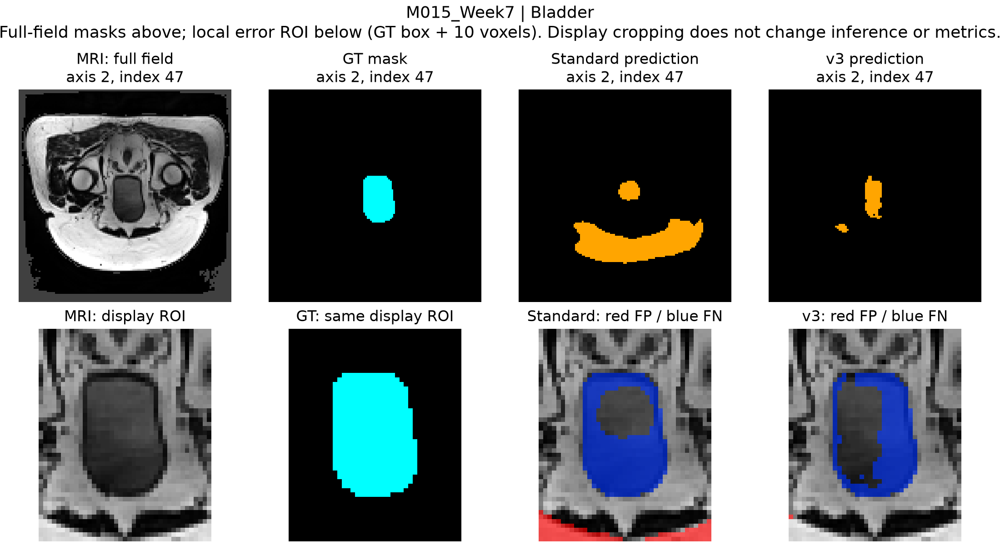
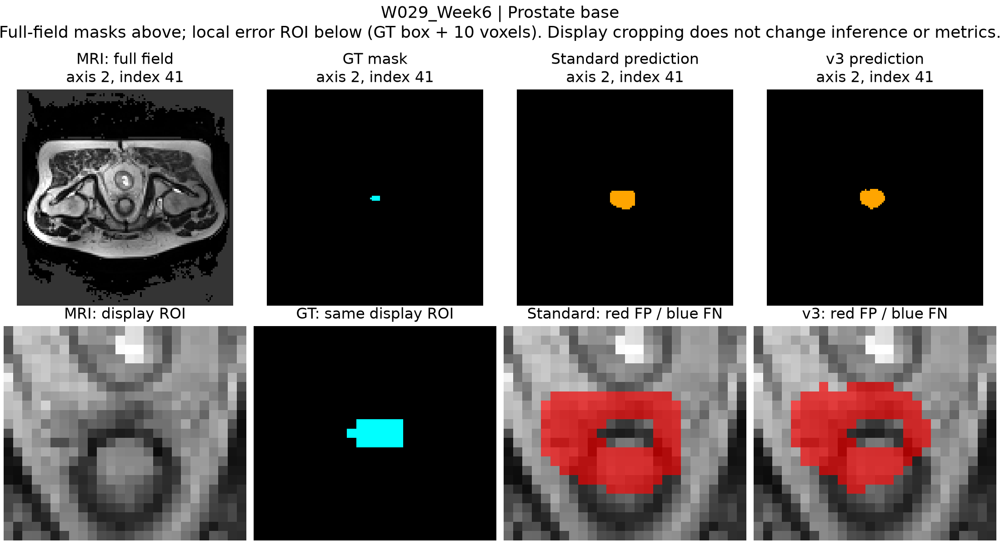
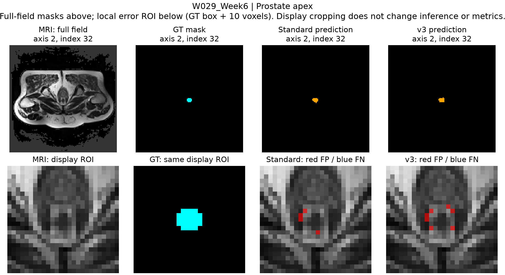
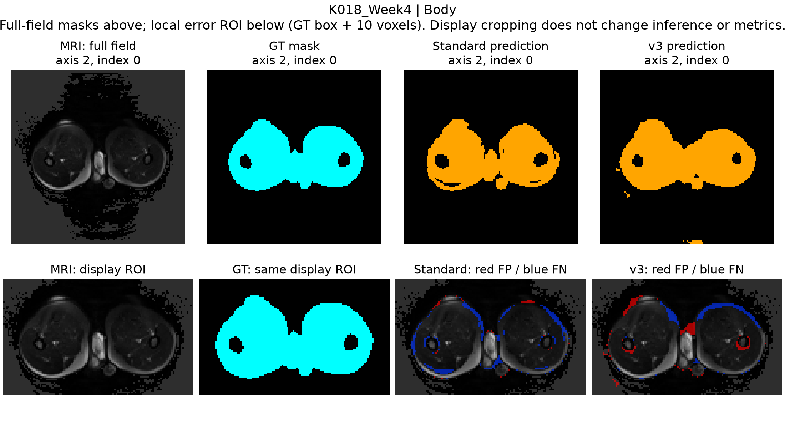
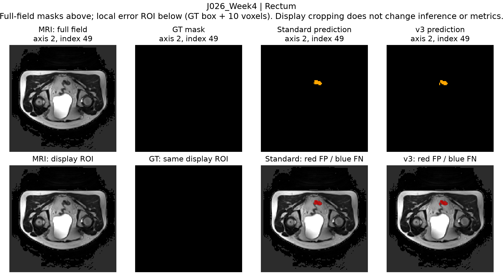
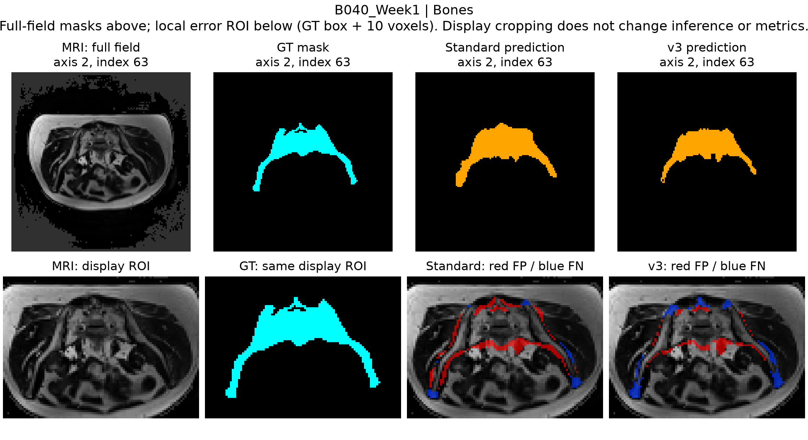

# HipMRI Segmentation: Spatial Continuity, Boundary Errors and Computational Cost

**COMP3710 Final Assessment | RuiJie Gong | Student ID: 49069239**

## Abstract

Ten 50-epoch U-Net runs were compared on HipMRI using patient-disjoint splits: 26 Train, 6 Validation and 6 Test patients. Each run was evaluated at its best measured Validation checkpoint. Improved v3 was the best-performing model in the initial Improved series and had the highest Validation small-organ Dice across all ten runs, 0.8564, compared with 0.8502 for Standard 3D. On the previously inspected Test cohort, their small-organ Dice values were 0.8145 and 0.7851, and prostate Dice values were 0.7485 and 0.7433. Both 3D models had higher prostate base/apex slice Dice and fewer visits with internal prediction gaps than the supplementary 2D configuration. Relative to Standard, however, v3 had lower mean base/apex slice Dice and more adjacent-organ confusion. Its median prostate 95th-percentile Hausdorff distance (HD95) was lower, 6.65 versus 7.98 mm, but its maximum was higher, 115.37 versus 19.23 mm. Peak allocated inference memory on one reference case was 0.3458 GiB for v3, 0.2460 GiB for Standard and 0.0761 GiB for 2D. v3 remains the choice under the original Validation endpoint, with Standard retained for boundary comparison. These results do not establish autonomous contouring performance: Test had been inspected, each evaluation split contained only six patients, and no external-cohort or independent-seed replication was completed.

## 1. Introduction

This study examines whether volumetric continuity or multiscale context reduces boundary and slice-transition errors that whole-organ Dice can conceal. It measures prostate base/apex overlap, bladder/rectum class confusion, disconnected predictions and computational cost in HipMRI magnetic resonance imaging (MRI) data. The 3D Improved U-Net with residual units and multiscale outputs is compared primarily with an implemented Standard 3D U-Net; a separately trained 2D U-Net provides supplementary context. The model choices follow the baseline allowance and Hard-route description on pages 5-6 of the course specification.

| Course investigation | Research question measured in this study | Results and corresponding discussion |
|---|---|---|
| Volumetric continuity versus slice-wise processing | Do the tested 3D configurations improve prostate base/apex overlap and slice continuity over the supplementary 2D configuration? | [Regional overlap, gaps and adjacent-slice area change](#35-prostate-regions-slice-continuity-and-adjacent-organ-confusion); [interpretation of the 2D/3D comparison](#41-spatial-continuity-in-the-tested-2d-and-3d-configurations) |
| Local boundary errors concealed by global overlap | Does Improved v3 improve prostate ends, adjacent-organ separation and surface-error extremes over Standard 3D, in addition to whole-organ Dice? | [Per-class overlap](#32-per-class-test-overlap-and-precisionrecall), [surface errors](#33-surface-distances-and-distant-body-predictions) and [five MRI cases](#36-case-level-error-analysis); [boundary comparison](#42-mean-overlap-gains-and-persistent-boundary-errors) |
| Anatomical benefit versus computation | What additional inference memory and latency accompany the measured 3D results, and which uses remain unsupported by the observed errors? | [Measured resources](#34-parameter-count-gpu-memory-and-inference-time); [cost interpretation](#43-measured-inference-cost-and-profiling-scope) and [engineering recommendation](#46-engineering-recommendation-for-the-prototype) |

The comparisons address spatial continuity, local boundary errors and inference cost. The 2D run also differs in sampling, width and class weights, so its contrast with 3D cannot isolate the effect of volumetric convolution. The adjacent-organ statistic counts ground-truth (GT) Bladder/Rectum voxels predicted as Prostate; it does not measure wall invasion, radiation dose or treatment outcomes.

**Supplementary material.** [Appendix A](#appendix-a-software-environment-and-reproduction-commands) documents the software environment and commands for training, evaluation and PDF generation. [Appendix B](#appendix-b-evidence-files-and-requirement-coverage) identifies the submitted evidence and its coverage of the coursework requirements. [Appendix C](#appendix-c-feasibility-review) contains the one-page feasibility review required by the specification.

Checkpoint selection used Validation. Test was inspected during the research process; its results are descriptive rather than a new blind evaluation.

## 2. Materials and methods

### 2.1 Dataset audit and preprocessing

**Audit sequence.** Pretraining checks covered MRI/mask pairing, factor-two preprocessing, sampled patches and two-patch optimiser behaviour. The initial audit decoded only Train arrays. Validation/Test filenames were inventoried to check the split; their label distributions did not guide the training recipe.

| Check before formal cohort training | Evidence and decision |
|---|---|
| Cohort and mechanical integrity | All 143 Train MRI/mask pairs from 26 patients were audited; no inventory/case errors, non-finite values or illegal labels were found. All six labels occurred in every Train volume; no identical-file hash groups were found within Train. |
| Geometry and gross alignment | Every MRI/mask affine matched exactly. All Train MRI used LPS orientation and millimetres; 142 volumes were 256x256x128 and one was 256x256x144. Two axial overlays per volume showed no obvious gross displacement. This screen did not certify every local contour. |
| Documented metadata warning | All 143 mask headers left spatial units unspecified. Matching grids, affines and spacings supported using the paired MRI geometry; the unspecified mask units remain a source-data limitation. |
| Distribution and supervision | Train-only counts showed Background 59.99%, Body 35.75%, Bones 3.41%, Bladder 0.60%, Rectum 0.15% and Prostate 0.11%. Visit counts varied from 1 to 8 per patient. This motivated patient-balanced sampling and Train-derived cross-entropy (CE) weights. |
| Actual preprocessing | The factor-two pipeline processed 143/143 Train cases without errors; all small organs survived. The ratio of Prostate physical label volume after to before resampling ranged from 0.9383 to 1.0423. Normalised nonzero MRI values had mean approximately 0 and standard deviation approximately 1. Organ survival did not establish preservation of thin boundaries. |
| Delivered samples and learning checks | Patient-balanced CPU sampling/tensor checks preceded a paired GPU optimiser smoke and full-volume capacity probe. In a controlled two-patch, 500-update check, unweighted CE left Standard predicting no Bladder, Rectum or Prostate voxels. Weighted CE produced same-patch Dice of 0.9843, 0.9796 and 0.9722 for these organs, respectively. This supported weighted CE for training; same-patch scores do not estimate unseen-patient accuracy. |

**Pretraining decision.** The checks found matching paired geometry, preserved labels, finite model inputs, working sampling and a functioning optimiser/inference path. This supported controlled training. These checks did not include expert review of every contour, and downsampling could still remove millimetre-scale detail. Numerical summaries and audit hashes are in `evidence/provenance.json` under `pretraining_review`.

| Split | Patients | Volumes | Purpose |
|---|---|---|---|
| Train | 26 | 143 | Optimisation and Train-derived weights |
| Validation | 6 | 38 | Checkpoint selection and diagnosis |
| Existing Test | 6 | 30 | Descriptive fixed-checkpoint evaluation |

`config/patient_split.json` records the fixed patient lists and their provenance: the previously approved split was preserved for comparability with the pre-restart experiments, rather than drawn again for this submission. Train contains 26 of 38 patients (68.4%); Validation and Test each contain six (15.8%). Keeping all visits from a patient together prevents within-patient visits from crossing the optimisation/evaluation boundary. Retaining this split also permits the ten runs to be compared on the same patients. The retained record does not document the original randomisation procedure or clinical stratification, so neither is claimed here. Six patients per evaluation split limits population-level conclusions.

Files are paired by patient/week. `dataset.py` checks matching 3D shape, affine and voxel spacing, finite arrays and integer labels 0-5. MRI must declare millimetres; matching masks with unknown spatial units are accepted as a documented source-metadata limitation. Metadata agreement is not expert confirmation of anatomy.

MRI and mask are jointly downsampled by (2,2,2). Output centre j samples source centre `(j+0.5)*2-0.5`; the affine uses the same transform. MRI interpolation is linear, mask nearest-neighbour; lost labels trigger failure. Image-only nonzero Z-score preserves outside zeros. The GT mask never defines the region used for prediction.

Arrays use X/Y/Z voxel order until conversion to channel/depth/height/width (CDHW) model input. High-end zero padding makes dimensions divisible by 16 and is removed before metrics/export. Evaluation is on the downsampled physical grid, not original resolution. Cross-entropy (CE) takes integer labels; Dice converts them to six-channel one-hot internally; `one_hot()` is also available.

Keep raw files outside Git:

```text
HipMRI_Study_open/
  semantic_MRs/PatientID_WeekN_LFOV.nii.gz
  semantic_labels_only/PatientID_WeekN_SEMANTIC.nii.gz
```

### 2.2 Network architectures

**Architecture specification.** Standard uses volumetric convolution and encoder-decoder skips, drawing on U-Net and 3D U-Net [1,2]. Improved uses residual context blocks and multiscale outputs, drawing on Isensee et al. [3]. Both implementations start at eight channels and use one-group GroupNorm (GN1) where specified below. Section 3.4 reports inference memory; no width search was performed. The table describes the implemented models, which differ from the cited architectures.

| Property | Standard 3D U-Net | Improved 3D U-Net v3 |
|---|---|---|
| Input and output | One MRI channel; six class logits | One MRI channel; six combined class logits |
| Feature hierarchy | Five resolutions, channels 8,16,32,64,128; four downsampling steps | Same five resolutions and channel widths |
| Encoder stage | Two 3x3x3 convolutions, each followed by GN1 and ReLU | 3x3x3 stem; a residual context block at every resolution |
| Downsampling | 2x2x2 max pooling, stride 2 | 3x3x3 convolution, stride 2, padding 1; channels double |
| Decoder step | 2x2x2 transposed convolution, stride 2; concatenate matching encoder features; two-convolution block | Nearest-neighbour upsampling to the skip grid, 3x3x3 channel reduction and LeakyReLU; concatenate matching context features; localisation block |
| Localisation / block details | 3x3x3 convolutions use padding 1 and no bias | Localisation: 3x3x3 convolution on 2C channels, GN1 and LeakyReLU, then 1x1x1 reduction to C |
| Normalisation and activation | GN(1,C), epsilon 1e-5, learned scale/offset; ReLU | Fourteen GN(1,C) sites, epsilon 1e-5, learned scale/offset; LeakyReLU slope 0.01 |
| Residual and regularisation | No residual blocks or dropout | Five identity residual blocks; Dropout3d probability 0.3 between each block's two convolutions, active during training |
| Segmentation heads | One 1x1x1 convolution at full resolution | 1x1x1 heads at full, half and quarter resolution; resize the latter two and sum the logits |
| Trainable parameters | 1,412,550 | 2,366,946 |

For a training patch, both encoders follow this spatial/channel schedule. Sizes are X/Y/Z voxels; the implementation receives Bx1x32x64x64 after conversion to depth/height/width order. B is batch size.

| Encoder level | Channels | Patch feature size X/Y/Z |
|---|---|---|
| Full resolution | 8 | 64x64x32 |
| Half resolution | 16 | 32x32x16 |
| Quarter resolution | 32 | 16x16x8 |
| One eighth | 64 | 8x8x4 |
| Bottleneck, one sixteenth | 128 | 4x4x2 |

The decoder reverses this hierarchy, using four feature-concatenation skips, and ends with Bx6x32x64x64 logits for a training patch. Evaluation accepts a larger padded whole volume with the same channel hierarchy; this is not a fixed patch-size inference model.

**The v3 residual block.** For feature tensor x with C channels, the branch applies GN1 -> LeakyReLU -> 3x3x3 convolution -> Dropout3d -> GN1 -> LeakyReLU -> 3x3x3 convolution, then adds the original x. The spatial convolutions use stride 1 and padding 1. GN1 normalises across channels and spatial positions within each sample, not across the batch. v1 instead used per-channel InstanceNorm. The input-context and head-output experiments are reported in Section 4.4; the normalisation definition alone does not identify the cause of a prediction error.

**Output fusion and supervision.** The full-resolution head sees eight decoder channels; the half- and quarter-resolution heads see 16 and 32. Auxiliary logits are resized to the main grid by trilinear interpolation with `align_corners=False`. Training and inference both use `combined = main + resized_half + resized_quarter`; one loss is applied to this sum, so all three heads receive gradients. This is additive multiscale supervision, not the independent head losses of v2. Class order is Background, Body, Bones, Bladder, Rectum, Prostate. Softmax supplies probabilities for the Dice loss; inference uses the largest combined logit per voxel.


### 2.3 Loss function, training and checkpoint selection

Both models use random seed 371017 and the Adam optimiser, with a fixed learning rate of 0.001 and no weight decay. One shuffled/cycled visit per Train patient supplies ten uniform 64x64x32 XYZ patches per epoch: 260 patches, batch size 2, 130 updates; 50 epochs yield 6,500 updates. The submission preserves the deterministic visit/crop/batch schedule. Exact GPU rerun weights are not guaranteed across kernels, hardware and library versions.

Loss is `0.5 * weighted_cross_entropy + 0.5 * foreground_soft_Dice_loss`. Background remains in CE but is excluded from Dice. CE weights derived from Train data are `[1.453871, 1, 2.617199, 4.498586, 8.893215, 9.699950]` in label order. The selected weights came from Train patch exposure and the controlled two-patch learning check described in Section 2.1. The v5-L comparison tests a change to the three small-organ weights; its observed Validation and Test scores are reported in Section 3.1. Training loss and evaluation Dice are reported separately.

Validation runs every five epochs. Pool confusion matrices across visits within each patient; compute Bladder/Rectum/Prostate Dice, average within patient, then average six patients equally. Choose the highest score at measured epochs 5,10,...,50, with earlier ties. The intermediate epochs were not all evaluated. Both selected checkpoints happen to be epoch 50.


### 2.4 Experimental development and model selection

**Completed runs and evaluation budget.** Ten formal runs completed 50 epochs each: Standard, supplementary 2D, v1, v2, v3, A0, A1 and v5-C/L/S. Tiny-batch checks, inference probes and sampler audits were diagnostics. Train exposure and Validation predictions guided later experiments. The configuration changes below identify what was tested, but a result cannot by itself establish the cause of an error. Standard, v1 and 2D were extended from 40 to 50 epochs, so the final comparison uses the same total epoch budget. Earlier fixed-epoch mechanism checks are separate from the final comparison of each run's best measured Validation checkpoint (Section 3).

**Initial comparison and subsequent diagnostics.** Standard and the first Improved network, later called v1, used the same patient-balanced 3D crops, loss, split and optimisation recipe. v1 added residual context, InstanceNorm, dropout and additive output heads. After training, we examined per-class Validation confusion counts, precision/recall, physical Body surfaces and MRI overlays alongside the loss curves. Fixed predictions were reproduced before further measurements so that checkpoint or preprocessing changes would not affect the diagnosis.

The v1 investigation examined boundary/background exposure, output-head coupling, imbalance weights and normalisation/input extent as possible contributors. Train audits measured sampler exposure; fixed-weight Validation probes compared full-volume and sliding-window inference and inspected individual heads. These probes did not retrain the architecture. A head-replay control failed its numerical-equivalence threshold and was excluded from causal interpretation. v2, v3 and later branches changed the factors listed below.

| Run / parent | Design decision and question tested | Comparison logic |
|---|---|---|
| Standard / initial reference | Basic 3D U-Net, GN1, one head; establish a volumetric baseline under the verified pipeline | Same 3D split, patch schedule, objective and update budget as v1 |
| v1 / initial Improved | Residual context, InstanceNorm, dropout 0.3 and summed multiscale logits; test the contextual Hard architecture | Several components differ from Standard, so the aggregate contrast cannot identify one causal component |
| 2D / supplementary branch | Width-16 slice U-Net; four uniform plus two crops per small organ per patient, with its own Train-derived weights | Slice-only context and lower resource use provide an engineering reference; different width/sampling/weights prevent a pure dimensionality ablation |
| v2 / v1 | Train main, half and quarter heads independently: `(Lmain + 0.5 Lhalf + 0.25 Lquarter) / 1.75`; use the main head at inference | Tests whether individually useful heads avoid reliance on summed predictions; keeps v1's backbone and InstanceNorm. Training supervision and inference output change together |
| v3 / v1 | Replace all 14 InstanceNorm sites with GN1; retain v1's residual blocks, dropout, additive heads and loss | Normalisation is the only declared recipe change from v1; the comparison uses a historical single-run reference. v2's independent losses are not used |
| A0 / v3 | AdamW, decay 1e-5 excluding bias/normalisation, cosine learning rate from 0.001 towards 1e-5 over 6,500 updates | Tests a conventional optimisation/regularisation package; the combined changes cannot isolate decay from optimiser or schedule |
| A1 / A0 | With probability 0.3, apply paired physical-axis rotations up to 10 degrees and isotropic scaling 0.9-1.1; linear MRI and nearest-neighbour mask interpolation | A1-A0 tests this specific spatial augmentation under the AdamW/cosine recipe. A Train-only 26-patient geometry/exposure audit and real previews preceded training |
| v5-C / v3 | Concurrent run using the original v3 settings and nominal seed | Provides a contemporary control for L/S and reveals same-recipe run variation; this is not an independent-seed replication |
| v5-L / C | Compress only the three small-organ CE weights by square root: 4.498586/8.893215/9.699950 become 2.120987/2.982149/3.114474 | Tests a less aggressive imbalance penalty while retaining Adam, constant learning rate, architecture and sampling |
| v5-S / C | Retain Adam and zero decay; change only the learning-rate rule to cosine over 6,500 updates, towards 1e-5 | Separates the schedule question from A0's additional optimiser/decay changes |

**Sequence of revisions.** v2 changed head supervision and inference output after the v1 head-output diagnostic. Its best Validation small-organ score was below v1's, as recorded in Section 3.1. v3 therefore retained v1's additive outputs while replacing InstanceNorm with GN1. A0/A1 then tested optimiser/decay/schedule changes and paired spatial augmentation around the v3 architecture. The A1 Train-only audit covered 26 patients and six real previews, with gates for small-organ exposure and out-of-volume sampling; it preceded A1 training and did not measure segmentation accuracy. C/L/S subsequently separated the learning-rate schedule and small-organ CE weights under a concurrent v3-recipe control. The Train edge-sampling candidate was audited but never trained as a formal segmentation run and is not counted among the ten models.

**Selection of the submitted model pair.** Patient-equal Validation Dice for Bladder, Rectum and Prostate, measured every five epochs, was the selection endpoint. Comparing each run's best measured checkpoint places v3 first across all ten runs and the initial Improved series: 0.8564 versus 0.8502 for Standard and 0.8542 for the later same-recipe C run. Its Validation Body HD95 median was 4.58 mm, compared with 76.61 mm for v1 (Section 3.3). Standard remains the baseline; it has fewer parameters, lower measured peak inference memory and different Test boundary outcomes (Sections 3.3-3.5). C had higher Test prostate Dice, but changing the selection rule after inspecting Test would be inappropriate. v3 is the Validation-selected research candidate, not the best model on every metric or a clinically approved model.

### 2.5 Evaluation protocol and study limitations

All models use identical patient splits and evaluation grids. 3D inference processes the complete downsampled volume once, not sliding windows. The supplementary 2D model processes slices and reconstructs a volume. A 3D training patch contains 131,072 voxels (64x64x32), whereas a 2D crop contains 4,096 pixels (64x64); equal epoch/update counts do not equalise processed input elements or computation. No GT-dependent post-processing is used. Taking the largest class logit gives the same class as applying softmax first.

TP, FP and FN denote true positives, false positives and false negatives. Dice=`2TP/(2TP+FP+FN)`, intersection over union (IoU)=`TP/(TP+FP+FN)`, precision=`TP/(TP+FP)`, recall=`TP/(TP+FN)`. If a class is absent from both prediction and GT, its overlap is recorded as unavailable rather than perfect. Primary overlap tables pool visits within patients before averaging patients. The foreground mean gives equal weight to labels 1-5; Background remains in the six-class table. The supplementary post-hoc 50% prostate-weighted score is not a selection rule or official course criterion.

The 95th-percentile Hausdorff distance (HD95) and average symmetric surface distance (ASSD) use concatenated directed distances between six-connected mask surfaces, in physical millimetres. HD95 is the 95th percentile; ASSD here is their combined mean. Empty-mask statuses are explicit and null, never zero distance. All five foreground masks were present in all 680 fixed-audit case/model entries. Surface medians/maxima below summarise volumes, unlike patient-equal overlap. The saved distances use this surface convention. The evaluation code rejects sheared grids rather than applying spacing-only Euclidean distances to them.

**Test has already been repeatedly inspected.** Checkpoints were chosen using Validation. Because Test has already been examined, it is not a fresh blind holdout and should not guide further tuning. Six patients, not 30 correlated visits, are the independent Test units. No external cohort or independent multi-seed replication was completed.

## 3. Results

### 3.1 Validation-selected checkpoints across ten runs

Every model in the table completed 50 training epochs. The submitted runtime implements Standard and v3; the other runs provide experimental comparisons, including unsuccessful changes.

| Model | Best epoch | Validation small organs | Test small organs | Test foreground five | Test Prostate |
| --- | --- | --- | --- | --- | --- |
| 2D | 50 | 0.7757 | 0.7082 | 0.7883 | 0.6611 |
| Standard | 50 | 0.8502 | 0.7851 | 0.8370 | 0.7433 |
| v1 | 50 | 0.8420 | 0.8078 | 0.8502 | 0.7520 |
| v2 | 45 | 0.8362 | 0.7959 | 0.8422 | 0.7478 |
| v3 | 50 | 0.8564 | 0.8145 | 0.8631 | 0.7485 |
| A0 | 45 | 0.8450 | 0.7836 | 0.8400 | 0.7318 |
| A1 | 45 | 0.8298 | 0.7801 | 0.8362 | 0.7273 |
| v5-C | 50 | 0.8542 | 0.8040 | 0.8557 | 0.7633 |
| v5-L | 45 | 0.8426 | 0.7858 | 0.8388 | 0.7361 |
| v5-S | 45 | 0.8465 | 0.7788 | 0.8350 | 0.7281 |

**A1 augmentation result (design in Section 2.4).** The best Validation small-organ Dice decreased from 0.8450 to 0.8298, and existing Test Dice from 0.7836 to 0.7801. Validation distant Background-to-Body voxel counts decreased from 9,572 to 1,171; the corresponding Test counts decreased from 9,636 to 535. These are sums over volumes, not patient-equal rates. The lower counts occurred alongside the lower small-organ Dice values. This result concerns one tested augmentation scheme and training budget; it does not show that data augmentation is generally ineffective.

v3's Test small-organ gain over Standard is +0.0294, but only 3/6 patients improve; excluding influential M015 changes the contrast to approximately -0.0050. Validation improves for 5/6 patients. These descriptive sensitivities do not establish population superiority. C's higher Test prostate Dice is reported without switching the primary selection rule after seeing Test.

### 3.2 Per-class Test overlap and precision/recall

| Class | Std Dice | v3 Dice | Std IoU | v3 IoU | Precision Std / v3 | Recall Std / v3 |
| --- | --- | --- | --- | --- | --- | --- |
| Background | 0.9904 | 0.9885 | 0.9814 | 0.9778 | 0.9952 / 0.9961 | 0.9858 / 0.9814 |
| Body | 0.9677 | 0.9732 | 0.9384 | 0.9484 | 0.9748 / 0.9664 | 0.9610 / 0.9807 |
| Bones | 0.8619 | 0.8988 | 0.7578 | 0.8168 | 0.7868 / 0.8793 | 0.9543 / 0.9205 |
| Bladder | 0.7993 | 0.8539 | 0.7455 | 0.7768 | 0.7871 / 0.8807 | 0.8229 / 0.8598 |
| Rectum | 0.8128 | 0.8410 | 0.6918 | 0.7280 | 0.7898 / 0.8086 | 0.8414 / 0.8784 |
| Prostate | 0.7433 | 0.7485 | 0.6081 | 0.6193 | 0.7189 / 0.6983 | 0.8415 / 0.8516 |


v3 had higher patient-equal Test Dice for all five foreground classes. The prostate difference was about 0.0052, while its precision was lower: 0.6983 versus 0.7189. W029_Week6 also had lower whole-volume prostate Dice with v3.

### 3.3 Surface distances and distant Body predictions

| Class | Median HD95 Std / v3 mm | Worst HD95 Std / v3 mm | Median ASSD Std / v3 mm |
| --- | --- | --- | --- |
| Body | 4.86 / 4.50 | 18.72 / 22.23 | 1.21 / 1.66 |
| Bones | 7.46 / 4.58 | 18.97 / 19.02 | 2.69 / 1.83 |
| Bladder | 3.36 / 3.89 | 109.49 / 72.36 | 1.38 / 1.51 |
| Rectum | 7.06 / 7.28 | 38.56 / 109.19 | 2.46 / 2.09 |
| Prostate | 7.98 / 6.65 | 19.23 / 115.37 | 3.45 / 2.73 |

Median prostate HD95 was 7.98 mm for Standard and 6.65 mm for v3, while the worst value was 19.23 and 115.37 mm, respectively. Maximum Body HD95 was 18.72/22.23 mm and maximum Rectum HD95 was 38.56/109.19 mm for Standard/v3. v3's Test prostate (0.7485), small-organ (0.8145) and foreground (0.8631) mean Dice values exceed the Hard-route target of 0.7. The specification does not define how that target should be aggregated, and one of six Test patients had prostate Dice below 0.7. Mean scores do not establish per-patient attainment or local contour safety.


The following additional Body measurements come from the selected-checkpoint records. Distant false predictions count GT Background voxels labelled Body at least 20 mm from GT Body. Counts are summed over the 38 Validation or 30 Test volumes; they are not patient-equal scores.

| Model | Validation median Body HD95 (mm) | Validation distant Body FP voxels | Test distant Body FP voxels |
|---|---|---|---|
| Standard | 4.75 | 1,007 | 2,804 |
| v1 | 76.61 | 1,358,516 | 667,239 |
| v3 | 4.58 | 73,204 | 81,145 |

v3 had a lower Validation median Body HD95 and fewer distant Body false predictions than v1, although its distant-voxel counts exceeded Standard on both splits. Unrounded counts and source identities are in `evidence/provenance.json` under `report_diagnostic_summaries`.

### 3.4 Parameter count, GPU memory and inference time

| Model | Parameters | Peak inference GiB | Reference latency s |
| --- | --- | --- | --- |
| 2D | 1,942,374 | 0.0761 | 0.1395 |
| Standard | 1,412,550 | 0.2460 | 0.1552 |
| v3 | 2,366,946 | 0.3458 | 0.1452 |

The reference benchmark used an NVIDIA A100-PCIE-40GB, prepared Validation case K008_Week0, three warm-ups, five repetitions and one resident model. Latency includes transfer, execution, argmax and conversion; it excludes decoding, preprocessing, metrics and file I/O. Peak figures measure allocated inference memory, not training memory or total device use. Repetition timings and patient records are in `evidence/experiments.json`.

The cohort summary uses one separate inference pass per volume. Validation contains 38 volumes from six patients and Test contains 30 from six. Quartiles and P95 are calculated across volumes with linear interpolation. These timing summaries weight volumes equally; segmentation summaries elsewhere weight patients equally.

| Model | Split | Median latency s | Q1-Q3 s | P95 s | Maximum peak allocated GiB |
|---|---|---|---|---|---|
| 2D | Validation | 0.1412 | 0.1406-0.1415 | 0.1417 | 0.0761 |
| 2D | Test | 0.1401 | 0.1394-0.1410 | 0.1414 | 0.0761 |
| Standard | Validation | 0.1733 | 0.1722-0.1737 | 0.1744 | 0.2460 |
| Standard | Test | 0.1740 | 0.1700-0.1744 | 0.1747 | 0.2460 |
| v3 | Validation | 0.1669 | 0.1665-0.1671 | 0.1675 | 0.3458 |
| v3 | Test | 0.1666 | 0.1665-0.1668 | 0.1670 | 0.3458 |

Inputs were prepared in RAM before each pass; execution was GPU-synchronised, peak allocated memory was reset per case, and the model remained resident. These timings exclude file loading, preprocessing and metrics. The cohort and five-repeat reference protocols measure different quantities and should be reported separately. Unrounded values are in `evidence/cohort_inference_summary.json`.

The supplementary 2D model segments slices independently and used 0.0761 GiB in the reference inference measurement. The 3D models process the full downsampled volume. End-region, continuity and distant-component results come from measured predictions. The 2D arm also differs in sampling, class weights and width, so it does not isolate dimensionality or address the separate Easy-route dataset/target. Measurements of prostate end regions, nearby organs at risk (OAR) and changes between adjacent slices are in `evidence/experiments.json`.


### 3.5 Prostate regions, slice continuity and adjacent-organ confusion

These diagnostics were calculated from the predictions and geometry records already saved for the 30 Test volumes. They do not involve new inference, tuning or checkpoint selection.

| Existing Test diagnostic | 2D | Standard 3D | Improved v3 |
|---|---|---|---|
| Apex mean slice Dice | 0.5186 | 0.7544 | 0.7523 |
| Central mean slice Dice | 0.7125 | 0.7824 | 0.7931 |
| Base mean slice Dice | 0.3473 | 0.5097 | 0.5069 |
| Visits with an internal predicted prostate gap (%) | 43.75 | 0.00 | 8.33 |
| Adjacent-area transition error (dimensionless) | 0.1953 | 0.0685 | 0.0720 |
| GT Bladder/Rectum voxels labelled Prostate (%) | 0.386 | 0.485 | 0.580 |

End-region values average GT-positive slice Dice within each visit, then visits within each patient, and finally the six patients equally. Base and apex are the physically superior and inferior 20% of GT-positive slices: geometric proxies rather than clinician-defined regions. These slice averages differ from the pooled whole-organ Dice in Section 3.2.

The gap statistic is the patient-equal mean fraction of visits with an empty predicted Z slice between nonempty predicted prostate slices. The GT has no such gaps in this cohort. It counts missing intermediate predicted slices, not correct anatomical placement. The area-transition error is the absolute difference between prediction and GT mean normalized adjacent-area changes on GT-positive adjacent slice pairs. It is a descriptive shape-change measure, not a validated anatomical quality score.

The adjacent-organ percentage pools counts within each patient before averaging patients. Its denominator is all GT Bladder/Rectum voxels, and its numerator is those labelled as Prostate. It measures class confusion. Wall-specific regions and clinical severity thresholds were not annotated, and no dose measurement was made. Definitions and unrounded values are in `evidence/spatial_context_summary.json`.

**Regional comparison.** Standard and v3 had higher apex/base overlap and fewer internal gaps than this 2D configuration. Against Standard, v3's higher overlap was concentrated in central slices: the central mean was 0.7931 versus 0.7824, while apex/base means were slightly lower. Its internal-gap fraction was 8.33% versus 0.00%, and adjacent-organ confusion was higher.

### 3.6 Case-level error analysis

Five purposively selected cases show different error patterns; they do not estimate how often those patterns occur. M015 is an extreme failure, while the Rectum and Bones cases show local errors despite higher whole-volume scores. The panels use real MRI and the selected Standard/v3 checkpoints. The prediction and panel checks are documented in Appendix A.4.

**Reading the panels.** Each figure concerns one target class. In the upper row, MRI is followed by the target's binary GT mask (cyan) and Standard/v3 predictions (orange). Black in a mask panel means "not this target class"; it does not mean missing MRI or missing annotations for every class. The lower row shows MRI, GT and red FP/blue FN overlays in the same display region. The region is the 2D GT bounding box plus ten voxels; when the target GT is absent, the full field is retained. Display crops do not affect inference or metrics. Physical pixel aspect is preserved; axis 2 is axial Z and indices are zero-based on the downsampled grid.

The fixed slices were taken from the previously documented cases: M015 z=47, W029 base z=41 and apex z=32, K018 z=0, J026 z=49, and B040 z=63. They were not reselected to favour v3. The Body, Rectum and Bones views retain earlier A1-error-selected planes; this remains purposive rather than random sampling. Prostate base/apex uses physical superior/inferior ordering as a geometric proxy, not expert end-region annotation.

**Scope of the measurements.** Dice, surface distances and voxel counts below describe the whole volume unless explicitly labelled as a prostate-region mean. They are not scores for the displayed slice or crop. FP/FN are disagreements with the supplied labels, not expert adjudications of the true anatomical boundary. No case-specific controlled experiment established a unique anatomical, intensity or model mechanism for these errors.

#### 3.6.1 M015_Week7, Test: extreme bladder mismatch



**Observed error and measurements.** Standard predicts Bladder well outside the GT region and misses much of the labelled target. v3 reduces whole-volume Bladder FP from 24,513 to 752 voxels, but still misses 2,951 of the 4,976 GT voxels. Dice is 0.0676 Standard versus 0.5224 v3; HD95 is 109.49 versus 58.84 mm.

**Selection and interpretation.** This is Standard's lowest Bladder Dice among the 30 Test volumes, so it illustrates severe failure rather than typical performance. The patient sensitivity analysis in Section 4.5 shows why this case should not be generalised to every patient. The records do not isolate anatomy, intensity or annotation effects as its cause. The remaining missed bladder extent warrants manual inspection; higher Dice alone does not resolve this case.

#### 3.6.2 W029_Week6, Test: prostate base overprediction and apex comparison





**Observed error and measurements.** Both base predictions extend beyond the small GT cross-section. Standard/v3 base-region mean slice Dice is 0.2111/0.2158, whereas apex-region Dice is 0.7272/0.8274. The apex comparison therefore shows a v3 gain, not failure of both ends to the same degree. Whole-volume prostate Dice is 0.4623/0.4377 and HD95 is 19.23/20.59 mm; whole-volume FP increases from 895 to 1,026 voxels.

**Interpretation and use.** These regional means cover the geometric end regions, not only the two displayed planes. The base remains poorly matched despite the apex improvement. Both drafts require end-region inspection, particularly excess base extent. No controlled test established the trigger, and the images do not establish which neighbouring tissue receives dose or whether a clinical wall is invaded.

#### 3.6.3 K018_Week4, Validation: Body boundary errors despite similar Dice



**Observed error and measurements.** The displayed masks and overlays retain Body FP and FN. Standard/v3 whole-volume Body Dice is almost equal (0.9740/0.9742), but HD95 is 4.75/6.24 mm and Background-to-Body predictions at least 20 mm from GT Body total 5/3,128 voxels. The latter counts come from whole-volume distance analysis; the display does not label every visible FP as at least 20 mm away.

**Interpretation and use.** The slice lies at the image-grid boundary, which is not an anatomical endpoint of the body. The case demonstrates why a similar Dice cannot replace full-volume inspection for extra predictions. The v1 fixed-weight input-context diagnostic on this visit is discussed separately in Section 4.4; it does not establish the cause of v3's errors. Check the complete prediction field rather than accepting the displayed slice as a complete component audit.

#### 3.6.4 J026_Week4, Validation: Rectum prediction on a GT-negative slice

**Why the GT panels are black.** On the selected z=49 plane, no voxel has the Rectum label. Both GT panels are therefore deliberately black, and the lower row repeats the full field because there is no target GT box to enlarge. Other anatomical classes are suppressed in these binary views. This is a false-positive example relative to the supplied annotation, not a missing-mask illustration.



**Measurements and interpretation.** The full volume contains 941 GT Rectum voxels on 23 axial slices; the label is not absent from the case. Standard/v3 whole-volume Dice is 0.8110/0.8437, ASSD is 2.00/1.73 mm and HD95 is 6.24 mm for both. Thus improved overlap and mean surface distance coexist with a nonempty prediction on this GT-negative plane. This example does not prove anatomical absence of rectum, annotation completeness or invasion of the rectal wall. Review the predicted extent against MRI and the supplied labels; the cause of the discrepancy remains unresolved.

#### 3.6.5 B040_Week1, Validation: bone FP/FN trade-off



**Observed error and measurements.** The selected plane retains both FP and FN relative to the Bones annotation. Standard/v3 whole-volume Dice is 0.8607/0.9026 and HD95 is 7.41/4.58 mm. However, FP decreases from 9,589 to 4,208 voxels while FN increases from 1,240 to 2,693. The overlap gain therefore does not imply improvement in both error types.

**Interpretation and use.** This illustrates residual errors in a case whose overall Bones scores improve, rather than an extreme failure of every metric. Missing as well as extra bone regions still require inspection. Bones is reported separately from the three-small-organ selection score; neither a tissue-intensity cause nor a dose consequence was established.

## 4. Discussion

### 4.1 Spatial continuity in the tested 2D and 3D configurations

Standard/v3 had Test whole-prostate Dice of 0.7433/0.7485, compared with 0.6611 for 2D. Apex slice Dice was 0.7544/0.7523 versus 0.5186, and base slice Dice was 0.5097/0.5069 versus 0.3473. The patient-equal fraction of visits with an internal predicted prostate gap was 0.00%/8.33%, compared with 43.75% for 2D. The tested 3D configurations differed from the 2D configuration at prostate ends and intermediate slices as well as in the central region.

Those differences do not isolate dimensionality: 2D also changed width, sampling and class weights. Base Dice remained approximately 0.51 for both 3D models, and the W029_Week6 panel retained end-region FP/FN. The existing records support a comparison of these configurations, not a causal estimate for adding 3D kernels alone.

### 4.2 Mean overlap gains and persistent boundary errors

v3 had higher Test mean Dice for all five foreground classes than Standard. For Prostate, Dice changed from 0.7433 to 0.7485, precision from 0.7189 to 0.6983 and recall from 0.8415 to 0.8516. Its median prostate HD95 was lower by about 1.33 mm, while its maximum was 115.37 mm rather than 19.23 mm. Whole-organ overlap and local boundary measures therefore gave different assessments.

The spatial diagnostics did not show an additional v3 advantage over Standard: apex/base means were slightly lower, the internal-gap fraction was higher, and the GT Bladder/Rectum-to-Prostate fraction was 0.580% rather than 0.485%. Test distant Body false predictions also remained higher: 81,145 versus 2,804 voxels. These measurements answer the boundary question with different outcomes for different metrics; higher mean foreground Dice did not coincide with fewer errors on all boundary measures. No clinical outcome can be inferred from the adjacent-organ proxy.

### 4.3 Measured inference cost and profiling scope

On K008_Week0 using an A100, Standard and v3 used 3.23 and 4.54 times the 2D model's peak allocated inference memory. v3 used 1.41 times Standard's memory. Median resident-model latency over five repetitions was 0.1452 s for v3 and 0.1552 s for Standard. These one-case measurements do not establish a general speed advantage.

The course's cost question is only partly measured. The controlled table concerns inference on factor-two-downsampled volumes, not a matched training-memory/time experiment. It therefore neither demonstrates a 5-10-fold training penalty nor estimates full-resolution deployment cost. v3 completed its recorded 50-epoch training job in 02:02:48, including Validation and checkpoint IO; that job wall time is not a controlled comparison of architecture-only training speed.

### 4.4 Validation diagnostics and limits of causal attribution

The earlier v1 had worse Body HD95 than Standard in all 38 Validation volumes; their medians were 76.61 and 4.75 mm. With v1 weights fixed, replacing the combined output by the main head alone changed patient-equal Validation small-organ Dice from 0.8420 to 0.2414 and median Body HD95 from 76.61 to 108.96 mm. The result documents dependence on the trained combined output; it does not show what a separately trained main-head architecture would achieve.

The fixed-weight four-case inference experiment also had nonuniform organ outcomes. On K018_Week4, sliding windows reduced distant Body FP from 58,078 to 18,650 voxels while the within-volume mean of the three small-organ Dice values fell from 0.7610 to 0.7158. The corresponding small-organ means also fell on K008_Week0 but rose on B040_Week4 and J026_Week4. These were four selected Validation cases, not an all-38 protocol comparison. A separate head-replay control failed its numerical-equivalence threshold, so its replay outputs were not accepted as mechanistic evidence.

v3 replaced InstanceNorm with GN1 in the v1 architecture. Its selected Validation Body median decreased to 4.58 mm and its small-organ score increased to 0.8564. This was the best Validation result in the initial Improved series, but the limited same-recipe replication cannot establish why v1 produced distant predictions. The exposure audit was not followed by an edge-sampling training run. A1/L/S were trained, but none exceeded v3's Validation score. The remaining errors therefore cannot be assigned to a specific untested cause. Head/window diagnostic values and source hashes are in `evidence/provenance.json` under `report_diagnostic_summaries`.

### 4.5 Patient-level variation and evaluation limitations

v3 exceeded Standard's primary Validation score for five of six patients, but exceeded its existing Test score for only three of six. Removing M015 changed the Test small-organ contrast from +0.0294 to approximately -0.0050. The same-recipe C run had Validation Dice 0.8542 rather than v3's 0.8564, while its Test prostate Dice was higher, 0.7633 rather than 0.7485. These recorded differences prevent ranking v3 first for every patient, metric or repeated run.

Checkpoints were selected using Validation, but Test was subsequently inspected repeatedly. No new holdout, external cohort or independent-seed study was completed. The Test set contains six patient units with 30 correlated visits; the report's patient-equal summaries avoid counting those visits as 30 independent patients. The current data do not estimate reliability in a different hospital or patient population.

### 4.6 Engineering recommendation for the prototype

For the coursework prototype, retain v3 under the original Validation small-organ selection rule and retain Standard as the implemented baseline. The observed v3 advantages are higher average Test foreground Dice and a lower median prostate HD95. The observed regressions include worse maximum prostate/rectum HD95, more internal prostate gaps than Standard and more distant Body FP. A decision based only on the average Dice would omit those regressions.

These results do not support unattended radiotherapy contouring. Research review of generated contours should inspect superior/inferior prostate slices, predictions entering labelled bladder/rectum regions, and disconnected or distant predictions. Correction time, clinician agreement and dose effects were not measured. Further experiments should use Train/Validation for development, reserve new patient data unused during development and disjoint from the training patients for final assessment, and repeat the comparison across seeds.

| Observed error | Consequence for this prototype | Review action before accepting a research contour |
|---|---|---|
| Base-region mean slice Dice about 0.51; W029_Week6 below 0.22 for both models | Whole-prostate Dice does not describe end-slice placement | Inspect physical superior/inferior extent and each end-region contour against MRI |
| v3 labels 0.580% of GT Bladder/Rectum voxels as Prostate versus 0.485% for Standard | The measured class confusion persists despite higher average prostate Dice | Inspect the prostate boundary next to bladder and rectum; the recorded proxy cannot certify wall separation |
| v3 maximum prostate HD95 115.37 mm and 81,145 distant Body FP voxels in Test | Typical surface scores omit large individual errors and distant components | Inspect the full 3D field and disconnected predictions, rather than only a central slice |
| M015_Week7 bladder Dice remains 0.5224 with v3 | Improvement over Standard does not make this case a reliable automatic draft | Review target localisation and missing bladder extent; manual correction burden is unmeasured |

## 5. Artificial Intelligence Usage Disclosure

OpenAI ChatGPT and Codex were used extensively for research planning, literature interpretation, model and experiment proposals, implementation, debugging, diagnostics, metric analysis, visualisation, report drafting and submission preparation. This included substantial code and text generation, not only language editing.

AI suggestions were treated as proposals requiring verification. Checks included patient-split and paired-geometry tests, loss/gradient and recovery tests, recomputation from integer confusion counts, and input/checkpoint/source hashes. GPU replays reproduced all 76 Standard/v3 Validation matrices and ten fixed model/case matrices; the actual prediction CLI was also checked. Reported metrics and MRI figures are tied to saved experimental outputs. Negative results and failed controls are retained; unresolved causes are not presented as findings.

I remain personally responsible for understanding, reviewing and defending every submitted architectural decision, code component, equation and experimental claim. The working rule is to disclose AI contributions, cite adapted sources, test generated work against reproducible evidence and limit conclusions to that evidence. AI assistance and automated checks do not themselves establish correctness or clinical utility.

## References

1. Ronneberger, Fischer and Brox. *U-Net: Convolutional Networks for Biomedical Image Segmentation*. 2015. https://arxiv.org/abs/1505.04597
2. Cicek et al. *3D U-Net: Learning Dense Volumetric Segmentation from Sparse Annotation*. 2016. https://arxiv.org/abs/1606.06650
3. Isensee et al. *Brain Tumor Segmentation and Radiomics Survival Prediction: Contribution to the BRATS 2017 Challenge*. 2018. https://arxiv.org/abs/1802.10508

The encoder-decoder and skip design draws on [1], the volumetric U-Net on [2], and the residual context blocks and multiscale outputs on [3]. GroupNorm, width, objective and preprocessing are project-specific choices. This implementation does not reproduce the cited systems exactly and uses no externally pretrained model.

## Appendix A. Software environment and reproduction commands

### A.1 Dependencies and installation

The local CPU tests used Python 3.11.16, PyTorch 2.13.0+cpu, NumPy 2.4.6, SciPy 1.17.1, nibabel 5.4.2 and Matplotlib 3.11.0. `requirements.txt` pins core packages. A later GPU documentation replay used Python 3.11.15, PyTorch 2.13.0+cu130 and NumPy 2.4.6 on an A100; the original training environment was not fully recorded. CUDA installations require a PyTorch wheel compatible with the compute environment. The installation commands below describe the procedure but were not tested as a fresh isolated CUDA setup.

The imported local versions and nine-test result are recorded in [evidence/local_environment.json](evidence/local_environment.json). This CPU check validates the package's tests and count-recalculation example; the separate GPU replay in A.4 validates agreement with the historical Validation predictions.

The table gives the versions captured during the local CPU tests and the GPU documentation replay on 22 October 2026.

| Component | Local CPU verification | GPU documentation replay, job 686318 |
|---|---|---|
| Python | 3.11.16 | 3.11.15 |
| PyTorch | 2.13.0+cpu | 2.13.0+cu130 |
| CUDA build / GPU | Not available | 13.0 / NVIDIA A100-PCIE-40GB |
| NumPy / SciPy | 2.4.6 / 1.17.1 | 2.4.6 / 1.17.1 |
| nibabel / Matplotlib | 5.4.2 / 3.11.0 | 5.4.2 / 3.11.2 |
| Pillow | Not captured in the local verification record | 12.3.0 |

GPU versions, source hashes, the actual command and prediction checks are retained in [evidence/documentation_replay.json](evidence/documentation_replay.json). Library differences are recorded rather than treated as interchangeable proof of a fresh installation.

```bash
cd recognition/HipMRI_UNet_s4906923
python -m pip install -r requirements.txt
python -B -m unittest discover -s tests -v
```

In the existing Windows Conda environment, `MKL_THREADING_LAYER=SEQUENTIAL` and `OMP_NUM_THREADS=1` avoided an OpenMP runtime conflict; do not use a duplicate-runtime override. Run GPU training on allocated compute nodes, not the login node. The recorded v3 submission requested one A100, two CPU cores and a six-hour job limit; the job completed in 02:02:48. The requested limit is not an observed runtime.

### A.2 Training, checkpoint storage and recovery

```bash
python -B train.py train --model standard --dataset-root /path/to/HipMRI_Study_open --run-dir /path/to/new_standard --device cuda
python -B train.py train --model v3 --dataset-root /path/to/HipMRI_Study_open --run-dir /path/to/new_v3 --device cuda
```

Training only decodes Train/Validation. Test filenames are enumerated for cohort validation but Test arrays are not loaded. Each completed batch atomically saves `latest.pt` with optimizer, RNG and position. Validation improvements save `best.pt`; epoch JSON and `training.png` are retained. `--keep-epoch-weights` additionally retains all epoch weights if space permits. Compact default storage differs from historical retention, not the mathematical recipe.

```bash
python -B train.py train --model v3 --dataset-root /path/to/HipMRI_Study_open --run-dir /path/to/new_v3 --device cuda --resume
```

Resume requires the same source/config/runtime identity and submission-format recovery files. It does not mutate historical research runs. Two writers are rejected by `.writer.lock`; after a force-kill, confirm no writer remains before removing that stale lock. New 50-epoch training is not required to evaluate existing selected weights.

### A.3 Fixed-checkpoint evaluation and prediction export

Supply trusted local checkpoints explicitly; weights are excluded from Git. The selected checkpoint hashes appear in `evidence/experiments.json`. Existing private backups can be used in place without copying into this folder. Historical files contain Python optimizer/RNG objects: load only trusted checkpoints.

```bash
python -B train.py evaluate --model v3 --dataset-root /path/to/HipMRI_Study_open --checkpoint /path/to/v3/best.pt --split validation --output /path/to/new_validation.json --device cuda
python -B train.py evaluate --model v3 --dataset-root /path/to/HipMRI_Study_open --checkpoint /path/to/v3/best.pt --split test --output /path/to/new_fixed_test.json --device cuda
python -B predict.py --model v3 --checkpoint /path/to/v3/best.pt --dataset-root /path/to/HipMRI_Study_open --split validation --case K008_Week0 --output-dir /path/to/new_example --device cuda
```

Use `--model standard` with Standard weights for the baseline. Outputs: `metrics.json`, `overlay.png`, `prediction_downsampled.nii.gz`. Inference uses MRI only; paired GT is used afterwards for metrics/illustration. The exported NIfTI uses the downsampled affine, not original-resolution geometry. Outputs refuse overwrite. Without authorised MRI/weights, use the synthetic tests and inspect the recorded metrics; random weights must not be substituted for experimental results.

**Executed example.** Job 686318 ran the `predict.py` command above with the recorded v3 `best.pt`, the authorised HipMRI root and Validation case K008_Week0. The process returned 0 and its six-class confusion matrix exactly matched the historical record. Its real outputs were:

```text
cli_example_K008_v3/
  metrics.json                    Six-class counts, overlap, physical surfaces and source hashes
  overlay.png                     GT/prediction contours and FP/FN views for five foreground classes
  prediction_downsampled.nii.gz    Predicted labels on the downsampled physical grid
```

The submitted [metrics example](evidence/example_K008_v3_prediction.json) and [actual output panel](figures/example_K008_v3.png) are copied from this execution. The label volume remains outside Git. For this one volume, Body/Bones/Bladder/Rectum/Prostate Dice are 0.978729/0.891083/0.925819/0.754756/0.824233; these values are not patient-equal cohort scores. The panel selects each class's GT-largest-area and maximum-error axial slices after prediction, rather than using GT to constrain inference. This example verifies executable output and historical agreement; it is not a new generalisation test or a latency benchmark.

### A.4 Standalone Validation replay

A standalone replay reproduced all 76 Standard/v3 Validation confusion matrices, input and weight identities, and physical surface measurements. Job 682858 completed in 00:04:49 with exit 0:0 on 21 October 2026, using PyTorch 2.13.0+cu130. All seven package tests passed before that check. The Validation scores were 0.8502228594450512 (Standard) and 0.8563563984705311 (v3). Verification scripts and backup receipts are stored in the research archive. The replay checks agreement with the earlier implementation, not generalisation or clinical safety.

Job 686318 completed in 00:00:26 with exit 0:0 on 22 October 2026. It ran the submitted prediction CLI on K008_Week0 and reproduced ten fixed Standard/v3 case matrices before rendering Section 3.6. The six panel hashes matched the replay outputs. Two cases came from the previously inspected Test cohort; weights, case identities and slices were fixed before replay. This check verified the example command and figures without adding independent Test evidence.

### A.5 Report export

```bash
python -m pip install reportlab==5.0.1
python -B export_report.py
```

`REPORT.pdf` is generated from this README and its figures. The feasibility review in Appendix C occupies one dedicated page.

### A.6 Worked example without MRI or weights

The saved K008_Week0 Validation record can be recalculated locally with the submitted command below. This reads the historical confusion counts; it does not rerun the network or generate a new mask.

```bash
python -B train.py inspect-record --model v3 --split validation --case K008_Week0 --output /path/to/new_record.json
```

The actual exported example is [evidence/example_K008_v3_record.json](evidence/example_K008_v3_record.json). It identifies epoch 50, the input/checkpoint hashes, a 128x128x64 downsampled XYZ grid and spacings 3.515625, 3.515625, 3.1199951171875 mm. Prostate TP=1,034, FP=242 and FN=199 give `Dice = 2068/2509 = 0.8242327621` and `IoU = 1034/1475 = 0.7010169492`. These are one-volume values, not the patient-equal cohort score. The command recalculates overlap and copies the recorded surface distances; surface distances cannot be reconstructed from a confusion matrix alone. It refuses to overwrite an existing export. The separate MRI/weight-based command in A.3 is required to create a new prediction volume and panel.

## Appendix B. Evidence files and requirement coverage

```text
HipMRI_UNet_s4906923/
  modules.py             PyTorch-only Standard/v3 components
  dataset.py             Fixed patient split, paired preprocessing and sampling
  train.py               Direct model imports, training, Validation and fixed evaluation
  predict.py             Saved-model example, metrics, overlay and NIfTI export
  utils.py               Loss, inference, overlap and physical boundaries
  config/                Fixed patient split and training settings
  tests/                 Synthetic data, geometry, model and recovery tests
  evidence/              Ten-model count records, CSVs and source identities
  figures/               Method, curves, comparison, five real case studies and CLI example
  README.md              This report, with a companion PDF export
```

The submitted runtime has no dependency on the earlier research directory (`20261017`) or retired models. Source paths in `evidence/provenance.json` identify research records but are not runtime inputs. The tests and saved-record command in A.6 run without the archive, MRI or weights; new inference requires the data and checkpoint inputs in A.3.

`evidence/experiments.json` contains 500 epoch summaries and 680 best-model/case entries, including confusion counts from which overlap metrics can be recalculated. Six Standard/v3 panels cover five cases in this report. `evidence/documentation_replay.json` records the prediction CLI and figure checks and the GPU environment. Source and checkpoint hashes provide traceability without including MRI volumes or model weights in Git.

The nine-test suite covers split leakage, NIfTI pairing, resampling, label retention, padding/crop inversion, patient aggregation, anisotropic surface distances and empty masks, model gradients/loading, training recovery and count-based export. A synthetic 211-case file-list fixture exercised the prediction CLI; it provides no performance estimate. Separate real-MRI GPU checks reproduced all 76 Standard/v3 Validation case comparisons. The `inspect-record` mode is tested independently of training and inference.

| Coursework requirement | Evidence in this report |
|---|---|
| Hard volumetric residual model and deep supervision | Model code, architecture explanation, all-head gradients and six-class results |
| Implemented baseline, same split | Standard/v3, fixed split and input/weight identities |
| Per-class Dice/IoU and resource profiling | Six-class table, boundaries, parameters/VRAM/latency |
| Boundary/context dilemma and 3-5 failures | Five original MRI cases, prostate ends, OAR/slice diagnostics, recommendation |
| Modular code and reproducibility | Five required files, dependencies, commands and tests |

The selected Standard/v3 recipes use no spatial augmentation; A1 evaluated one augmentation scheme separately (Sections 2.4 and 3.1). The submitted loader has no augmentation transform, so the course specification's augmentation wording remains an unresolved implementation question. The Git submission excludes datasets and model weights. Appendix C describes the feasibility review and the limits of its surviving documentation. This coverage summary follows the local 2026 draft specification.

## Appendix C. Feasibility review

**Status and provenance.** This is a retrospective review, not a verified copy of the check-off document. On 22 October 2026 the student confirmed completed check-off (described as "last Tuesday") and reported the original review lost; the exact date and reviewed text remain unconfirmed. The direction was retained while the planned maximum of five models expanded to ten runs. An earlier separately archived proposal records an A100 40 GB envelope and up to one GPU-hour for initial smoke tests and throughput measurement. Those are proposed initial-test limits, not the formal training cost; its source hash is retained in `evidence/provenance.json`.

**User need and scope.** Evaluate a six-class improved 3D contouring prototype against an implemented baseline on supplied downsampled HipMRI. The comparison records patient-level splits, prostate precision, base/apex overlap, surface errors and disconnected predictions alongside whole-organ overlap.

**Five review criteria and current evidence.** (1) Patient-disjoint lists and paired geometry/labels pass checks: 143/143 Train volumes passed the recorded pipeline audit. (2) Implement residual volumetric context and multiscale outputs; report the Hard-route Dice target of 0.7 with explicit aggregation: v3 Test prostate/small-organ means are 0.7485/0.8145, without per-patient attainment. (3) Compare per-class Dice/IoU, physical boundaries and 3-5 failures: Sections 3.2-3.6 provide these, including regressions. (4) Check compute feasibility within the recorded one-A100, two-CPU, six-hour training allocation: v3 completed in 02:02:48; inference peaked at 0.3458 GiB on K008_Week0. Training peak VRAM was not recorded, so inference memory does not substitute for it. (5) Provide executable commands and fixed-checkpoint reproducibility: the standalone code reproduced all 76 Validation confusion matrices. These are present review criteria, not a claim to reproduce the lost original criteria or clinical safety thresholds.

**Choice and course concepts.** Standard provides volumetric encoder-decoder skip connections. v3 adds residual context, dropout and summed multiscale outputs. Normalisation uses one-group GroupNorm, written GroupNorm(1,C), where C is the number of channels. The work applies 3D convolution, multiclass supervised learning, imbalance weighting and patient-level generalisation analysis. It adapts the three cited papers rather than claiming full reproduction.

**Measured outcome.** There are 26/6/6 patients and 143/38/30 volumes. Ten formal models completed 50 epochs. Standard/v3 Validation small-organ scores are 0.8502/0.8564; Test scores are 0.7851/0.8145. The reference v3 inference latency was 0.1452 s on K008_Week0. Job wall time includes Validation/checkpoint IO, and neither it nor the one-case profile establishes an architecture-only training-speed comparison.

**Risks, budget and fallback.** Each evaluation split contains six patients, Test was inspected repeatedly and no independent-seed or external-cohort comparison was completed. Saving every epoch exhausted HPC storage during A0/A1; both runs resumed and completed 50 epochs. The submission trainer saves latest/best by default, with optional epoch weights. Keep Standard as the comparison model. The edge-sampling candidate passed a Train exposure audit but was not trained; no segmentation gain is attributed to that audit. Further evaluation should use new, independent patients rather than reusing Test for tuning.

**Next decision.** Retain the Validation-selected v3 and Standard baseline for the coursework comparison. Further performance claims require an independent patient assessment; the existing Test cohort cannot provide a new blind selection test. This reconstruction documents the present evidence and the student's consultation confirmation; it is not a replacement copy of the original check-off document.
