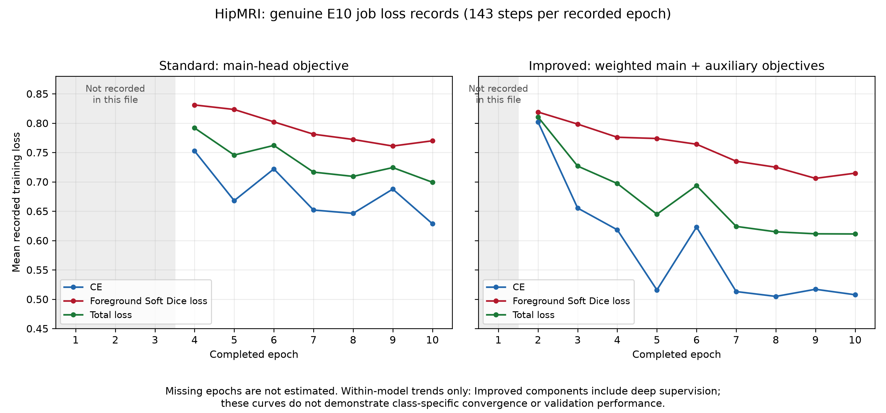

# HipMRI 3D Improved U-Net Segmentation

## Project Status

Production discovery, pairing, the frozen patient split, NIfTI loading, spatial resampling, intensity normalisation, the on-demand Patch Dataset, and both 3D U-Net architectures are implemented. Historical student-run regression, real preprocessing/patch checks and Standard GPU smoke evidence are preserved below. Both models completed 10 epochs / 1,430 updates: Standard job **648790**, Improved **649668**. Full Validation completed 38/38 with zero failures for Standard **649669** and Improved **650393** (reported 8m04s); original Improved job **649912** was CANCELLED and replaced. Four original E10 training/validation JSONL files are now downloaded and inspected locally: step/epoch accounting, source hashes, matched inference settings and all 38 confusion matrices per model pass the evidence audit. Original checkpoint binaries remain unavailable locally; this is log verification, not independently repeated remote execution. Six paired-case JSONs and eight PNGs were inspected locally. Four failure studies now exist, with images external pending permission. Final Test evaluation, clinical validity, tutor check-off, submission and a repeated matched resource benchmark remain unverified. See [report Sections 1–5](../FINAL-REPORT.md), the [evidence register](../docs/evidence/traceability.md) and [artefact manifest](../docs/evidence/failure-cases.md).

The required `predict.py` entry point is functional for the original Standard and Improved E10 checkpoint families, full-volume metrics and aligned PNG panels. Its Improved branch uses the original E10 loader; it is not a verified V3 E12 or V4 checkpoint inference path. Local CPU verification passed 22 focused prediction tests and a 92-test selected regression suite. Student-run real MRI/A100 acceptance subsequently passed for both architectures on B040_Week0 (jobs **650442 / 650468**); job **650490** generated six additional PASS paired-case outputs. These are separate synthetic and real evidence levels. Held-out Test evaluation remains pending.

## Model version and source navigation

Start with the training entry point in the row of interest, then open its architecture and evaluation links. For the Baseline, open [train.py](train.py) and [StandardUNet3D in modules.py](modules.py) first. The Improved family reuses [ImprovedUNet3D in improved_modules.py](improved_modules.py); V2–V4 change the objective or continuation protocol, not the network class. The shared patient split and sampling implementation are in [dataset.py](dataset.py) and [patch_dataset.py](patch_dataset.py); resampling and normalisation policies are in [resampling_config.json](resampling_config.json) and [normalization_config.json](normalization_config.json). The [unified experiment history](../docs/experiments.md) gives the full numerical record and evidence limits.

| Model / Version | Architecture | Training Entry Point | Evaluation Entry Point | Configuration | Main Change | Actual Outcome |
|---|---|---|---|---|---|---|
| Standard Baseline E10 | [StandardUNet3D](modules.py) | [train.py](train.py) | [validate.py](validate.py) | [shared patch policy](patch_dataset_config.json); no version-specific JSON | Original 3D U-Net and CE/foreground Dice | E10 full Validation completed; architectural baseline, with Bones/Rectum/Prostate omission. |
| Improved V1 E10 | [ImprovedUNet3D](improved_modules.py) | [train_improved.py](train_improved.py) | [validate_improved.py](validate_improved.py) | [shared patch policy](patch_dataset_config.json); no version-specific JSON | Residual blocks and deep supervision, with the original objective | E10 full Validation completed; large-organ gains but minority-class omission persisted. |
| Improved V2 E10 | [ImprovedUNet3D](improved_modules.py) | [train_improved_v2.py](train_improved_v2.py) | [validate_improved_v2.py](validate_improved_v2.py) | [improved_v2_config.json](improved_v2_config.json) | Inverse-square-root class-weighted CE; original Dice/model/sampler | Recorded 38-volume Validation recovered minority overlap; its E10 checkpoint became the V3 parent. |
| Improved V3 split E12 | [ImprovedUNet3D](improved_modules.py) | [run_improved_v3_split.py](run_improved_v3_split.py) using [train_improved_v3.py](train_improved_v3.py) | [split Stage C](run_improved_v3_split.py) using [shared evaluator](validate.py) | [improved_v3_config.json](improved_v3_config.json) plus inherited V2 policy | Continue V2 model/optimizer/RNG through E11–E12; separate training A/B and 38-volume Validation/selection C | E12 selected as protected candidate; no formal freeze. |
| V4 E20 Control / Treatment | [ImprovedUNet3D](improved_modules.py) | [experiment_prostate_fp_e20.py](experiment_prostate_fp_e20.py) for both arms | [scheduled full Validation in the E20 runner](experiment_prostate_fp_e20.py) | [prostate_fp_e20_config.json](prostate_fp_e20_config.json) | Paired V3 E12 continuation; Treatment alone changes Prostate overlap to Tversky alpha 0.7 | E20 Treatment reduced pooled Prostate FP 32.30% but failed three acceptance gates and was rejected; Control not automatically selected. |

The earlier [E14 V4 draft runner](experiment_prostate_fp.py) and [draft configuration](prostate_fp_config.json) are historical development inputs, not the frozen E20 decision implementation. [predict.py](predict.py) covers the original Standard/Improved E10 checkpoint families; it has not been validated for V3 E12 final inference. Held-out Test remains unevaluated.

### Protected V3 E12 inference adapter status

[predict_v3.py](predict_v3.py) is a separate candidate path. It requires the original V3 A/B/C run tree, the B-stage E12 checkpoint and C-stage `selection.json`; it verifies their recorded SHA-256 identities, reruns the complete lineage audit, checks checkpoint metadata and strict `ImprovedUNet3D` state compatibility, and reuses the established full-volume preprocessing, sliding-window evaluator, metrics and panels. `--preflight-only` performs CPU metadata checks without decoding MRI or running inference. Full-split Validation compares all 38 new per-case confusion matrices against the authenticated V3 C journal and fails admission if they differ. Prediction defaults to Validation. Test additionally requires `--split test`, `--allow-test` and an independently reviewed `--freeze-receipt` binding the candidate, adapter source and passed Validation-equivalence check. This receipt has not been created. Outputs and metrics use the shared resampled XYZ grid, without inverse resampling to source geometry. The original E10 `predict.py` is unchanged.

Synthetic CPU admission tests passed locally. This is implementation evidence only: the actual E12 checkpoint, receipt, A/B/C logs and HipMRI data were not available here, so the adapter has not passed real-candidate preflight or Validation equivalence and is **not yet the formally frozen final inference path**. No Test data were opened. The local virtual environment also lacks Matplotlib, so the existing visualization tests could not pass in that environment; install the declared dependencies before a complete regression run.

For closure on Rangpur, run `python -m recognition.hipmri_3d_improved_unet_hard.predict_v3` with `--run-root`, `--checkpoint`, `--selection-receipt` and `--preflight-only` first. Then use the same evidence paths with `--all-split --output-dir <new-external-directory>` in an allocated GPU session to verify all 38 Validation cases against V3 C. An independent review must confirm the resulting `historical_v3_c_confusion_equivalence=true`, source/configuration hashes and official assessment requirements before recording a formal freeze. A freeze receipt for later Test admission must bind `candidate_checkpoint_sha256`, `selection_sha256`, `config_sha256` and the current `adapter_sha256`, and record `validation_equivalence: "PASS"`, `formal_freeze: true` and `test_evaluated_before_freeze: false`. These fields express a review decision; the adapter does not create or independently certify that decision. Only then can a separate Test run be considered. No such run or receipt is claimed here.

## Local environment and complete regression suite

The CPU regression suite is standard-library `unittest`; Pytest is not
required. Python 3.11 is the documented environment (the historical WSL
regression run used Python 3.11.15). From the repository root, create an
isolated environment and install the bounded runtime dependencies:

```powershell
py -3.11 -m venv .venv-regression
.\.venv-regression\Scripts\Activate.ps1
python -m pip install -r recognition\requirements.txt
python -m unittest discover -v -s recognition\hipmri_3d_improved_unet_hard -t .
```

Discovery includes both the task-level and nested `diagnostics` test modules.
These tests use synthetic fixtures and do not access the dataset, checkpoints,
GPU or Slurm. The dependency file specifies compatible ranges rather than
locking every transitive dependency. For real CUDA training/inference, install
a PyTorch build appropriate to the machine and use the required Slurm
allocation; a successful local CPU regression is not GPU or real-data
acceptance.

Latest local regression run: **279 tests passed** in **22.012 s** using
Windows/Python 3.11.16, CPU PyTorch 2.13.0, NumPy 2.4.6, NiBabel 5.4.2,
SciPy 1.17.1 and Matplotlib 3.11.2. CUDA was unavailable; this run verifies
the synthetic CPU suite only.

## Problem

This project investigates volumetric MRI segmentation for prostate radiotherapy planning using HipMRI.

## Dataset and Labels

The dataset source is the HipMRI Study on Rangpur at `/home/groups/comp3710/HipMRI_Study_open`. MRI files are discovered under `semantic_MRs/*_LFOV.nii.gz`; segmentation files are discovered under `semantic_labels_only/*_SEMANTIC.nii.gz`. Files are paired by patient ID and Week number. The dataset root can be passed to `discover_dataset()`; its default is the Rangpur path.

Production discovery verified 38 unique patients and 211 matched MRI/segmentation pairs on Rangpur, with no missing or unmatched files or unexpected patient IDs. A student-run, read-only audit of all 211 MRI/mask headers found LPS orientation for both files in every pair and zero shape, affine, spacing, or orientation grid mismatches. All 211 MRIs declare spatial units of `mm`; all 211 masks declare `unknown`. This header audit did not decode every image array or assess clinical annotation accuracy. The authoritative CSIRO semantic label mapping is:

| ID | Structure |
| --- | --- |
| 0 | Background |
| 1 | Body |
| 2 | Bones |
| 3 | Bladder |
| 4 | Rectum |
| 5 | Prostate |

## Approved Patient Split

The approved patient assignments are stored explicitly in `dataset.py`; seed **3710** records provenance and is not used to redraw the split at runtime.

| Split | Verified patients | Verified volumes |
| --- | ---: | ---: |
| Train | 26 | 143 |
| Validation | 6 | 38 |
| Test | 6 | 30 |
| Total | 38 | 211 |

Real-data validation confirmed that all Weeks from a patient stay in one partition, no patients overlap between splits, and `K019_Week1` is in Train. Discovery rejects missing MRI/mask partners, unknown or missing approved patients, duplicate patient/Week pairs, and deviations from the approved volume counts.

## NIfTI Loading and Spatial Validation

`load_volume_pair()` in `volume_io.py` accepts one approved `VolumePair` from `discover_dataset()`. It decodes one 3D MRI and segmentation without changing voxel order, shape, affine, spacing, orientation, or source files. The returned metadata includes both effective affines, voxel spacing, axis codes, stored data types, and labels present. MRI values are returned as finite `float32` without intensity normalisation; validated integer labels 0–5 are returned as `uint8`, with a subset of labels permitted in an individual case.

Matching declared physical spatial units are accepted only with matching geometry. For the audited HipMRI pattern, an MRI declaring `mm` and a mask declaring `unknown` may be paired only after 3D shape, valid affine, spacing, and orientation checks pass. The returned `spatial_unit` is the MRI-declared working unit; `segmentation_header_spatial_unit` retains the mask's actual `unknown` value, and `segmentation_unit_inferred=True` records the conditional inference. Explicit unit conflicts or geometric mismatches remain errors. The original mask header is not rewritten or described as explicitly declaring `mm`.

After this correction, the student ran 33/33 tests successfully on Rangpur and loaded the real `K019_Week1` pair. Both decoded arrays had shape `(256, 256, 144)`; MRI dtype was `float32`, segmentation dtype `uint8`, axis codes were `('L', 'P', 'S')`, and labels present were `(0, 1, 2, 3, 4, 5)`. The working unit was `mm`, while the mask header remained `unknown` and its unit inference flag was `True`.

The later throughput and coverage audit completed production loading, resampling and normalisation checks for all 181 Train/Validation pairs. Subsequent student reports establish completed training and full-volume Validation for both arms, subject to the evidence limits in Project Status. Array processing and final evaluation of the 30 Test pairs remain unverified. The Patch Dataset retains integer mask IDs rather than materialising one-hot masks; compliance with the course's one-hot guidance requires clarification.

## 3D Resampling and Spatial Alignment

`resample_volume_pair()` in `resampling.py` converts one validated `LoadedVolumePair` to a shared physical 3D output grid. The target-spacing candidate is `(1.6796875, 1.6796875, 1.55999755859375)` mm, recorded as the median of patient-level median spacings across the **26 training patients and 143 training volumes**. Its derivation is student-supplied training-only audit evidence, not recomputed during this documentation review. It is not claimed to be clinically optimal. Both implemented 3D model arms use the same resampling policy; resampling can increase some dimensions and is not universal downsampling.

`make_target_grid()` preserves the source voxel-axis directions and covers the source voxel-edge field of view; it does not reorient LPS data. MRI and mask use the **same output shape and affine**. Each array is sampled with its own output-to-input mapping, `inverse(source_affine) @ output_affine`. MRI uses linear interpolation (`order=1`) with `nearest` boundary mode. The discrete mask uses nearest-neighbour interpolation (`order=0`) with `grid-constant` mode and background value `0`; no fractional label IDs are introduced. Both operations run on CPU, one pair at a time.

Source review found that SciPy `constant` mode erased some valid face-touching labels when output centers fell just outside the source voxel-center range but remained within its voxel-edge extent. The targeted correction uses `grid-constant` for the mask, retaining those edge labels while assigning background beyond the edge domain. MRI uses `nearest` to avoid a zero-intensity ramp near the boundary. Synthetic regression tests cover all six faces and samples beyond the source edge. This change did not alter the physical-grid equations.

The configured allocation guard is **512 MiB** (`536870912` bytes), estimating four times the combined source and output MRI/mask array bytes. It rejects a predicted excess before output allocation; it is **not** a guaranteed peak resident-memory limit. The result retains spatial-unit provenance, original and resulting labels, per-class voxel counts and physical volumes. Existing foreground labels that disappear during resampling cause an error. These checks do not establish clinical segmentation accuracy.

`resampling_config.json` records the spacing candidate and memory cap, which callers **pass explicitly** to `resample_volume_pair()`; the function has no defaults for them, so editing JSON alone does not change a call that passes the old values. The JSON also declares MRI boundary mode `nearest`, mask boundary mode `grid-constant`, and boundary value `0`; `resampling.py` reads and validates those declarations and rejects unsupported changes. Interpolation orders `1`/`0`, the 4× planning multiplier, grid-rounding tolerance, and orthogonality tolerance are fixed in source. The configuration records the approved initial policy rather than a trained or clinically optimised parameter set.

The student-run **updated Rangpur suite passed 53/53 tests**. Real acceptance examples after the boundary fix were:

| Pair | Input → output shape | Prostate voxels, input → output | Peak RSS | Exit status |
| --- | --- | ---: | ---: | ---: |
| `K019_Week1` | `(256, 256, 144)` → `(256, 256, 144)` | 17,245 → 17,245 | 182,120 KiB | 0 |
| `S035_Week0` | `(256, 256, 128)` → `(286, 286, 128)` | 3,478 → 4,448 | 185,740 KiB | 0 |

At Batch 2.2 acceptance, only these **two real MRI arrays** were resampled as examples. The subsequent throughput and coverage audit resampled all 181 Train/Validation volumes. The complete 211-volume dataset has not been fully resampled or clinically validated; the voxel-count change for S035 is not a segmentation-performance result.

## MRI Intensity Normalisation

`normalize_volume_pair()` in `intensity_normalization.py` processes one validated `ResampledVolumePair` on CPU. It selects voxels where the **resampled MRI intensity before normalisation is nonzero**, using MRI intensities alone and never the ground-truth segmentation. It computes the 0.5th and 99.5th percentiles of those values, clips them to the resulting bounds, then computes the clipped values' `float64` mean and population standard deviation (`ddof=0`). It Z-scores the selected values and writes a new finite `float32` MRI of the same shape. Zero-intensity locations in that input remain zero. Output statistics use the originally selected positions, including any that normalise to zero. The segmentation is retained by reference without in-place modification; the affine is copied, and pair identity, spatial geometry, label metadata, and spatial-unit provenance are preserved.

An entirely zero MRI, non-finite values, invalid 3D shape or dtype, and zero or numerically degenerate clipped nonzero standard deviation are rejected. The result records the selected voxel count, percentile bounds, mean and standard deviation used, original zero fraction, and output statistics on the originally selected voxels. `normalization_config.json` freezes the original-MRI-nonzero selection, percentile values `0.5`/`99.5`, selected-voxel clipping, `ddof=0`, zero preservation, `float64` statistics, and `float32` output. The module reads and validates this policy. These settings are an initial engineering choice for both future model arms, not a clinically optimised formula.

The focused local synthetic suite passed **18/18** tests in WSL with an import shim because NiBabel was unavailable locally. The student-run combined Rangpur suite passed **71/71** tests in **0.214 s**. The student then reported these two real acceptance examples:

| Case | Selected voxels | Clipping bounds | Clipped mean / population std | Output selected mean / std | Peak process RSS | Wall time |
| --- | ---: | --- | --- | --- | ---: | ---: |
| `K019_Week1`, `(256, 256, 144)` | 7,199,017 | 1.0 / 298.0 | 62.71922972261352 / 70.6617517907729 | -2.0519089452645352e-09 / 0.9999999993619909 | 341780 KiB | 5.66 s |
| `S035_Week0`, `(286, 286, 128)` | 7,136,647 | 0.012912326492369175 / 292.36941619872994 | 64.3451434267759 / 73.6351732255404 | -1.364474822943357e-09 / 0.9999999989009823 | 345368 KiB | 5.54 s |

For both cases, unchanged mask and affine checks passed and the process exited with status `0`. Peak RSS is for the **whole verification process**, not memory exclusively allocated by normalisation. These were the two Batch 2.3 acceptance examples; the subsequent coverage audit normalised all 181 Train/Validation volumes. Full 211-volume normalisation and clinical accuracy remain unverified. Later training evidence is described in Project Status.

## On-Demand 3D Patch Dataset

`HipMRIPatchDataset` in `patch_dataset.py` accepts only `train` and `validation`, using the frozen patient-disjoint assignments from `discover_dataset()`. Each `__getitem__` loads, resamples, and normalises **one** MRI/mask pair through the approved functions; no processed full-volume cache is retained. The source NumPy convention `(X,Y,Z)` is transposed to tensor `(D,H,W)=(Z,Y,X)`, then MRI and mask receive identical crop coordinates. This axis permutation is not another physical resampling operation. Each sample contains a `float32` MRI tensor `[1,D,H,W]`, a `torch.long` mask `[D,H,W]` with integer IDs 0–5, and patient ID, Week, crop origin in DHW order, and sampling mode.

`patch_dataset_config.json` sets an initial `(64,64,64)` patch, one training patch per volume, foreground-sampling probability `0.5`, prostate foreground label `5`, seed `3710`, and center-crop validation. Patch dimensions can be configured but must be positive, divisible by 16, and fit the processed volume without padding. Training crop choices are reproducible from seed, epoch, and sample index; `set_epoch()` allows them to vary reproducibly between epochs. If foreground sampling selects label 5 and it exists, the sampled patch contains a prostate voxel; an absent label safely falls back to a random crop. Validation uses a deterministic center crop without label-guided selection. The initial DataLoader uses `num_workers=0` and CPU preprocessing.

Codex reported **16/16 focused local synthetic tests passed** in WSL. They used constructed arrays, mocked preprocessing interfaces, and an in-memory NiBabel import shim; they were not real-data tests. The student ran the five-module Rangpur regression suite: `Ran 87 tests in 8.646s`, then `OK` (71 previously verified tests plus 16 Patch Dataset tests).

The student then ran a CPU-only, read-only real-data check with `HipMRIPatchDataset`, `Subset`, and `DataLoader` (`batch_size=1`, `num_workers=0`). MRI shape/dtype and finiteness, mask shape/dtype and labels, prostate-aware training sampling with label 5 present, and deterministic validation center sampling passed:

| Split and case | MRI batch | Mask batch | Labels | Crop origin DHW | Mode | Result |
| --- | --- | --- | --- | --- | --- | --- |
| Train `K019_Week1` | `(1,1,64,64,64)` float32 | `(1,64,64,64)` int64 | `[0,1,2,3,5]` | `[40,60,64]` | `prostate` | PASS |
| Validation `B040_Week0` | `(1,1,64,64,64)` float32 | `(1,64,64,64)` int64 | `[1,2,3,4,5]` | `[32,87,87]` | `center` | PASS |

The final output was `PASS: REAL PATCH DATASET VERIFICATION`; process wall time was **11.72 s**, maximum resident set size **768352 KiB**, and exit status **0**. RSS covers the whole Python verification process, not GPU memory or an isolated Patch Dataset allocation. At this milestone, only two real patches were accepted. All 211 MRI arrays have not been processed through the full pipeline; center crops may miss the prostate in other validation cases, and repeated on-demand preprocessing may limit training throughput. The later full-volume evaluators use sliding windows instead of this center-crop Dataset. Training and full Validation evidence for both models are now recorded below; clinical validity and final Test Dice/IoU remain unestablished.

The configured probability `0.5` selects the prostate-aware branch; it does not guarantee exactly half of patches contain prostate. Random crops may also contain class 5. No data augmentation is implemented.

## Standard 3D U-Net and Real GPU Smoke Test

`StandardUNet3D` in `modules.py` is the Normal Difficulty baseline, with `in_channels=1`, `out_channels=6`, and `base_channels=16`. It has four encoder downsampling stages, two padded 3D convolutions with GroupNorm and ReLU per block, a bottleneck, and four learnable transposed-convolution decoder stages with concatenated encoder skips. A final 1×1×1 convolution returns six raw logits without softmax or argmax. The default model has **5,646,470 trainable scalar parameters**. For a 64³ patch, encoder widths are 16/32/64/128 at 64³/32³/16³/8³, the bottleneck has 256 channels at 4³, and decoder widths are 128/64/32/16 before the six-channel output at 64³.

Codex reported **10/10 local synthetic CPU tests passed**. The student transferred `modules.py` and `test_standard_unet.py` to Rangpur and ran the six-module CPU regression suite: `Ran 97 tests in 10.212s`, followed by `OK` (87 earlier tests plus 10 architecture tests). A nonfatal CUDA driver warning appeared on the login node; all tests passed. That CPU result did not establish GPU compatibility.

The student first requested a `comp3710` allocation, which remained queued and was manually cancelled, then obtained interactive Slurm job **647039**, partition **a100**, compute node **a100-5**, with an **NVIDIA A100-PCIE-40GB**. In the allocated session, the student verified PyTorch **2.13.0+cu130**, CUDA build **13.0**, NVIDIA driver **590.48.01**, `torch.cuda.is_available() = True`, and successful CUDA tensor creation.

The student ran `python -B -m recognition.hipmri_3d_improved_unet_hard.smoke_standard_unet`. The script used the frozen training split, seed 3710, prostate-sampling probability 1.0, and `DataLoader(batch_size=1, num_workers=0, shuffle=False)`. It preprocessed the MRI on CPU, transferred only patch tensors to the GPU, and used the default model for exactly one float32 forward → cross-entropy loss → backward → SGD update, with learning rate **0.001** and no automatic mixed precision.

| Check | Student-reported result |
| --- | --- |
| Case / crop origin DHW | `K019_Week1` / `[40, 60, 64]` |
| Integer target labels | `[0, 1, 2, 3, 5]` |
| MRI / target batch | `(1, 1, 64, 64, 64)` float32 / `(1, 64, 64, 64)` torch.long |
| Raw logits | Finite float32 `(1, 6, 64, 64, 64)` check passed |
| Initial cross-entropy loss | `1.92833924` |
| Gradients | All 64 trainable parameter tensors had finite gradients |
| Parameter update | 59/64 trainable parameter tensors changed after one SGD step |
| GPU allocated / reserved | `55286272` / `465567744` bytes |
| Peak GPU allocated / reserved | `441744384` / `465567744` bytes |

The final output was `PASS: ONE REAL STANDARD 3D U-NET GPU OPTIMISATION STEP`. This demonstrates training-pipeline executability for one real training patch. The loss is an initial single-patch value; finite gradients do not establish convergence, and 59 changed parameter tensors satisfy the smoke-test requirement that at least one parameter changes. GPU memory figures belong to this exact configuration and run. No full epoch, validation measurement or checkpointing occurred **in that smoke test**; subsequent training is recorded separately. The GPU results were supplied by the student and were not independently rerun by Codex.

## Batch 1 — Preprocessing Throughput and Full Train/Validation Coverage

`profile_pipeline.py` calls the approved `discover_dataset()` → `load_volume_pair()` → `resample_volume_pair()` → `normalize_volume_pair()` pipeline sequentially on CPU, one pair at a time, without caches or dataset writes. It measures each production stage and checks finite normalised MRI values, matching spatial geometry, valid mask IDs 0–5 and foreground-label integrity. Its default audit is deliberately small; `--full-coverage` explicitly requests all Train/Validation volumes. Test-volume arrays are excluded, although discovery validates all approved filenames.

The student transferred the script and ran the targeted audit on Rangpur:

| Case | Frozen split | Result | Total processing seconds |
| --- | --- | --- | ---: |
| `K019_Week1` | Train | PASS | 4.960915867239237 |
| `S035_Week0` | Train | PASS | 5.4963636212050915 |
| `B040_Week0` | Validation | PASS | 4.075449131429195 |

This run had **3 successes, 0 failures**, session wall time **15.359112702310085 s**, and a correctly false full-coverage flag: it verified selected cases only.

The first CPU Slurm submission was rejected for its `--mem=4G` request before job creation. The student resubmitted without that option and completed job **647115**, partition **cpu**, node **vcpu-5**, requesting **2 CPUs** and a **1-hour** limit. Final Slurm state was **COMPLETED**, `ExitCode=0:0`, elapsed time **00:14:20**, and stderr was empty. The full audit reported **143/143 training volumes from 26 patients**, **38/38 validation volumes from 6 patients**, **181/181 successes**, **0 failures**, full-coverage flag **true**, and final **PASS**. No test-volume arrays were processed.

| Measured quantity | Total seconds | Mean seconds/case |
| --- | ---: | ---: |
| Loading | 265.0306965364143 | 1.4642579919138914 |
| Resampling | 545.37738248799 | 3.0131347098783974 |
| Normalisation | 26.101277890615165 | 0.14420595519676888 |
| Total per-case processing, including integrity checks | 856.6517753805965 | 4.732882736909373 |

Session wall time was **859.4736277926713 s**. Peak RSS was **345210880 bytes**, the cumulative **whole-process RAM peak**, not GPU VRAM or a per-stage allocation. Resampling accounted for approximately **63.7%** of summed per-case processing time. Stage totals exclude additional integrity checks; session wall time also includes setup, reporting and cleanup.

These student-supplied measurements establish complete preprocessing executability for the **181 Train/Validation volumes**, not clinical annotation accuracy, model convergence, Dice/IoU, full-volume inference correctness, Test-split array-processing success or actual full-training runtime. The on-demand Patch Dataset repeats full-volume preprocessing for each requested patch; a standalone one-case cache benchmark exists, but **no production training cache is integrated**. No projected training runtime is reported as a measurement. At this audit milestone, two real DataLoader patches had separate acceptance evidence; subsequent model training and validation have their own evidence below.

## Improved Architecture, Training and Full-Volume Validation

`ImprovedUNet3D` in `improved_modules.py` preserves the baseline's four-level 3D topology but uses residual encoder, bottleneck and decoder units. Its default trainable parameter count is **5,734,114**, including two auxiliary heads. For `[B,1,64,64,64]` input, main logits are `[B,6,64,64,64]`; `deep_supervision=True` additionally returns half-resolution `[B,6,32,32,32]` and quarter-resolution `[B,6,16,16,16]` logits. Default forward returns only main logits. The models are course-inspired implementations, not demonstrated exact paper reproductions.

Both training entry points use AdamW (`lr=0.001`, `weight_decay=0.00001`, betas `0.9/0.999`, epsilon `1e-8`), batch size 1, one patch per volume, seed 3710, float32 without AMP, and no scheduler. Base loss is `0.5 CE + 0.5 foreground Soft Dice`, where Dice classes 1–5 all contribute, including target-absent classes, with smoothing `1e-5`. Improved loss is `(Lmain + 0.5 Lhalf + 0.25 Lquarter) / 1.75`; auxiliary **logits** are trilinearly upsampled with `align_corners=False`, while integer labels are unchanged. Improved reported loss components include auxiliary heads and are not directly comparable to Standard main-head loss as model-quality metrics.

Completed epochs save atomic model/optimiser/configuration/RNG checkpoints. Resume requires exact configuration and source-hash compatibility; diagnostic steps do not save completed-epoch checkpoints. Improved filenames must start with `improved_unet_`. Random seeds, disabled cuDNN benchmarking/TF32 and deterministic **warn-only** settings provide best-effort reproducibility, not guaranteed bitwise CUDA determinism.

`validate.py` and `validate_improved.py` use the same 64³ sliding windows, default stride 32, CPU accumulation of uniformly averaged softmax probabilities, and full-volume argmax. Predictions and ground truth are aligned in the resampled XYZ grid. Class Dice is `2 TP/(Ntrue+Npred)`; IoU is `TP/(Ntrue+Npred-TP)`. Both-absent classes are `null` and excluded from macro averages, whereas one-sided absence scores zero. Outputs include per-volume metrics, pooled per-patient metrics, `overall_pooled`, `overall_volume_macro` and `overall_patient_macro`. Both original full-validation logs confirm executed 64³ windows/stride 32, matching case identities and geometry, mean-softmax aggregation and the same absent-class policy. The E10 table is recomputed `overall_pooled`; patient/volume macro summaries are also verified and remain distinct.

### Current recorded results

Original training logs record **10 completed epochs / 1,430 optimiser updates for both arms** on Rangpur A100. Standard resumed from epoch 3 and records epochs 4–10; Improved resumed from epoch 1 and records epochs 2–10. Earlier step/loss events require prior logs, not interpolation. These are equal update budgets, not equal compute budgets. Standard E10 validation **649669** and Improved **650393** each completed **38/38**, zero failures. The recomputed full-precision `overall_pooled` values, counts and provenance are preserved in the [manifest](../docs/evidence/failure-cases.md#full-validation-numerical-provenance); the [Section 5 comparison](../FINAL-REPORT.md#51-controlled-validation-comparison) interprets them without calling them final Test results.

Recorded Standard E10 Dice values are Background **0.94134160556791**, Body **0.8427898257960118**, Bladder **0.6220039283221238**, and **0.0** for Bones, Rectum and Prostate. No Bones, Rectum or Prostate voxels were predicted in any of its 38 cases. Improved predicts no Rectum/Prostate and only three Bones voxels across two cases. Partial class prediction collapse is observed; its cause has not been isolated. Cancelled job 649912 is retained as failed-attempt history, not a successful Validation result.

## Validation Comparison and Failure Case Evidence

Both Epoch 10 models were evaluated on the same 38 volumes/six Validation patients. The following `overall_pooled` scores are recomputed from all original per-volume confusion matrices and agree with their summaries. They are not patient-macro averages. Display rounding agrees with the earlier table; Improved Bones is now shown in scientific notation to identify its negligible positive overlap.

| Class | Standard DSC | Improved DSC | Standard IoU | Improved IoU |
| --- | ---: | ---: | ---: | ---: |
| Background | 0.941342 | 0.976012 | 0.889184 | 0.953148 |
| Body | 0.842790 | 0.906781 | 0.728295 | 0.829460 |
| Bones | 0.000000 | 3.943110e-7 | 0.000000 | 1.971555e-7 |
| Bladder | 0.622004 | 0.768230 | 0.451383 | 0.623680 |
| Rectum | 0.000000 | 0.000000 | 0.000000 | 0.000000 |
| Prostate | 0.000000 | 0.000000 | 0.000000 | 0.000000 |

Background, Body and Bladder are predicted in all 38 volumes by both models. Improved predicts three Bones voxels (two TP, one FP) across K018_Week1 and K018_Week4, giving positive DSC=3.943109603265999e-7, not useful segmentation. Both models predict zero Rectum/Prostate voxels. Exact class counts and coverage are in the [manifest](../docs/evidence/failure-cases.md#full-validation-numerical-provenance). Residual units and deep supervision were changed jointly, so individual causal effects cannot be inferred.

### Recorded training losses



Standard total loss changes from 0.791711 (epoch 4) to 0.699227 (epoch 10); Improved from 0.810483 (epoch 2) to 0.611152 (epoch 10). Both are non-monotonic and both Soft Dice losses rise at epoch 10. Improved's CE/Dice components include auxiliary heads; absolute losses are not directly comparable main-head quality measures. The [epoch/component/runtime table](../docs/evidence/failure-cases.md#recorded-training-loss-trajectory) preserves every available event, missing epochs and timing scope. Declining losses do not establish adequate training-patch class exposure or class-specific convergence. Standard full validation names `standard_unet_last.pt`, paired-case predictions name `standard_unet_epoch10.pt`; E10 metadata matches; job 650924 preflight now records equal current Standard file hashes/state tensors. Historical Validation-time `last.pt` hash remains absent; binaries are not independently inspected locally.

### Train-only patch exposure evidence

The student completed reconstruction job **650736** (reported Slurm COMPLETED 0:0, 00:18:46). Its original external JSONL is now authenticated locally: **143 Train volumes, 26 patients, 1,430 unique volume/epoch patches**, PASS, full Train=true. Independent counts/distributions match the summary. Bones appears in **1,230 patches (86.01%)**, occupying **9.10%** of pooled patch voxels; Bladder **869 (60.77%) / 4.03%**, Rectum **777 (54.34%) / 1.23%**, Prostate **880 (61.54%) / 1.43%**. All 754 prostate-aware crops contain Bones and Prostate; 676 random crops have lower target exposure. Bones positive-patch median occupancy is **10.08%**, so simple lack of examples or tiny fragments alone does not explain its near-total Validation failure. Background+Body still occupy **84.20%** of sampled voxels.

[The diagnosis](../docs/analysis/class-prediction-collapse.md#original-full-train-audit-authentication) preserves the original file hash, raw/resampled/patch denominators, physical voxel sizes, fragment thresholds and patient/epoch/branch variability. This is Standard-checkpoint-authenticated replay of the common configured sampler, not proof of unchanged historical MRI/mask bytes or a newly executed training run. The subsequent student-run protected probability probe (650924) is now authenticated locally below. No gradient measurement/retraining occurred; no Test arrays were used.

### Read-only E10 checkpoint probability evidence

Original external `prob_probe_650924.jsonl` verifies three fixed patches / six main-head forwards (two Train crops and B040 Validation center crop), PASS; zero backward passes, optimiser updates or Test arrays. The student supplied Slurm COMPLETED 0:0 / 25 s on an A100. Local aggregate/source checks pass; [the diagnosis](../docs/analysis/class-prediction-collapse.md#authenticated-real-probability-results) records SHA-256, exact crop/checkpoint identities, all statistics and evidence limits.

Bones often ranks second but never wins on true Bones; Rectum probabilities are low; Improved raises Prostate scores without any TP. Both Train crops already omit all three classes. Bladder recall improves but precision decreases; K019 Rectum slightly regresses. These selected-patch findings are not full-volume Dice or causal proof. One separately authorised **Train-only loss-component parameter-gradient attribution measurement**, not immediate retraining/reweighting, is recommended. Source/checkpoints remain unchanged.

### Four paired case studies

The cases are four distinct patients selected purposively to expose improvements, regression and persistent omission, not an unbiased population sample. Both models use 64³ windows, stride 32, mean-softmax aggregation and aligned resampled XYZ grids. Six local JSONs authenticate the last three pairs' model/checkpoint, geometry, labels and Z levels; their confusion matrices reproduce Dice/IoU and derived precision/recall. B040 full-volume numerical counts now also agree with both original validation logs; its prediction-driver JSONs remain unavailable, so PNG model attribution still uses filenames and student records.

| Case | Shared Z slices | Standard / Improved Bladder DSC | GT Prostate voxels; predicted by either model | Interpretation |
| --- | --- | --- | --- | --- |
| B040_Week0 | 51,62,73 | 0.5365 / 0.8695 | 7,105; 0 | Bladder recall approximately 36.9%→80.7%; both omit Prostate, Rectum and Bones |
| M030_Week5 | 43,55,67 | 0.4279 / 0.8515 | 5,932; 0 | Bladder recall 27.26%→75.10%; larger Bladder coverage at Z=67 and fewer visible Body gaps |
| S022_Week5 | 44,54,64 | 0.6243 / 0.2490 | 5,966; 0 | Genuine regression: Bladder TP 10,838→3,298 of 20,816; recall 52.07%→15.84%, precision 77.95%→58.10% |
| K008_Week0 | 56,70,84 | 0.5599 / 0.6862 | 11,114; 0 | Largest prostate in representative screening still omitted; small size alone is not an established explanation |

**Figures 5.1–5.4: insertion deferred pending permission.** Eight original PNGs exist outside Git, each displaying MRI / Ground Truth / Prediction / Error Map. [Report Section 5.3](../FINAL-REPORT.md#53-paired-anatomical-failure-case-studies) supplies paired captions and careful panel descriptions; the [manifest](../docs/evidence/failure-cases.md) records exact external paths/hashes and JSON identities. No broken image embeds are used. The course permits README visual content, but explicit permission to publicly redistribute HipMRI-derived images was not established locally. Insert unchanged originals into the final local PDF only if course/dataset rules allow it, labelling A=Standard and B=Improved. Source-axis Z slices are not asserted to be anatomical apex/base.

### Available resource evidence and recommendation

| Measurement | Standard | Improved |
| --- | ---: | ---: |
| Trainable parameters | 5,646,470 | 5,734,114 |
| M030 inference seconds | 9.625768 | 9.464645 |
| S022 inference seconds | 9.444015 | 9.523250 |
| K008 inference seconds | 7.790201 | 7.931949 |
| Peak allocated GPU bytes, each of the three recorded cases | 362,597,376 | 362,163,200 |
| Peak reserved GPU bytes, each of the three recorded cases | 379,584,512 | 396,361,728 |

Times/peaks are locally inspected JSON records from A100 single-case runs, PyTorch 2.13.0+cu130/CUDA 13.0. Timing includes sliding windows, CPU accumulation and argmax, not preprocessing or PNG creation. This is not repeated/cohort-wide matched profiling or full-training cost. Improved adds approximately 1.55% parameters; small timing differences do not establish a general speed advantage.

Improved segmentation of Background, Body and Bladder coexists with total Prostate/Rectum omission and a marked S022 regression. **Recommendation: retain both checkpoints as research prototypes requiring specialist review; neither establishes reliable autonomous prostate contouring.** Failure causes, clinical accuracy, consecutive-slice/boundary metrics and final Test performance remain unresolved. The final comprehensive README/PDF still needs the outstanding assessment material listed below; linking this supplemental report alone does not complete submission.

## Usage and Reproducibility

Run modules from the repository root or the equivalent Rangpur verification workspace, using the existing `torch` environment. Real training/validation entry points require an allocated CUDA Slurm compute session. The following are **usage examples verified against CLI source**, not additional executed experiments. Existing source files and JSON policies must match the checkpoint hashes. Output directories must already exist outside Git and the source dataset. Use new checkpoint files for fresh runs; never overwrite an existing run inadvertently.

```bash
# Fresh runs; --epochs is the total desired completed epoch count.
python -B -m recognition.hipmri_3d_improved_unet_hard.train \
  --checkpoint "$HOME/hipmri_training_runs/standard_unet_new_run.pt" --epochs 10
python -B -m recognition.hipmri_3d_improved_unet_hard.train_improved \
  --checkpoint "$HOME/hipmri_training_runs/improved_unet_new_run.pt" --epochs 10

# Full frozen Validation split; select --case B040_Week0 instead for one case.
python -B -m recognition.hipmri_3d_improved_unet_hard.validate \
  --checkpoint "$HOME/hipmri_training_runs/standard_unet_last.pt" --all-validation --stride 32
python -B -m recognition.hipmri_3d_improved_unet_hard.validate_improved \
  --checkpoint "$HOME/hipmri_training_runs/improved_unet_last.pt" --all-validation --stride 32
```

To resume, pass the same completed-epoch checkpoint as both `--checkpoint` and `--resume`, and set `--epochs` above the recorded completed count. Both scripts support `--diagnostic-one-step` for a fresh one-step run without saving a checkpoint. `--dataset-root` overrides the default Rangpur source path. The existing validation entry points write JSON records to stdout and do not export prediction NIfTIs. The prediction driver below adds aligned PNG panels and an external JSON results file.

Student-supplied dependency records list PyTorch **2.13.0+cu130**, CUDA build **13.0**, NumPy **2.4.6**, NiBabel **5.4.2** and SciPy **1.17.1** on Rangpur. The six downloaded prediction JSONs now confirm these recorded E10 checkpoint training versions and the prediction GPU/PyTorch/CUDA fields. Both original training and full-validation setup logs now confirm the same library/device fields and training configurations. They do not record the exact Python version; retain that evidence before claiming a complete reproducible environment. No dependency installation was performed in this documentation audit.

## Prediction Driver

`predict.py` delegates checkpoint loading to the existing protected Standard/Improved loaders, including `weights_only=True`, strict state loading, architecture/epoch, policy and source-hash checks. It calls the unchanged production loading, resampling and normalisation functions for each selected pair and reuses `validate.sliding_window_predict()`, confusion-count metrics and summary aggregation. It does not use validation center crops, change masks, retrain models or write source NIfTIs/checkpoints. Both model arms use fixed 64³ inference patches and the same default stride 32, uniform overlapping softmax-probability averaging, then argmax. Metrics are on the shared resampled XYZ grid with the existing both-absent-null policy.

| CLI argument | Supported values / behaviour |
| --- | --- |
| `--model` | Required: `standard` or `improved`; the checkpoint must match. |
| `--checkpoint` | Required existing completed-epoch checkpoint, compatible with current production source/configuration. |
| `--dataset-root` | Defaults to `/home/groups/comp3710/HipMRI_Study_open`; production discovery validates the complete frozen split. |
| `--split` | `validation` (default) or `test`; training cases are rejected. |
| `--allow-test` | Required together with `--split test`; invalid for Validation. No Test arrays are decoded by default. |
| `--cases` / `--case` | One or more `Patient_WeekN` identifiers from the selected split, e.g. `B040_Week0`. |
| `--all-split` | Process all 38 Validation or all 30 explicitly opted-in Test volumes; mutually exclusive with case selection. Scope selection is required. |
| `--stride` | Integer 1–64, default 32. Use the same value for both models. |
| `--device` | `cuda` (default; requires allocated Slurm CUDA session) or `cpu` (slow, useful for checks). |
| `--output-dir` | Required **new** directory with an existing parent, outside the source dataset and Git/source workspace. Existing directories are rejected. |

Prerequisites are PyTorch, NumPy, NiBabel, SciPy and **Matplotlib** in the selected environment, access to the complete source dataset and a compatible external checkpoint. Checkpoint mismatch errors are reported without weakening protections. Copy `predict.py` alongside the matching approved sources and configurations in the Rangpur verification workspace. Execute GPU inference only after acquiring a compute allocation and activating the existing `torch` environment.

The following Bash blocks are **usage examples, not verbatim records of the completed jobs**. Actual real acceptance is recorded separately below. From an allocated Rangpur GPU shell:

```bash
cd "$HOME/comp3710_hipmri_verify"
conda activate torch
mkdir -p "$HOME/hipmri_prediction_runs"

python -B -m recognition.hipmri_3d_improved_unet_hard.predict \
  --model standard --checkpoint "$HOME/hipmri_training_runs/standard_unet_last.pt" \
  --split validation --cases B040_Week0 --stride 32 --device cuda \
  --output-dir "$HOME/hipmri_prediction_runs/standard_B040_smoke_01"

python -B -m recognition.hipmri_3d_improved_unet_hard.predict \
  --model improved --checkpoint "$HOME/hipmri_training_runs/improved_unet_last.pt" \
  --split validation --cases B040_Week0 --stride 32 --device cuda \
  --output-dir "$HOME/hipmri_prediction_runs/improved_B040_smoke_01"
```

Use `--all-split` instead of `--cases B040_Week0` for complete Validation. Choose a fresh output directory for each run. After model/checkpoint selection and inference settings have been frozen, the final Test evaluation can be **explicitly** launched with:

```bash
python -B -m recognition.hipmri_3d_improved_unet_hard.predict \
  --model improved --checkpoint "$HOME/hipmri_training_runs/improved_unet_last.pt" \
  --split test --allow-test --all-split --stride 32 --device cuda \
  --output-dir "$HOME/hipmri_prediction_runs/improved_final_test_01"
```

Run the Standard comparison separately with its own model/checkpoint/output directory and identical settings. Do not use Test results to select hyperparameters or checkpoints.

Outputs are JSON events on stdout, one `<Patient>_Week<N>_panels.png` per successful case and `results.json`. The JSON records model/checkpoint identity and SHA-256, configuration, case/split, source and processed shapes, affine/unit provenance, predicted classes, per-class/per-patient/pooled/macro metrics, timing and failures. CUDA peaks include the loaded model and inference allocations; CPU runs report GPU fields as `null`. Preprocessing, inference, metric and visualisation timings are separate. A failed case produces a failure record and nonzero exit status; summary metrics describe successful cases only, and full-split completion is not claimed for a case-only run.

Panels show the **same** XYZ slice transposed to XY display for MRI, truth, prediction and errors, with physical XY aspect ratio and fixed six-class colours. Three representative Z levels span the ground-truth prostate extent, or geometric slices if prostate is absent. This is display selection, not preprocessing or automatic anatomical apex/base identification. Red marks prostate false positives, blue prostate false negatives and yellow other wrong-class voxels. Prediction NIfTI export/inverse resampling and clinical boundary validation are not implemented.

Local WSL CPU verification (PyTorch `2.12.1+cu130`, CUDA hidden) passed **22 focused tests** and **92 selected tests in 10.643s, OK** across prediction, validation, Improved integration, both architectures, training and discovery. Those checks used synthetic arrays, checkpoint fixtures and mocked NIfTI/preprocessing where required; local NiBabel was unavailable. Subsequent student-run A100 prediction jobs **650442 / 650468** passed for Standard/Improved B040_Week0, and **650490** completed six more paired PNG/JSON outputs. These are real acceptance records supplied by the student, not remote runs executed by Codex. No Test evaluation is claimed. Syntax and CLI-help checks also passed in the implementation batch.

## Assessment Documentation Gaps

The locally available `COMP3710_Report_2026_draft_v2.2.pdf` has an internal title stating **Version 2.0 Final Assessment Specification (Draft)**. This audit uses its Sections 2.2, 3, 4.1, 5.3, 6.1 and 8; confirm whether a later course clarification supersedes it. It permits a basic 2D or 3D U-Net baseline and lists residual units/deep supervision for Hard 3D Improved U-Net. Its 3D table specifies downsampled HipMRI and a test Dice target of approximately 0.7; no achieved test target is claimed here.

Before submission, unresolved requirements include:

- Include the actual one-page feasibility review and confirm tutor check-off evidence; neither is present in this repository.
- Resolve the specification's one-hot mask guidance versus the implemented class-index Dataset and internally generated Dice indicators; do not claim full compliance without clarification.
- Confirm whether the training-derived spacing/patch approach satisfies the table's downsampled-data scope, since some cases are upsampled.
- Resolve remaining mandatory entry-point organisation: Improved architecture lives in a helper, preprocessing/Patch Dataset are separate modules, and training and validation are separate entry points. The functional prediction driver has local and real acceptance evidence. Helpers are permitted, but filename existence alone does not establish all required responsibilities.
- Four paired autopsies, a supported Validation comparison/recommendation and three-case resource measurements now exist. A [numeric training-loss plot](../figures/e10_recorded_training_losses.png) now uses only recorded Standard epochs 4–10 and Improved epochs 2–10. Complete authorised medical figure insertion, an algorithm figure, the missing early loss history, clinically grounded base/apex analysis and the remaining matched resource evidence.
- Keep the untouched Test split reserved for the eventual required held-out evaluation; this documentation audit did not evaluate it.
- Make the task README the comprehensive submission report and export its PDF. The separate [Final Report](../FINAL-REPORT.md) currently supplements it and does not replace the README/PDF requirement. PR submission and review-response evidence are not verified here.

Course-listed architecture references are Ronneberger, Fischer and Brox (2015), *U-Net: Convolutional Networks for Biomedical Image Segmentation*; Çiçek et al. (2016), *3D U-Net: Learning Dense Volumetric Segmentation from Sparse Annotation*; and Isensee et al. (2018), *Brain Tumor Segmentation and Radiomics Survival Prediction: Contribution to the BRATS 2017 Challenge*. The exact CSIRO label citation remains unavailable locally. These references identify design context, not an exact architectural reproduction.

## Engineering Question

Compared with a Standard 3D U-Net (Normal Difficulty baseline), does a 3D Improved U-Net (Hard Difficulty) with volumetric residual units and deep supervision reduce clinically important prostate boundary and slice-transition errors, improve segmentation performance, and justify its additional computational cost?

## Planned Model Comparison

- Standard 3D U-Net — Normal Difficulty baseline
- 3D Improved U-Net — Hard Difficulty model with volumetric residual units and deep supervision

## Planned Evaluation

- Per-class Dice
- Per-class IoU
- Prostate base/apex analysis
- Failure-case analysis
- Peak GPU VRAM
- Inference time per case

## Repository Structure

- `modules.py`: Standard 3D U-Net baseline.
- `improved_modules.py`: Residual Improved 3D U-Net and deep-supervision loss helper.
- `test_improved_unet.py`: Synthetic residual, output-shape and gradient tests.
- `test_improved_integration.py`: Synthetic training/checkpoint/evaluator integration tests.
- `test_standard_unet.py`: Synthetic CPU architecture, logits, gradient, and optimiser tests.
- `smoke_standard_unet.py`: Exactly one real float32 GPU optimisation step on an allocated compute node.
- `dataset.py`: Approved patient split, filename discovery, pairing, and coverage checks.
- `test_dataset.py`: Synthetic tests for discovery and split validation.
- `volume_io.py`: One-pair 3D NIfTI decoding and spatial/content validation.
- `test_volume_io.py`: Synthetic NIfTI tests for loading, geometry, and invalid values.
- `resampling.py`: One-pair shared-grid 3D physical resampling and integrity checks.
- `resampling_config.json`: Approved initial spacing, memory limit, and boundary policy.
- `test_resampling.py`: Synthetic spatial, label, boundary, and memory-guard tests.
- `intensity_normalization.py`: One-pair MRI-only clipping and nonzero Z-score normalisation.
- `normalization_config.json`: Frozen initial percentile, selection, precision, and zero policies.
- `test_intensity_normalization.py`: Synthetic normalisation and input-integrity tests.
- `patch_dataset.py`: On-demand, aligned 3D training and validation patches.
- `patch_dataset_config.json`: Initial patch shape and sampling policy.
- `test_patch_dataset.py`: Synthetic tensor-axis, crop, sampling, split, and DataLoader tests.
- `profile_pipeline.py`: Read-only CPU stage timing and explicit Train/Validation volume-coverage audit.
- `train.py` / `train_improved.py`: Separate Standard / Improved training entry points.
- `test_training.py`: Synthetic base-loss, epoch accounting and checkpoint/resume tests.
- `validate.py` / `validate_improved.py`: Standard / Improved checkpoint loading and full-volume Validation evaluation.
- `test_validation.py`: Sliding-window, metric, checkpoint and reporting-path tests.
- `benchmark_k019_preprocessing_cache.py`: Standalone temporary one-case benchmark; not a production training cache.
- `predict.py`: Protected checkpoint prediction driver, explicit evaluation split selection, shared full-volume inference/metrics and aligned PNG/JSON outputs.
- `test_prediction.py`: CPU synthetic driver, checkpoint-protection, selection, alignment and output tests.
- `ai.md`: Historical AI disclosure and verified-command records.

## Artificial Intelligence Usage Disclosure

AI assistance was used to draft the discovery code, split validation, NIfTI loader, resampling, normalisation, and Patch Dataset implementations, synthetic tests, and documentation, and to review reported failures and propose targeted corrections. ChatGPT assisted model planning, source review, and smoke-test interpretation; Codex assisted Standard 3D U-Net implementation and created the architecture tests and GPU smoke-test script. The approved patient assignments, expected counts, CSIRO labels, training-derived spacing evidence, and real intensity-audit results were provided as project facts; they were not generated by the assistant. The student specified the tasks, manually transferred files, requested the GPU allocation, executed the Rangpur regressions, 211-pair header audit, real-pair preprocessing/DataLoader checks and single GPU optimisation step, and reviewed and supplied the outputs. Codex did not independently rerun the Rangpur GPU results. For the throughput and coverage batch, Codex implemented `profile_pipeline.py` and performed local synthetic/CLI checks; ChatGPT assisted scope definition, source review and output interpretation. The student transferred the profiler, executed the targeted audit, submitted and monitored the CPU batch job, verified Slurm completion and supplied the real measurements; Codex did not independently execute these Rangpur audits. The detailed AI contribution and command record is maintained in `ai.md`.

Subsequent conversation records document Codex-generated training/validation integrations, Improved architecture and synthetic tests; ChatGPT assisted specification, source review and interpretation, while the student executed and supplied remote training/validation evidence. In this documentation audit, Codex inspected source/configuration/specification, checked frozen assignment and parameter counts locally without training, corrected report/README wording and created the internal traceability register. Remote E10 execution was performed and reported by the student, not rerun by Codex. A later local audit inspected the four downloaded original logs, verified their arithmetic/configuration/source-hash records, and generated the numeric loss plot; this verifies recorded contents, not independent remote execution. The existing historical `ai.md` entries were preserved; later milestone command details not already present there still require evidence-based maintenance.

For the prediction-driver batch, Codex implemented the driver and focused synthetic tests, reused approved production APIs, ran the local 92-test CPU suite and updated this README/traceability document. The student specified the scope, Test opt-in and checkpoint-protection requirements and subsequently supplied real A100 acceptance/paired-case records. In the Section 5 batch, Codex inspected six local JSONs and eight PNGs, checked confusion-derived arithmetic, reconciled documentation and prepared captions plus a metadata-only manifest. The student performed the remote training, Validation and prediction experiments; Codex did not rerun them. No new inference, Test evaluation or experimental metric was generated in this documentation batch. Historical AI records are preserved in [ai.md](ai.md).

For the complete Baseline–V4 research timeline and evidence levels, see the [unified experiment history](../docs/experiments.md). This package README documents implementation, execution interfaces and assessment gaps.

## V4 E20 - Paired Prostate FP Experiment

**Current Validation decision (14 October 2026):** Control and Treatment completed the frozen paired E13–E20 protocol, with full-volume Validation at E14/E16/E18/E20. Treatment reduced pooled Prostate false positives by 32.30%, but failed the mandatory Prostate patient-macro Dice gain (0.027050 < 0.03), pooled Recall-loss (0.076124 > 0.05), and other-class patient-macro regression (0.048440 > 0.02, Rectum) gates. The frozen rule rejected Treatment, retained V3 E12 as the protected candidate, and did not automatically select Control E20. This is exploratory Validation evidence. No formal final-model freeze or Held-out Test evaluation has occurred. The existing `predict.py` does not establish V3/V4-compatible final inference. See the independent E20 audit (local-only: `research_archive/08_validation_and_independent_audit/COMP3710_P4-04C_audit_20261014/INDEPENDENT_AUDIT.md`), acceptance decision (local-only: `research_archive/10_scientific_documentation/COMP3710_V4_FINAL_DOCS_20261014/V4_ACCEPTANCE_DECISION.md`), and pre-Test inference audit (local-only: `research_archive/12_handover_and_pretest_readiness/COMP3710_P4-05A_20261014/INFERENCE_PROTOCOL_AUDIT.md`).

The design and checks below record the 13 October pre-execution snapshot.

### Scientific question

Can stronger Prostate false-positive penalisation reduce pooled
Prostate false positives while preserving Prostate recall and the
other anatomical classes?

This is an exploratory development comparison, not independent
Held-out Test evidence.

### Controlled experimental design

| Parameter | Frozen design |
| --- | --- |
| Parent | Selected V3 E12 checkpoint |
| Parent SHA-256 | `bb0d03c7a047ed187fadb5e1bf6ac1776448b351621764e9b6f0ff1fb67660d4` |
| Selection receipt SHA-256 | `fffe08a6c6502989e1ad033a0b78ea5117377dbad2de762791a3a895b2e189da` |
| Control | Original V3 loss; Prostate alpha=0.5 |
| Treatment | Prostate Tversky alpha=0.7 |
| Changed class | Prostate, class index 5 |
| Training | E13-E20, 143 steps per epoch per arm |
| Additional updates | 1,144 per arm |
| Validation | E14, E16, E18, E20 |
| Primary comparison | E20 |
| Job boundary | Maximum one training epoch per job |
| Held-out Test | Not accessed by this V4 experiment |

Train contains 26 patients / 143 volumes. Validation contains six
patients / 38 volumes. The frozen Held-out Test contains six patients /
30 volumes and remains excluded from development evaluation.

Both arms use the same selected V3 E12 parent and the original
training, sampling, optimisation and evaluation policies, except for
the specified Prostate loss change.

### Implementation

- `experiment_prostate_fp_e20.py`: paired training, logging,
  checkpoints, validation, comparison and recovery guards.
- `prostate_fp_e20_config.json`: declared experiment configuration.
- `test_prostate_fp_e20.py`: CPU loss and configuration regression tests.

The original E14 draft remains separate and unchanged.

### Verification completed before GPU training

| Verification | Observed result |
| --- | --- |
| Numerical loss / gradient tests | 3/3 PASS |
| Mocked resume boundary | 7/7 PASS |
| Synthetic paired integrity | 8/8 PASS |
| Synthetic CPU training loop | 3/3 PASS |
| Actual CPU checkpoint and journal tests | 5/5 PASS |
| Synthetic failed-E13 recovery | 9/9 PASS |
| Mocked runtime lock lifecycle | 4/4 PASS |
| Latest CPU numerical regression | 3/3 PASS |

These are bounded verification results. They do not prove successful
real MRI training, full Slurm failure recovery or GPU compatibility.

Validation is already involved in development and parent selection;
therefore V4 Validation results must be reported as exploratory.
The later E20 Validation comparison is documented above. It does not establish independent confirmation, Held-out Test performance, formal model freeze or clinical safety.

### Historical execution gates recorded on 13 October

1. Final source and configuration freeze.
2. Documentation and targeted Git commit.
3. Approved A100 one-step smoke test.
4. Paired E13-E20 training and scheduled full-volume Validation.
5. Checkpoint, journal, sample-order and metric audits.
6. Evidence-based comparison against the frozen decision criteria.

Unexpected SIGKILL termination, incomplete journals or orphaned locks
require manual evidence review. They must not be silently deleted or
treated as successful recovery.
